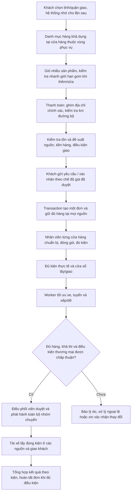

# Kế hoạch đặt hàng theo vị trí, nhiều cửa hàng và vận tải gom hàng

Ngày: 31/10/2026 · Trạng thái: kế hoạch đề xuất để duyệt; chưa phải quyền triển khai ứng dụng/database. Cập nhật 31/10/2026: người dùng đồng ý hướng vùng phục vụ, giới hạn gom và hiển thị (POL-M01, M09, M11, M12).

Tài liệu liên quan: [Kế hoạch TMS](KE_HOACH_TMS.md), [Thiết kế database](THIET_KE_DATABASE.md), [Hợp đồng kiện hiện hành](docs/package-order-contract.md), [Nâng cấp database sau merge](MERGE_RECOVERY.md), [Quy tắc project](AGENTS.md).

## 1. Mục tiêu và trạng thái quyết định

Khách mua từ danh mục chung theo khu vực giao, không phải hiểu cơ cấu chi nhánh. Một giỏ có thể lấy hàng ở nhiều cửa hàng **trong cùng vùng phục vụ** và trong giới hạn gom; nhân viên mỗi nơi chuẩn bị và đo kiện; hệ thống lập chuyến lấy hàng từ các nơi đó và giao đến khách. Một xe có thể gom nhiều nguồn nếu thực hiện được; không cam kết mọi đơn luôn gom bằng một xe.

Hai vấn đề cần tránh: (1) khách phải tự dò từng chi nhánh để tìm hàng; (2) gom hàng từ nguồn quá xa (ví dụ khách miền Bắc gom từ cửa hàng miền Nam, hoặc hai nguồn nằm hai phía đối nhau của khách).

| Nội dung | Trạng thái |
|---|---|
| Đơn giản hóa: cửa hàng là nguồn xuất trong luồng mới; giao đến khách | Người dùng đã đồng ý |
| Không bắt khách chọn chi nhánh/cửa hàng; hiển thị hàng theo vị trí; hỗ trợ nhiều nguồn | Hướng người dùng yêu cầu lập kế hoạch |
| Vùng phục vụ theo nhóm tỉnh/thành là ranh giới cứng + km đường bộ tối đa theo từng cửa hàng (mặc định 100 km, cấu hình được) — POL-M01 | Người dùng đã đồng ý hướng thiết kế (31/10/2026); danh sách vùng cụ thể cần cấu hình theo dữ liệu thật |
| Tối đa 2 nguồn/đơn (cấu hình được, có thể nâng 3) + giới hạn khoảng cách giữa các nguồn — POL-M11 | Người dùng đã đồng ý hướng thiết kế; ngưỡng km giữa nguồn chưa chốt giá trị |
| Hiển thị theo ngữ cảnh, kiểm tra giỏ khi thêm/sửa, chọn tỉnh/quận trước và ghim địa chỉ khi thanh toán — POL-M12 | Người dùng đã đồng ý hướng thiết kế |
| Nhân viên đóng gói, đo từng kiện trước tối ưu thực thi | Luồng mục tiêu trong trao đổi; phải có xác nhận thực tế, không dùng kiện tự sinh làm bằng chứng |
| Giá, phí giao, giao nhiều lượt, TTL giữ hàng, điều phối liên chi nhánh | Cần chốt cụ thể ở mục 13 |
| Schema/API/trạng thái mới trong tài liệu | Thiết kế đề xuất; cần review trước migration/code |

Phạm vi gồm tìm hàng, giỏ nhiều SKU, phân nguồn, giữ hàng, chuẩn bị, vận tải gom hàng, giao nhận và truy vết. Tái sử dụng tồn kho sẵn có phục vụ xuất hàng; không xây WMS, sàn nhiều người bán hoặc ERP. Giữ nguyên đơn B2B và dữ liệu tổng kho/điểm nhận cũ; luồng mới không cung cấp hai lựa chọn đó. Chưa mở chuyển tải, đổi xe giữa đường hoặc trung tâm gom hàng.

## 2. Hiện trạng đã đọc và khoảng thiếu

Đối chiếu mã nguồn workspace ngày lập kế hoạch; chưa xác minh database/dịch vụ đang chạy. Các thay đổi optimizer và giao diện đang có trong workspace thuộc công việc khác, không được ghi đè.

| Thành phần | Hiện trạng trong code | Cần thay đổi |
|---|---|---|
| `frontend/src/pages/CustomerPortalPage.tsx` | Một SKU mỗi lần; tải catalog và locations tổng quát; cho chọn nguồn | Danh mục theo nơi giao, giỏ nhiều SKU, checkout không chọn chi nhánh |
| `backend/src/catalog/catalog.service.ts` | Catalog theo sản phẩm, chưa lọc nguồn theo tọa độ/tồn khả dụng | Truy vấn bán được theo vùng và SKU; phân trang đúng sau lọc |
| `backend/src/locations/locations.service.ts` | API locations dùng scope nội bộ | API phục vụ khách riêng, không mở rộng quyền API nội bộ |
| `backend/src/sales-orders/sales-orders.service.ts` | Một `allocatedSourceId`, một `branchId`; checkout tạo kiện READY theo quantity; có tọa độ mặc định; chưa reserve | Đơn nhiều nguồn, báo giá có version, giữ hàng atomic, bỏ tự xác nhận kiện |
| `backend/src/inventory/inventory.service.ts` | Đã có reservation, ledger, khóa StockBalance; chưa nối checkout mới | Tái sử dụng logic transaction; mở giữ/giải phóng nhiều nguồn và kiểm tra concurrency |
| `backend/src/fulfillment/fulfillment.service.ts` | Chuẩn bị theo đơn một nguồn; pack còn yêu cầu điểm nhận | Chuẩn bị theo phần xuất của từng cửa hàng, đo và xác nhận nhiều kiện |
| `backend/prisma/schema.prisma` | Retail dùng PackageItem; B2B dùng Package.orderItemId; Allocation.orderItemId bắt buộc | Cầu nối vận tải theo kiện, không suy diễn một kiện chỉ chứa một dòng |
| `backend/src/trips/trips.service.ts` | Auto chọn B2B đủ kiện theo một branch; tài nguyên theo branch | Nhóm điều phối được cấp quyền nhiều branch; thêm yêu cầu retail cùng contract kiện |
| `backend/src/orders/order-contract.ts` | B2B đúng một pickup + một delivery | Giữ contract B2B; biểu diễn retail nhiều nguồn bằng các yêu cầu vận tải riêng |
| `optimizer/app/models.py` và validator | Có contract, splitting, hình học; chưa chứng minh hỗ trợ luồng mới | Contract mới theo transport request, parent order, package; validator và benchmark riêng |

Thông số SKU hiện là giá/thông số danh mục. Không coi một SKU = một kiện thực tế. `OrderItem.quantity` bán lẻ là số đơn vị sản phẩm; khác số kiện.

## 3. Luồng mục tiêu

Ví dụ minh họa: khách mua 20 bao xi măng từ A và 5 thùng sơn từ B. Một Order có hai phần chuẩn bị. Nhân viên A/B khai báo kiện thực tế; solver có thể đề xuất xe → A → B → khách, hoặc B → A → khách. Nếu không có một xe phù hợp, chỉ đề xuất nhiều xe/lượt theo policy đã được khách chấp thuận. Không đổi điểm giao sang một kho trung gian.

Khách thấy một mã đơn, số tiền, trạng thái chuẩn bị, phương án giao và từng lần giao nếu có. Nhân viên A chỉ được xử lý hàng tại A; điều phối viên liên chi nhánh phải có scope cho nguồn và tài nguyên liên quan.

## 4. Quy tắc tìm hàng và phân nguồn

### 4.1. Vùng phục vụ và hiển thị

Mô thức tham khảo: các nhà bán lẻ lớn (Thế Giới Di Động/Bách Hóa Xanh, Tiki/Shopee, Home Depot, Amazon) đều xác định khu vực khách trước khi hiển thị tồn, không bắt khách chọn kho/cửa hàng cho đơn giao tận nơi, dùng vùng phục vụ theo đơn vị hành chính do quản trị cấu hình thay cho một bán kính chung, và giới hạn số lần tách đơn. Đây là tham khảo hành vi công khai, không phải yêu cầu sao chép hệ thống của họ.

**Ba lớp ràng buộc nguồn (POL-M01, POL-M11):**

| Lớp | Quy tắc | Thời điểm kiểm tra |
|---|---|---|
| 1. Vùng phục vụ (cứng) | Quản trị cấu hình `ServiceZone` = nhóm tỉnh/thành; mỗi STORE phục vụ một hoặc nhiều vùng. Địa chỉ khách → tỉnh → vùng → tập cửa hàng ứng viên. Cửa hàng ngoài vùng không bao giờ là nguồn, kể cả khi gần theo đường thẳng | Danh mục, giỏ, báo giá, checkout |
| 2. Ngưỡng giao của từng cửa hàng | Mỗi STORE có km đường bộ tối đa tới điểm giao (mặc định 100 km, cấu hình theo cửa hàng). Lọc sơ bộ bằng đường thẳng ở danh mục/giỏ; xác nhận bằng Mapbox khi báo giá | Sơ bộ: danh mục/giỏ · Chính xác: báo giá |
| 3. Giới hạn gom của một đơn | Tối đa N nguồn/đơn (mặc định 2, cấu hình, có thể nâng 3) và khoảng cách đường bộ tối đa giữa các nguồn trong cùng đơn | Giỏ (sơ bộ), báo giá/checkout (chính xác) |

- Tỉnh/quận khách chọn khi duyệt danh mục chỉ dùng để xác định vùng; tọa độ chính xác chỉ bắt buộc khi thanh toán. Không ép dùng GPS điện thoại; từ chối định vị vẫn cho chọn tỉnh/quận và ghim tay.
- Nếu ghim chính xác thuộc vùng khác với tỉnh/quận đã chọn, tính lại giỏ theo vùng mới và báo khách; không giữ kết quả vùng cũ.
- Địa chỉ ở ranh giới hai vùng: tỉnh trong địa chỉ đã xác nhận quyết định vùng; một tỉnh có thể thuộc nhiều vùng nếu quản trị cấu hình, khi đó tập ứng viên là hợp các vùng. Không tự suy vùng từ cửa hàng gần nhất.
- Cấu hình vùng/ngưỡng/giới hạn gom do server quản lý và có version; khách không truyền vùng, bán kính hay số nguồn để vượt giới hạn. Báo giá ghi lại version cấu hình đã dùng.
- Chỉ xét `Location` loại STORE đang hoạt động, có tọa độ hợp lệ, chi nhánh quản lý, thuộc ít nhất một vùng và có khả năng xuất hàng. Không dùng tâm Branch.
- Lọc ứng viên theo vùng trước (truy vấn chỉ mục), rồi bounding box/khoảng cách; phân trang sau điều kiện vùng/tồn kho. Đánh giá query plan trước khi quyết định thêm PostGIS.
- Tái sử dụng công thức tồn khả dụng hiện hành sau khi đối chiếu ý nghĩa `onHand`, `damaged`, `reserved`, `safetyBuffer`; không tự trừ hàng hỏng hai lần. Catalog không phải lời giữ hàng.

**Hiển thị theo ngữ cảnh (POL-M12):**

- Danh mục/danh sách: mặc định chỉ hiện SKU có hàng trong vùng; có bộ lọc “Hiện cả hàng không có tại khu vực”.
- Tìm kiếm hoặc mở link trực tiếp: vẫn hiện SKU nhưng gắn nhãn “Không phục vụ tại khu vực của bạn” và khóa thêm vào giỏ, để khách không hiểu nhầm hệ thống không bán mặt hàng đó.
- Một SKU xuất hiện một lần. Số lượng tối đa có thể đặt = lượng đáp ứng được trong giới hạn N nguồn (lớp 3), không phải tổng thô mọi cửa hàng trong vùng.
- Nhãn mức đáp ứng: “Giao từ 1 nơi”, “Cần gom từ nhiều nơi (có thể nhiều lượt/phí cao hơn)”, “Không đủ trong khu vực”. Không công khai tồn chính xác từng cửa hàng hay thông tin vận hành nội bộ nếu chưa được cho phép.
- Giỏ: mỗi lần thêm/sửa/xóa dòng chạy kiểm tra nhanh khả năng đáp ứng cả giỏ (không reserve). Nếu thay đổi làm vượt N nguồn hoặc vượt khoảng cách giữa nguồn, cảnh báo ngay và gợi ý: giảm số lượng, bỏ dòng gây vượt, hoặc giao nhiều lần nếu POL-M04 cho phép. Kết quả kiểm tra nhanh không phải cam kết; báo giá vẫn kiểm tra lại.
- Chưa chọn khu vực, thiếu tọa độ khi thanh toán, chưa có cửa hàng phục vụ vùng hoặc không đủ hàng phải có trạng thái rõ. Không mở rộng vùng/ngưỡng hoặc dùng tọa độ mặc định âm thầm.
- Đổi khu vực/địa chỉ làm vô hiệu kết quả nguồn/báo giá cũ, tính lại giỏ; giữ giỏ để khách chỉnh, không tự xóa.

### 4.2. Phân nguồn và tối ưu

Tách hai thời điểm: **phân nguồn thương mại** dựa trên tồn và thông số dự kiến; **tối ưu thực thi** chỉ dùng kiện đã đo. Phân nguồn tốt chưa chứng minh xe chở được.

1. Chuẩn hóa giỏ, gộp SKU trùng, kiểm tra đơn vị và số lượng nguyên theo SKU hiện có.
2. Tạo tập nguồn từ vùng phục vụ của địa chỉ giao, loại cửa hàng vượt km tối đa của chính nó, ngoài giờ làm việc hoặc không đáp ứng điều kiện hàng đã biết. Nếu thiếu thông số dự kiến thì đánh dấu cần đánh giá, không chứng nhận khả thi.
3. Tìm phương án đáp ứng đủ giỏ trong giới hạn gom (POL-M11: tối đa N nguồn, khoảng cách đường bộ giữa các nguồn không vượt ngưỡng). Thứ tự ưu tiên (POL-M09): (a) một cửa hàng đủ cả giỏ; (b) hai cửa hàng, mỗi dòng SKU lấy trọn ở một nơi, tổng km đường bộ nhỏ nhất; (c) cho chia một dòng SKU qua hai cửa hàng (POL-M05); trong cùng mức, đúng hẹn trước rồi tới chi phí vận tải dự kiến.
4. Xếp hạng số lượng phương án có giới hạn bằng chi phí/thời gian dự kiến. Không chọn nguồn đầu tiên đủ hàng, không dùng tham lam rồi kết luận “bất khả thi”. Nếu không có phương án trong giới hạn gom, trả lý do cụ thể (thiếu hàng trong vùng, vượt số nguồn, vượt khoảng cách giữa nguồn) và gợi ý giảm/bỏ dòng hoặc giao nhiều lần theo POL-M04; không tự nới giới hạn.
5. Chỉ gọi Mapbox cho các cặp cần thiết sau lọc sơ bộ; có cache phù hợp điều khoản provider, timeout và giới hạn số điểm. Cặp không có đường giữ trạng thái không tới được; lỗi provider tách khỏi không có hàng.
6. Chốt nguồn và reserve khi tạo đơn. Nếu cạnh tranh làm mất tồn, trả lỗi có thể tính lại phương án; không tự thay giá/nguồn mà bỏ qua điều kiện khách đã xác nhận.
7. Sau đo kiện, giải lại routing + xếp/dỡ. Nếu không phù hợp: có thể đề xuất đổi xe, đổi lịch hoặc nhiều xe trong phạm vi policy. Đổi nguồn sau chuẩn bị phải có quy trình hủy/hoàn lại hàng và xác nhận mới; không đổi ID cửa hàng trên kiện.

Thiết kế ban đầu dùng số phương án nguồn có giới hạn rồi đánh giá tuyến; báo đây là heuristic có ngân sách, không khẳng định tối ưu toàn cục. Đo chênh lệch với baseline để quyết định có cần giải phối hợp phân nguồn–routing sâu hơn. Không loại hết nguồn chỉ vì giới hạn top-K mà trả “không thể phục vụ”; phải trả “chưa tìm được phương án trong giới hạn”.

## 5. Thiết kế dữ liệu đề xuất

Giữ `Order` bán lẻ làm đơn khách; không tạo thêm các Order B2B giả để đưa vào solver. Tên sau là tên logic để review, chưa phải migration cuối.

| Thành phần | Trách nhiệm và quan hệ |
|---|---|
| Order hiện có | Khách, giỏ đã chốt, tổng tiền, địa chỉ/cửa sổ giao, trạng thái tổng hợp; `branchId` chỉ có thể là đơn vị điều phối chủ trì, không đại diện mọi nguồn |
| FulfillmentGroup mới | Một phần xuất theo cửa hàng của Order; sourceLocationId, sourceBranchId snapshot, version, trạng thái chuẩn bị, khung giờ sẵn sàng |
| FulfillmentLine mới | Liên kết OrderItem với Group, số lượng được giữ/chuẩn bị; một dòng khách có thể chia nhiều group |
| InventoryReservation mở rộng | Tham chiếu FulfillmentLine, location, SKU, số lượng, vòng đời; nguồn dữ liệu số lượng giữ, không thêm bộ đếm độc lập không đối soát |
| Package hiện có mở rộng | Retail tham chiếu Group, thông tin mm/g thực đo, người đo và thời điểm/version; mỗi kiện chỉ ở một nguồn |
| PackageItem hiện có mở rộng | Nội dung kiện theo FulfillmentLine và OrderItem; một kiện có thể chứa nhiều dòng cùng group/đơn; không ghép nhiều Order vào một kiện ở đợt này |
| TransportRequest mới | Nhu cầu vận chuyển một tập kiện có chung nguồn và điểm giao; trỏ Group/Order, pickup và delivery thật, version; có thể sinh nhiều request khi khác cửa sổ giao |
| TransportRequestPackage mới | Mapping kiện vật lý vào request và phiên bản đang hiệu lực; không nhân đôi Package |
| Báo giá/phiên bản phân nguồn mới | Snapshot giỏ, vị trí, policy, giá, đề xuất nguồn, hạn hiệu lực và chấp thuận của khách; dữ liệu tính toán không thay FK nghiệp vụ |
| Nhóm phát hành mới hoặc mở rộng batch hiện hữu | Tập Trip cần phát hành đồng bộ cho một/nhiều đơn, manifest kỳ vọng, version; rollback toàn bộ khi thiếu kiện/tài nguyên |
| ServiceZone mới | Vùng phục vụ: mã, tên, trạng thái, version cấu hình; quản trị cấu hình |
| ServiceZoneProvince mới | Mapping vùng ↔ tỉnh/thành (unique theo cặp); một tỉnh có thể thuộc nhiều vùng nếu được cấu hình |
| StoreServiceZone mới | Mapping STORE ↔ vùng phục vụ (unique theo cặp, FK tới Location loại STORE) |
| Location (STORE) mở rộng | Km đường bộ giao tối đa (số nguyên dương, mặc định theo cấu hình hệ thống); null nghĩa là dùng mặc định, không phải 0 |
| Cấu hình gom đơn mới | Số nguồn tối đa/đơn, khoảng cách đường bộ tối đa giữa nguồn, km mặc định cửa hàng; có version và ngày hiệu lực; báo giá snapshot version đã dùng |

Các ràng buộc bắt buộc:

- Tổng quantity phân nguồn đang hiệu lực của một OrderItem phải bằng quantity đã chốt trước khi đơn được chấp nhận đủ hàng. Quantity dương, không vượt lượng giữ hợp lệ.
- Số FulfillmentGroup đang hiệu lực của một Order không vượt số nguồn tối đa trong version cấu hình đã snapshot; mọi Group phải thuộc cửa hàng phục vụ vùng của địa chỉ giao tại thời điểm checkout. Kiểm tra trong transaction checkout, không chỉ ở UI.
- Tổng PackageItem đã xác nhận không vượt phần chuẩn bị; trước sẵn sàng vận tải phải bằng đủ lượng cần giao. Số lượng SKU khác số kiện; không lấy quantity nhân lại khối lượng kiện.
- FKs/composite FKs bảo đảm OrderItem, FulfillmentLine, Group và Package thuộc cùng Order, đúng nguồn; không chỉ kiểm tra bằng UI.
- Manifest kiện immutable theo version đã xác nhận. Kiện đã phân công/đã lấy không sửa số đo hoặc chuyển nguồn trực tiếp; phải tạo điều chỉnh và invalidate kế hoạch tương lai.
- Mỗi kiện chỉ có một transport request đang hiệu lực và một phân công vận tải đang hiệu lực cho chặng tương ứng; index/transaction chặn hai worker áp dụng trùng.
- Allocation hiện yêu cầu OrderItem trong khi kiện retail có nhiều PackageItem. Cần mở Allocation theo Package làm nguồn vận tải, giữ nhánh B2B tham chiếu OrderItem và composite FK cũ; thêm CHECK/FK riêng cho retail Group/Request. Không ép kiện retail vào một OrderItem tùy ý hoặc xóa FK để qua lỗi.
- Rà soát toàn bộ consumer của Allocation, StopTask, DeliveryResult, invoice/report trước thay nullable/discriminator; migration chỉ hoàn tất khi lịch sử B2B vẫn đọc/kiểm tra được.
- `SalesInvoice.locationId` hiện chỉ có một nơi phát hành. Không lấy cửa hàng nguồn đầu tiên làm nơi phát hành mặc định: xác định đơn vị bán/phát hành theo policy hiện hữu hoặc quyết định bổ sung trước P3; báo cáo lượng xuất vẫn theo từng Group. Không tự chia thành nhiều hóa đơn hay mở kế toán liên chi nhánh trong nhiệm vụ này.
- Tiền dùng Decimal; số đo mm/g; UTC + timezone vận hành. Không dùng 0 cho phí chưa biết, số đo thiếu hoặc ETA chưa tính.
- Scope đọc Order retail dựa vào quyền sở hữu khách, tham gia group và phạm vi điều phối; không dùng duy nhất Order.branchId để lộ/chặn sai đơn nhiều nguồn.

## 6. Trạng thái, transaction và vòng đời hàng

Đề xuất thêm trạng thái fulfillment riêng, không nhét mọi bước vào OrderStatus/PackageStatus hiện có. Tên enum cuối được duyệt ở giai đoạn thiết kế.

| Đối tượng | Tiến trình logic |
|---|---|
| Yêu cầu mua/đơn | Chờ điều kiện thương mại → đã chấp nhận đủ hàng → đang chuẩn bị → chờ điều phối → đang giao → hoàn tất; ngoại lệ/hủy theo policy |
| FulfillmentGroup | Đã giữ hàng → đang chuẩn bị → đủ kiện đo → đã bàn giao; có thiếu hàng, chờ xử lý và hủy |
| Package | Nháp chuẩn bị → READY sau xác nhận → ALLOCATED → LOADED → DELIVERED; giữ lịch sử sự cố |
| Thanh toán | Độc lập với vận tải; chưa tích hợp cổng thanh toán, không suy ra đã trả tiền từ trạng thái đơn |

Checkout phải lưu Order, Group/Line, reservation toàn bộ nguồn, snapshot giá, idempotency và outbox trong cùng transaction. Khóa theo thứ tự ổn định toàn cục `(locationId, skuId)` để giảm deadlock; kiểm tra lại giá/quote/version khi khóa. Thiếu bất kỳ nguồn nào rollback cả giỏ, không báo thành công một phần. Cùng key cùng payload trả cùng kết quả; payload khác trả 409; hai request đồng thời cùng key không tạo hai đơn.

Reservation cần các mốc hiệu lực khác nhau: giữ tạm chờ xác nhận có TTL, đã chấp nhận/đang chuẩn bị có policy riêng. Không để job TTL tự nhả hàng đang đóng gói hoặc đã lên xe. Job hết hạn phải khóa/version cùng đơn và chỉ xử lý trạng thái hợp lệ; hoàn tất và hết hạn cạnh tranh vẫn cho một kết quả nhất quán.

Đề xuất trừ tồn vật lý khi xác nhận bàn giao lên xe; đóng gói chuyển phần giữ sang trạng thái đã chuẩn bị. Cần duyệt mốc này vì pack hiện có settle reservation sớm. Dù chọn mốc nào, một lần xuất chỉ có một ledger entry, retry không trừ hai lần. Hủy trước xuất giải phóng giữ; hủy sau xuất xử lý trả hàng/điều chỉnh có chứng từ, không tăng tồn trực tiếp.

Đơn hoàn tất từ kết quả giao từng kiện và policy giao đủ/thiếu, không từ việc một Trip kết thúc. Đơn nhiều xe phải tổng hợp mọi kiện. Sau pickup không cho hủy đơn bằng thao tác hủy chung hiện hành.

## 7. API và giao diện

Đây là contract dự kiến; endpoint mới phải có DTO runtime validation, phân trang, mã lỗi, version và idempotency cho mutation. API hiện hữu tiếp tục đọc dữ liệu cũ.

| API dự kiến | Nội dung |
|---|---|
| `GET /shopping/service-areas` | Danh sách tỉnh/quận được phục vụ để khách chọn khu vực; không trả danh sách cửa hàng nội bộ |
| `POST /shopping/availability/search` | Khu vực (tỉnh/quận) hoặc tọa độ đã xác nhận, bộ lọc (kể cả “hiện hàng không có tại khu vực”), phân trang; trả SKU, nhãn mức đáp ứng, số lượng tối đa trong giới hạn gom, version cấu hình, thời điểm tính; dùng body để hạn chế tọa độ trong URL/log |
| `POST /shopping/cart/check` | Giỏ + khu vực; kiểm tra nhanh không reserve: đáp ứng được không, số nguồn dự kiến, dòng gây vượt giới hạn và gợi ý xử lý |
| `POST /shopping/quotes` | Giỏ + địa chỉ đã ghim + cửa sổ giao; kiểm tra km đường bộ bằng Mapbox; trả quoteId/version/expiry, tiền hàng, tình trạng phí giao, nguồn dự kiến và điều kiện cần khách chấp thuận |
| `POST /sales-orders/checkout` phiên bản mới | quoteId/version và chấp thuận; server tự chọn/kiểm tra nguồn, giữ đủ hàng; không tin branchId/sourceId hoặc giá từ client |
| `GET /sales-orders/:id` | Một đơn khách, tiến độ chuẩn bị/giao tổng hợp; DTO khách và DTO nhân viên khác nhau theo quyền |
| API chuẩn bị theo group | Danh sách theo location được cấp quyền, bắt đầu chuẩn bị, ghi thiếu, tạo/sửa nháp kiện, xác nhận manifest với expectedVersion |
| API báo giá/chấp thuận lại | Ghi phiên bản phí/lịch/phương án giao mới và bằng chứng khách chấp thuận; bản mới làm vô hiệu đề xuất cũ |
| Job tối ưu hiện hữu, contract mở rộng | Nhận request IDs và planning scope, trả job; poll/socket; apply và batch publish kiểm tra lại version |
| API execution hiện hữu mở rộng | Scan/nhận từng kiện, giao/POD từng phần, chống trùng sự kiện và tải lại trạng thái sau reconnect |

Giao diện khách: chọn tỉnh/quận (nhớ cho lần sau, đổi được ở đầu trang) → danh mục có hàng trong vùng → giỏ có cảnh báo giới hạn gom → thanh toán ghim địa chỉ chính xác → xem tiền/điều kiện giao → gửi hoặc xác nhận → theo dõi. Không dropdown chi nhánh, tổng kho hay điểm nhận. Thay khu vực/địa chỉ hoặc quantity phải báo nguồn/giá cần tính lại.

Giao diện quản trị: cấu hình vùng phục vụ (nhóm tỉnh), gán cửa hàng vào vùng, km tối đa từng cửa hàng và tham số gom đơn; thay đổi tạo version mới, không làm đổi báo giá/đơn đã tạo.

Giao diện nhân viên: chỉ phần chuẩn bị của cửa hàng mình; xem SKU/số lượng, tách/gộp kiện trong cùng phần, nhập mm/g, đánh dấu thiếu và xác nhận đã đo. READY bị chặn nếu thiếu số đo/người xác nhận/manifest đủ hàng.

Giao diện điều phối: các request cùng đơn, nguồn và readiness; tài nguyên được cấp quyền; bản đồ pickup/delivery, kế hoạch xếp theo bước, đơn chưa xếp và lý do. Không hiển thị “tối ưu thành công” khi job lỗi hoặc chỉ có một phần chưa được phép phát hành.

Mọi màn hình có loading/empty/error/retry, chống submit lặp, giữ form khi API lỗi, reload đọc lại dữ liệu thật. Socket chỉ báo thay đổi; snapshot API là nguồn sự thật. Không log địa chỉ, số điện thoại, tọa độ khách và nội dung POD dư thừa.

## 8. Tối ưu gom hàng liên chi nhánh

- Không chỉ đổi bộ lọc `B2B_TRANSPORT` sang nhận retail. Tạo adapter từ B2B Order hoặc retail TransportRequest thành contract vận tải chung, giữ `parent_order_id`, `request_id`, `package_id`, source/delivery stop UUID thật.
- Mỗi request có một pickup và một delivery nên tận dụng được cấu trúc solver hiện hữu; một Order retail có nhiều request. Solver được tự sắp xen kẽ nhiều pickup/delivery hợp lệ; không ép ghé từng chi nhánh theo thứ tự tùy ý.
- Một kiện phải pickup trước delivery và ở nguyên một xe suốt chặng; việc tách request không được làm mất ràng buộc cùng đơn hoặc tạo kiện giả. Nếu chia nhiều xe, vẫn giữ điều kiện đủ toàn bộ manifest trước publish.
- Có planning scope liên chi nhánh rõ. Đề xuất điều phối viên có quyền toàn bộ vùng/chi nhánh tham gia mới tạo batch liên chi nhánh; nhân viên cửa hàng không được tự lấy xe chi nhánh khác. Chi phí chuyến và trách nhiệm điều phối được gắn riêng, không suy từ một Order.branchId.
- Lấy xe/tài xế trong scope được phép và xét current location, thời gian tiếp cận, ca/nghỉ, license/policy đã xác nhận, reservation, start/end và chuyến qua ngày. Không mở cả đội xe công ty chỉ vì đơn có nhiều nguồn.
- Snapshot chứa version của quote/consent, Group/manifest, từng Package, Request, xe/tài xế, policy và matrix. Điều kiện publish gồm đủ kiện, còn quyền, chưa xung đột, nguồn sẵn sàng và lịch/phí đã chấp thuận.
- Giữ Google OR-Tools và validator hình học: không chồng, không giao nhau, qua cửa được, tải đúng từng thao tác, đường xếp/dỡ không bị chắn, tái dùng đúng vùng trống. Không dùng tổng thể tích hoặc nhãn nhân viên “đã kiểm tra” thay nghiệm hình học.
- Contract Python mới có version riêng, adapter đọc kết quả và độc lập validator; vẫn đọc job/lịch sử cũ. Không âm thầm thay nghĩa `order_id` hay `allocation_id` trong contract hiện hành.
- Apply/publish tất cả Trip cần cho một Order như một nhóm atomic; khóa đơn/kiện/request/tài nguyên theo thứ tự ổn định. Không publish chuyến A trước trong khi chuyến B còn có thể thất bại làm thiếu hàng. Hoàn tất outbox sau commit và xử lý retry an toàn.
- Job ở worker Redis có timeout/lease/recovery. Kết quả phân biệt input sai, lỗi provider, timeout chưa có nghiệm, nghiệm một phần, khả thi, bất khả thi có bằng chứng. Timeout không phải bất khả thi.

Phí giao cho khách khác chi phí mục tiêu optimizer. Chưa có công thức đã duyệt thì hiển thị chờ báo phí/xác nhận, không đưa 0 hoặc chi phí xe làm giá bán tự động.

## 9. Các giai đoạn và đầu ra nghiệm thu

Thực hiện theo phụ thuộc P0 → P1 → P2 → P3 → P4 → P5 → P6 → P7. Chỉ P7 mới là bàn giao đầy đủ luồng đa nguồn. Các mốc trước phải ghi đúng phần đã hoạt động, không gọi toàn hệ thống hoàn tất.

| Mốc | Công việc cụ thể | Điều kiện qua mốc |
|---|---|---|
| P0 — Chốt nghiệp vụ và hiện trạng | Chốt mục 13; kiểm tra lockfile/migration thực; audit scope, inventory và đường đọc Allocation; lưu baseline B2B | Decision log có trạng thái; sơ đồ dữ liệu/contract; baseline kiểm chứng được; không chạy DB thật |
| P1 — Nền dữ liệu và quyền | Additive schema Group/Line/quote/request; mở quan hệ kiện/reservation/allocation; quyền cửa hàng và planning scope; migration dữ liệu đại diện | FK/CHECK/concurrency và migrate trên bản sao đạt; đọc lịch sử cũ không đổi; không gán giả dữ liệu thiếu |
| P2 — Danh mục theo vị trí và giỏ | Cấu hình vùng phục vụ/km cửa hàng/giới hạn gom; chọn khu vực; search STORE theo vùng, catalog tổng hợp trong giới hạn gom, nhãn/hiển thị theo ngữ cảnh, giỏ nhiều SKU có kiểm tra nhanh, đổi khu vực/địa chỉ | Không bao giờ lấy nguồn ngoài vùng; đúng ngưỡng km, tồn, phân trang; số lượng hiển thị khớp giới hạn gom; khách không chọn chi nhánh; không lộ API nội bộ |
| P3 — Phân nguồn và checkout | Quote/version, phương án nguồn có giới hạn, tiền hàng/phí, chấp thuận, reserve nhiều nơi atomic, TTL/cancel/outbox | Đơn nhiều nguồn lưu thật; race mua hàng cuối chỉ một kết quả hợp lệ; fail một nguồn rollback; retry không trùng |
| P4 — Chuẩn bị và đo kiện | Hàng đợi theo Group, ghi thiếu, tách/gộp kiện, đo, xác nhận; nối lifecycle tồn; không auto READY khi checkout | Bảo toàn SKU/quantity; nguồn A/B độc lập quyền; chỉ kiện đo đủ mới sinh request sẵn sàng; reload giữ dữ liệu |
| P5 — Tối ưu và phát hành | Adapter retail/B2B, multi-branch scope, snapshot v2, worker/matrix, routing + packing, validator, atomic apply/publish | Kịch bản A+B→khách chạy HTTP→queue→Python→Postgres; đầy đủ T21–T27; race tài nguyên/version rollback; B2B regression đạt |
| P6 — Thực thi và theo dõi | Scan bàn giao, ledger đúng mốc, tài xế lấy/giao theo kiện, POD, tổng hợp đơn, sự cố/retry/reconnect | Giao xong một phần không hoàn tất đơn; scan trùng không trừ kho; quyền file/socket; kiểm tra mobile theo phạm vi |
| P7 — Nghiệm thu và chuyển đổi | Benchmark, E2E nhiều nguồn, migration rehearsal, vận hành thử có giới hạn, tài liệu, bật luồng mới | Mọi tiêu chí mục 10 đạt; có bằng chứng thật và runbook rollback; không còn placeholder trên đường chạy |

Lát cắt thử đầu tiên: một cửa hàng → một SKU → reservation → nhân viên đo một kiện → request → một xe giao khách. Sau khi nối thật mới mở hai cửa hàng, rồi chia một SKU qua hai nguồn và nhiều xe. Đây là thứ tự giảm rủi ro triển khai, không giảm phạm vi nghiệm thu cuối.

Ước lượng lịch chỉ sau P0: liệt kê đầu việc theo backend/dữ liệu, web, optimizer và mobile, xác nhận nhân lực rồi đo tốc độ ở lát cắt đầu. Không gán thời hạn hoàn thành khi chưa biết mức tái sử dụng validator và trạng thái database. Có thể phân việc độc lập sau khi contract ổn định; không cho hai người sửa cùng lịch sử migration/Allocation mà chưa phối hợp.

### Bản đồ phạm vi sửa khi triển khai

| Khu vực | File/module chính và việc cần làm |
|---|---|
| Database | `backend/prisma/schema.prisma`, migration mới và fixture nâng cấp: quan hệ đa nguồn, ràng buộc quantity/Package, index và khả năng đọc dữ liệu cũ |
| Shopping | Module shopping mới hoặc biên API riêng trong catalog: availability/quote; tái sử dụng `catalog`, `locations`, `inventory`, adapter Mapbox hiện hữu thay vì nhân đôi truy vấn nghiệp vụ |
| Checkout | `backend/src/sales-orders/`: DTO, service, controller; một transaction đa nguồn, lỗi quote/version/stock và retry |
| Chuẩn bị | `backend/src/fulfillment/`, `backend/src/inventory/`: group queue, đóng kiện thực tế, vòng đời giữ/xuất và ledger; dùng chung nghiệp vụ với caller HTTP/job |
| Web khách | `CustomerPortalPage.tsx`: vị trí, catalog, giỏ, báo giá và theo dõi; tách component theo chức năng khi cần; bỏ API locations nội bộ khỏi luồng khách |
| Web vận hành | `OrderProcessingPage.tsx`, `RetailOrdersPage.tsx`, `AutomaticDispatchPage.tsx` và client/types: group, nguồn, manifest, scope và kết quả theo đơn khách |
| Điều phối | `backend/src/trips/`, auth/resource-access và outbox: adapter request, snapshot, quyền nhiều nguồn, apply và batch publish |
| Optimizer | `optimizer/app/models.py`, engine/validator đang dùng và contract tests: request identity, parent grouping, hình học, all-or-nothing và benchmark |
| Thực thi | `backend/src/driver-mobile/` và consumer mobile hiện hữu: stop/task/Package đúng nguồn, nhận/giao, POD và retry; đọc AGENTS.md của mobile trước khi sửa |
| Tương thích | `backend/src/orders/` giữ API B2B; rà soát invoice/report/pickup lịch sử; cập nhật `docs/package-order-contract.md`, README/runbook sau khi hành vi thực đã đổi |

Đề xuất chia commit review: contract/schema additive → quyền + đọc tương thích → tìm hàng/giỏ → quote/reserve → chuẩn bị/đo → adapter/solver/validator → apply/publish → execution → E2E/migration/runbook. Mỗi commit phải build và giữ hành vi cũ; không bật endpoint trả thành công khi phần bắt buộc chưa nối thật.

## 10. Bộ kịch bản kiểm chứng bắt buộc

| Mã | Kịch bản và kết quả cần đạt |
|---|---|
| MN01 | Cửa hàng thuộc/không thuộc vùng của địa chỉ; điểm trong/ngoài km tối đa của từng cửa hàng; dùng vị trí cửa hàng, không tâm branch; tọa độ không hợp lệ bị từ chối |
| MN02 | Nhiều cửa hàng có một SKU: một kết quả, tổng tồn đúng; phân trang không bỏ sản phẩm đủ điều kiện |
| MN03 | A có đủ giỏ, B chỉ có một phần: so sánh phương án nguồn có căn cứ; không mặc định phải gom |
| MN04 | Giỏ buộc lấy A+B thuộc hai branch: tạo một Order, hai Group và giữ hàng đủ; quyền nhân viên tách đúng |
| MN05 | Một SKU chia qua A/B: số lượng reserve, pack, giao cộng đúng; không tạo hai dòng mua tính tiền trùng |
| MN06 | Hai checkout tranh lượng cuối; same-key đồng thời; key khác payload; kết quả không oversell/không nhân đơn |
| MN07 | Nguồn B mất hàng giữa quote/checkout: rollback cả A/B, không có đơn nửa thành công |
| MN08 | Quote hết hạn/giá đổi/đổi nơi giao: bắt tính lại và chấp thuận khi cần; không âm thầm tăng tiền |
| MN09 | Checkout không tạo kiện READY; một kiện chứa nhiều dòng, nhiều kiện cho một dòng; thiếu/thừa/âm số lượng bị chặn |
| MN10 | READY phải có số đo thực, người đo và version; sửa sau snapshot làm apply thất bại, không sửa lịch sử đã lấy |
| MN11 | Một xe A→B→khách hoặc B→A→khách: từng kiện đúng nguồn, đúng delivery, pickup trước delivery |
| MN12 | Không xe nào chở đủ một đơn nhiều kiện: chia nhiều xe đúng policy; có một kiện không vừa thì không publish thiếu kiện |
| MN13 | Tải tăng/giảm từng thao tác; không chồng, không giao nhau, không ghép vùng rời rạc hoặc lấy chỗ kiện chưa dỡ |
| MN14 | Đầy đủ T21–T27: giao A rồi lấy C vào chỗ A khi B còn trên xe; C chắn đường dỡ B phải bị loại; đúng thứ tự tại cùng stop |
| MN15 | Hai batch tranh một xe/tài xế/kiện; trip cuối lỗi thì rollback toàn bộ apply/publish; version/consent mới làm snapshot cũ vô hiệu |
| MN16 | Mất đường/lỗi Mapbox/timeout/partial: trạng thái và lý do đúng; không thay bằng 0/đường thẳng hoặc kết luận bất khả thi sai |
| MN17 | TTL hết hạn cạnh tranh chuẩn bị/hủy/checkout; không nhả hàng đã xuất, không trả tồn hai lần; worker chết/retry phục hồi |
| MN18 | Nhân viên cửa hàng, khách khác, dispatcher thiếu scope không đọc/sửa/lấy kiện hoặc POD/socket ngoài quyền |
| MN19 | Scan LOAD/giao trùng và sự kiện sai thứ tự: không trừ tồn hay tăng delivered hai lần; offline retry/version đúng |
| MN20 | Một xe hoàn tất nhưng Order còn kiện ở xe khác: đơn chưa hoàn tất; giao thiếu/hủy sau pickup theo policy |
| MN21 | Reload, lỗi mạng, thao tác nhanh, 390px/desktop, focus/keyboard; giỏ/form giữ hợp lý, không hiện thành công khi chưa commit |
| MN22 | B2B cũ, đơn retail cũ, invoice/report và job snapshot cũ đọc đúng; upgrade có dữ liệu giữ nguyên UUID/lịch sử/ledger |
| MN23 | Hai cửa hàng cùng vùng, đều trong km tối đa nhưng ở hai phía đối nhau của khách, vượt khoảng cách giữa nguồn: phương án bị loại, trả lý do đúng; cửa hàng gần theo đường thẳng nhưng khác vùng (ví dụ khác miền) không bao giờ là nguồn |
| MN24 | Địa chỉ ở ranh giới hai vùng / tỉnh thuộc nhiều vùng; ghim chính xác khác tỉnh đã chọn: vùng xác định đúng, giỏ tính lại và khách được báo |
| MN25 | Tổng tồn trong vùng đủ nhưng cần quá N nguồn: số lượng tối đa hiển thị bằng lượng đáp ứng trong giới hạn gom; nhãn mức đáp ứng đúng |
| MN26 | Thêm/sửa dòng giỏ làm vượt N nguồn hoặc khoảng cách giữa nguồn: cảnh báo ngay, chỉ ra dòng gây vượt; checkout bỏ qua UI vẫn bị server chặn |
| MN27 | SKU không phục vụ tại khu vực: ẩn ở danh mục mặc định, hiện khi bật bộ lọc; mở link/tìm kiếm thấy nhãn và không thêm được vào giỏ |
| MN28 | Đổi cấu hình vùng/km/giới hạn gom: báo giá và đơn đã tạo giữ version cũ; báo giá mới dùng version mới |

Lệnh hiện có để sử dụng khi triển khai, chọn theo phần thay đổi và cấu hình test thật:

- Backend: `npm run typecheck`, `npm run lint`, `npm run build`, `npm test -- --runInBand`; `npm run test:postgres` trên database dùng một lần có `TEST_DATABASE_URL`.
- Hạ tầng merge/orders: đọc `MERGE_RECOVERY.md` trước; `npm run test:orders` và `npm run test:orders:auth` theo đúng wrapper/môi trường tương ứng. Bổ sung suite đa nguồn trong hạ tầng sẵn có, không bịa script đã tồn tại.
- Frontend: `npm run typecheck`, `npm run lint`, `npm test`, `npm run build`; mở rộng Playwright qua `npm run test:orders` nếu vẫn phù hợp fixture.
- Optimizer: chạy bằng Python environment hiện có, `python -m pytest -q`; thêm contract/validator/benchmark đa nguồn và regression B2B.
- PostgreSQL thật chứng minh khóa/FK/rollback; mock chỉ kiểm tra logic/contract. E2E queue và OR-Tools chạy thật; fixture matrix phải đánh dấu rõ, cần thêm kiểm tra Mapbox thật với token có quyền. Thiếu thiết bị mobile phải ghi phần chưa kiểm chứng, không nhận đã test nền/offline thật.

Đây là danh sách kiểm tra cho tương lai, không phải báo cáo test đã chạy trong nhiệm vụ lập kế hoạch.

## 11. Hiệu năng, chi phí và quan sát

- Đo riêng: search/quote p50-p95, số nguồn/SKU xét, matrix request count/cache hit, thời gian giữ khóa, deadlock/retry, thời gian chuẩn bị, queue wait, solver time và publish conflict.
- Benchmark tối thiểu các nhóm tăng dần 1/2/5/10 cửa hàng, 1/10/50 đơn, nhiều kiểu kích thước kiện và tài nguyên. Đây là bộ đo đề xuất, không phải cam kết sức tải.
- So sánh baseline nguồn gần đủ hàng + tuyến hiện có với phương án mới: tỷ lệ phục vụ, số nguồn, số xe, km đường bộ, chi phí dự kiến, trễ, số vi phạm hình học và runtime. Hard constraint phải không vi phạm.
- Giới hạn số candidate/matrix/solver bằng cấu hình, trả lý do khi vượt ngân sách. Không cắt bớt nguồn rồi giả vờ đã khảo sát toàn bộ.
- Chỉ đặt SLA sau benchmark trên môi trường đại diện; không tự thêm ngưỡng pháp lý hoặc định mức tài chính.
- Dùng correlation/job/order ID và số đếm tổng hợp; không gửi tọa độ/địa chỉ/số điện thoại khách trong metric hoặc log dài.

## 12. Migration, chuyển đổi và phục hồi

1. Kiểm tra lịch sử migration/database thật theo `MERGE_RECOVERY.md`; tài liệu cũ không phải bằng chứng schema đã đồng bộ. Backup và phục hồi thử vào bản sao trước thay đổi.
2. Tạo migration bổ sung theo hướng mở rộng, không sửa migration đã áp dụng. Rà soát index/lock/backfill và khả năng chạy song song app cũ/mới; SQL FK ngoài Prisma phải được giữ có chủ đích.
3. Backfill Group chỉ khi chứng minh nguồn và mapping. Kiện auto cũ không tự đổi thành “đã đo”; bản ghi không đủ bằng chứng gắn trạng thái đối soát, không được đưa vào optimizer mới.
4. Kiểm tra tổng lượng/tiền/reservation/ledger, UUID Package và lịch sử trước-sau. Không tự chuyển CENTRAL_WAREHOUSE/PICKUP_POINT thành STORE hoặc xóa enum/dữ liệu cũ.
5. Bật bằng feature flag cho tập cửa hàng/đơn thử có quyền; không phát sinh reservation/đơn/chi phí thật trong chế độ shadow. Đọc luồng cũ còn hoạt động với đơn lịch sử.
6. Chỉ mở rộng sau P7. Khi dừng luồng mới: ngừng nhận đơn mới, xử lý/giữ an toàn các đơn đang chạy; không nhả hàng đang vận chuyển hoặc xóa dữ liệu mới để rollback code.
7. Nếu app cũ không hiểu schema/trạng thái mới, rollback bằng phiên bản tương thích đã chuẩn bị hoặc sửa tiến. Không dùng down migration phá dữ liệu. Deploy/database thật cần quyền riêng theo project.

## 13. Các chính sách cần chốt trước phần phụ thuộc

| Mã | Điểm quyết định | Phương án đề xuất và hệ quả |
|---|---|---|
| POL-M01 | Vùng phục vụ và ngưỡng giao | **Hướng đã đồng ý:** vùng phục vụ theo nhóm tỉnh/thành là ranh giới cứng; mỗi STORE có km đường bộ tối đa (mặc định 100 km, cấu hình được), đường thẳng chỉ lọc sơ bộ. Còn cần: danh sách vùng và gán cửa hàng theo dữ liệu thật. Không tự nới khi thiếu hàng |
| POL-M02 | Giá hàng | Tiếp tục một giá theo SKU toàn hệ thống như catalog hiện tại; chưa mở giá khác nhau theo cửa hàng |
| POL-M03 | Phí giao và lúc xác nhận mua | Do kiện chỉ đo sau chuẩn bị: đề xuất tiền hàng biết trước, phí giao chờ xác nhận; khách gửi yêu cầu trước, chấp thuận tổng cuối trước publish. Nếu muốn chốt phí ngay checkout thì phải duyệt biểu phí có bảo đảm/điều kiện điều chỉnh; không dùng số đo dự kiến để hứa xe/tuyến chắc chắn |
| POL-M04 | Nhiều xe/lượt | Cho khách chọn chấp thuận hay yêu cầu giao một lần; không hứa gom một xe. Điều kiện cùng khung giờ và xử lý khi không thực hiện được phải công bố |
| POL-M05 | Chia SKU qua nguồn | Cho chia số đơn vị nguyên giữa cửa hàng, giữ nguyên SKU/quy cách; kiện đã đóng là bất khả phân. Không tự thay hàng tương đương |
| POL-M06 | Giữ hàng và chuẩn bị trước báo phí cuối | Chốt TTL từng bước, gia hạn, ai chịu chi phí đóng gói nếu khách từ chối và cách hoàn hàng; không tự đặt số phút/tiền phạt |
| POL-M07 | Mốc trừ tồn | Đề xuất tại bàn giao lên xe; đóng gói giữ trạng thái đã chuẩn bị. Phải đối soát thay đổi so với pack/settle cũ |
| POL-M08 | Điều phối liên chi nhánh | Một đơn vị chủ trì và dispatcher có scope toàn bộ vùng; chốt quyền mượn xe/tài xế, trách nhiệm xử lý và ghi chi phí |
| POL-M09 | Mục tiêu phân nguồn | **Thứ tự đã đồng ý:** 1 nguồn đủ cả giỏ → 2 nguồn mỗi dòng lấy trọn một nơi, tổng km đường bộ nhỏ nhất → chia dòng qua 2 nguồn; trong cùng mức ưu tiên đúng hẹn rồi chi phí vận tải dự kiến. Hệ số chi tiết duyệt sau benchmark, không dùng penalty tài chính giả |
| POL-M10 | Thiếu, đổi lịch, đổi nguồn và hủy | Trước chuẩn bị cho tính lại + khách xác nhận; sau chuẩn bị/đã lấy phải có quy trình bảo toàn hàng và audit. Chốt giao thiếu, trả hàng, POD và điều kiện hoàn tất |
| POL-M11 | Giới hạn gom của một đơn | **Hướng đã đồng ý:** tối đa 2 nguồn/đơn (cấu hình, có thể nâng 3) và khoảng cách đường bộ tối đa giữa các nguồn. Còn cần: giá trị km giữa nguồn. Vượt giới hạn thì gợi ý khách điều chỉnh, không tự nới |
| POL-M12 | Hiển thị và giỏ | **Hướng đã đồng ý:** chọn tỉnh/quận để duyệt, ghim chính xác khi thanh toán; danh mục mặc định chỉ hàng có trong vùng, tìm kiếm/link trực tiếp hiện nhãn “Không phục vụ tại khu vực của bạn” và khóa thêm giỏ; số lượng tối đa theo giới hạn gom; kiểm tra nhanh giỏ khi thêm/sửa |

Các điểm này không chặn việc soạn contract/màn hình nháp/dữ liệu kiểm thử, nhưng phải được quyết định trước khi code hành vi nghiệp vụ phụ thuộc. Đặc biệt POL-M03/M06 phải thống nhất để tránh thu tiền/gọi xác nhận đơn trong khi chưa có phí giao và khả năng vận tải thực.

## 14. Definition of Done cho phạm vi này

- Một khách tìm hàng theo khu vực giao, mua nhiều SKU từ tối đa N STORE cùng vùng phục vụ (có thể thuộc nhiều branch) mà không chọn branch; không bao giờ gom từ nguồn ngoài vùng hoặc vượt giới hạn gom; giá/điều kiện giao và chấp thuận truy vết được.
- Một đơn cha, đúng lượng giữ theo nguồn; chống oversell và thao tác lặp, không đặt thành công nửa giỏ.
- Mỗi nơi đóng gói và đo thật theo quyền; bảo toàn nội dung kiện; không tự READY theo danh mục.
- Tối ưu nhận đúng kiện/nguồn và lập chuyến gom khả thi, không chồng, kiểm tra đường xếp/dỡ/tải/lịch; người điều phối duyệt.
- Apply/publish bảo vệ toàn bộ đơn trên nhiều chuyến bằng transaction/version; không tranh trùng tài nguyên/kiện hoặc phát hành thiếu hàng.
- Lấy/giao, tồn kho, POD và trạng thái khách nối thật; giao xong một phần không tự hoàn tất toàn đơn.
- MN01–MN28 và T21–T27 liên quan có bằng chứng, benchmark/giới hạn được báo trung thực; không dùng mock làm chứng minh tích hợp thật.
- Migration nâng cấp có dữ liệu đại diện, B2B/retail cũ không mất lịch sử; tài liệu chạy và phục hồi khớp hành vi.
- Policy cần thiết đã chốt. Chưa có quyết định hoặc kiểm chứng bắt buộc thì ghi chưa hoàn tất, không hạ tiêu chí để bàn giao.

## 15. Kiểm chứng tài liệu trong lần lập kế hoạch

Đã đối chiếu schema Prisma, module catalog/sales-orders/inventory/locations/fulfillment, contract B2B/Package, luồng chọn đơn auto, manifest npm và hướng dẫn migration. Chỉ tạo/cập nhật Markdown; không sửa ứng dụng, không chạy migration, không truy cập secret và không tuyên bố đã test luồng mới.
