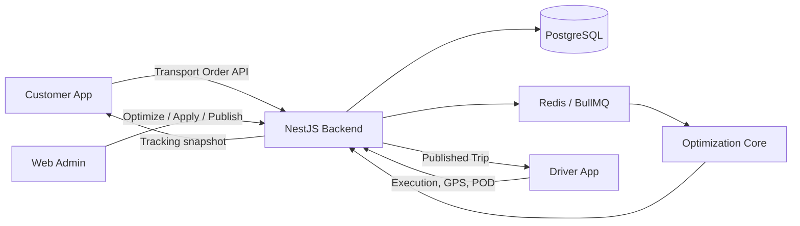

# Phạm vi thành viên 2 - Mobile Driver & Customer

## 1. Trạng thái tài liệu

- Mốc: M0 - Chuẩn hóa nghiệp vụ Smart TMS.
- Phạm vi: ứng dụng Mobile và các API thực thi dành cho Customer/Driver.
- Quy ước: `FINAL` là quyết định đã được người dùng chốt; `CURRENT` là hành vi đã có trong code; `PROPOSED` là đề xuất còn cần nhóm duyệt.
- Tài liệu này không cấp quyền thay đổi Optimization Core, Web Admin, Prisma schema hoặc migration.

## 2. Mục tiêu

Thành viên 2 chịu trách nhiệm xây dựng một ứng dụng Expo phục vụ hai vai trò:

- Customer tạo và theo dõi yêu cầu vận chuyển hàng hóa.
- Driver nhận Trip đã được điều phối và ghi nhận quá trình thực thi.
- Backend Mobile bảo vệ quyền truy cập, lưu actual data, GPS, e-POD, sự cố và đồng bộ offline.

## 3. Quyết định phạm vi

| Mã | Trạng thái | Quyết định |
|---|---|---|
| M0-01 | FINAL | Dùng một Expo App, tách navigator và feature theo role `CUSTOMER`/`DRIVER`. |
| M0-02 | FINAL | Android là nền tảng demo đầu tiên. |
| M0-03 | FINAL | Một Transport Order có đúng một pickup và một delivery trong MVP. |
| M0-04 | FINAL | Một Order có nhiều loại kiện; mỗi loại có số lượng riêng. |
| M0-05 | FINAL | Customer nhập khối lượng mỗi kiện; API Mobile không cho nhập `customerId` hoặc `branchId` đáng tin cậy. |
| M0-06 | FINAL | Retail được cô lập nhưng chưa xóa code, model, bảng hoặc migration. |
| M0-07 | CURRENT | Optimization Core và Web Admin tiếp tục dùng module Trips/Orders hiện có. |
| M0-08 | FINAL | Backend chuyển `unitWeightKg * quantity` thành `OrderItem.weightKg` vì schema hiện lưu tổng khối lượng của dòng. |

## 4. Phạm vi sở hữu

| Nhóm | Thành viên 2 chủ trì | Phối hợp bắt buộc |
|---|---|---|
| Mobile foundation | Expo, navigation theo role, secure token, API client, local queue | Không |
| Customer auth | Đăng ký, đăng nhập, profile, JWT authorization | Review backend dùng chung |
| Customer Order | Tạo/xem/hủy theo policy, lịch sử và tracking | Web Admin review trạng thái Order |
| Driver execution | My Trips, arrive, pickup/delivery, actual quantity, complete | Web Admin/Optimization review Trip version |
| GPS và ETA | Thu GPS nền, batch sync, tracking snapshot | Optimization thống nhất nguồn planned ETA |
| e-POD và incident | DeliveryAttempt, ảnh, chữ ký, giao thiếu/thất bại, sự cố | Storage/outbox review |
| Offline-first | Idempotency, thứ tự command, stale version và conflict UI | Backend dùng chung |

## 5. Ngoài phạm vi

- Thuật toán VRP/PDP, OR-Tools, spatial packing và xếp kiện.
- Màn hình điều phối, chọn xe/tài xế, apply/publish proposal trên Web Admin.
- Catalog, SKU, tồn kho, bán hàng, pickup point, thanh toán và retail analytics.
- Xóa retail schema/migration hoặc chuyển đổi dữ liệu cũ.
- Tự thay đổi optimizer contract hoặc Trip planning policy mà chưa có review.

## 6. Ranh giới dữ liệu



PostgreSQL là nguồn sự thật. Socket.IO chỉ thông báo có thay đổi; Mobile phải tải lại snapshot qua REST sau reconnect.

## 7. Cấu trúc Mobile đề xuất

```text
mobile/
  src/api/
  src/auth/
  src/features/customer-orders/
  src/features/customer-tracking/
  src/features/driver-trips/
  src/features/driver-execution/
  src/features/gps/
  src/features/pod/
  src/offline/
  src/navigation/
  src/types/
```

Cấu trúc này là `PROPOSED`; tên thư mục cuối cùng phải theo convention khi tạo project Expo.

## 8. Điều kiện hoàn thành phạm vi

- Customer đăng ký, tạo Transport Order và chỉ đọc dữ liệu của chính mình.
- Order hợp lệ đi qua optimizer và được Web Admin apply/publish thành Trip.
- Driver chỉ thấy Trip được phân công và thực thi được khi online/offline.
- GPS, e-POD, actual quantity và incident được lưu bền vững, retry không tạo trùng.
- Customer xem được trạng thái, ETA được xác định nguồn và kết quả giao hàng.
- Có test backend, test Mobile và bằng chứng chạy trên thiết bị Android thật.
