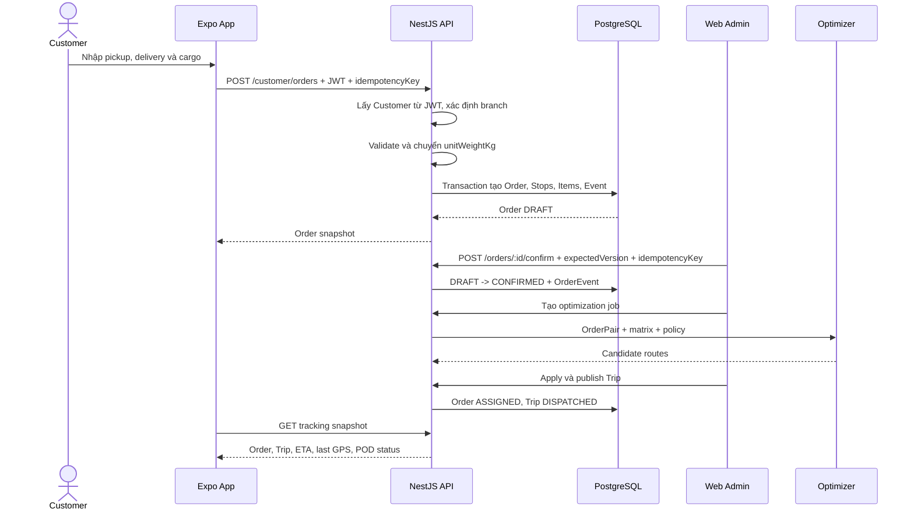
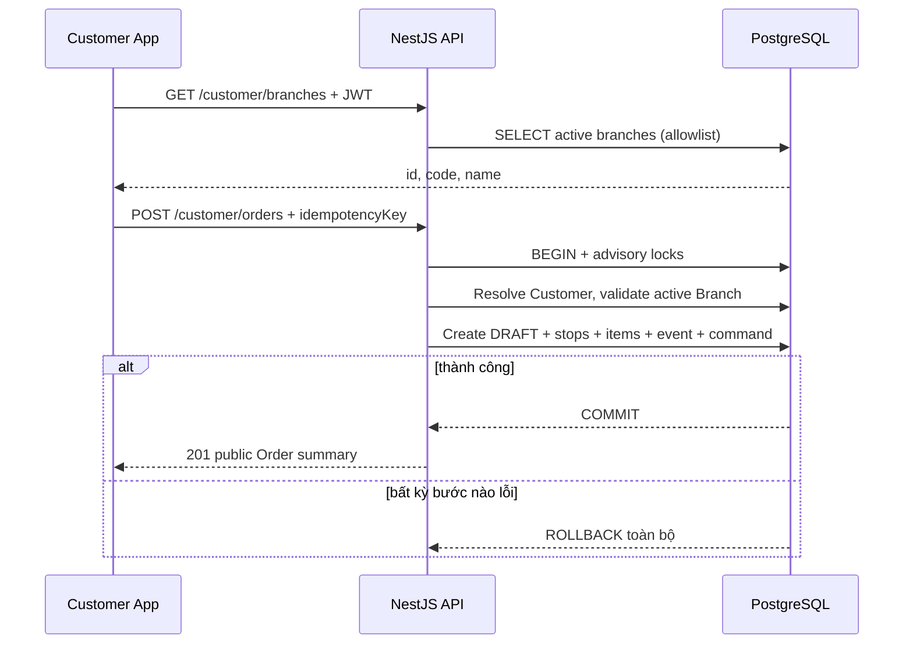

# Luồng nghiệp vụ Customer Transport Order

## 1. Phạm vi MVP

- `FINAL`: một Order có một pickup và một delivery.
- `FINAL`: một Order có nhiều dòng hàng; mỗi dòng có `quantity` kiện cùng quy cách.
- `FINAL`: Customer nhập khối lượng mỗi kiện.
- `FINAL`: Customer không được quyết định `customerId`, `branchId`, `orderNumber`, `status` hoặc `orderedAt` đáng tin cậy.
- `CURRENT`: Prisma hỗ trợ `Customer -> Order -> OrderStop/OrderItem/Package/OrderEvent`.

## 2. Dữ liệu Customer nhập

| Nhóm | Trường API đề xuất | Mapping hiện tại | Trạng thái |
|---|---|---|---|
| Command | `idempotencyKey` | `ProcessedCommand` | PROPOSED |
| Pickup | address, latitude, longitude, contactName, contactPhone | `OrderStop` type `PICKUP` | FINAL |
| Pickup | windowStart, windowEnd | Chưa có cột Prisma/DTO | PROPOSED |
| Delivery | address, latitude, longitude, contactName, contactPhone | `OrderStop` type `DELIVERY` | FINAL |
| Delivery | windowStart, windowEnd | Chưa có cột Prisma/DTO | PROPOSED |
| Cargo line | description, packageType, quantity | `OrderItem` | FINAL |
| Cargo line | lengthCm, widthCm, heightCm | Kích thước mỗi kiện | FINAL |
| Cargo line | unitWeightKg | Backend đổi sang tổng `weightKg` của dòng | FINAL |
| Order | notes | `Order.notes` | FINAL |

Backend phải lấy `customerId` từ quan hệ `User.customer`. `branchId` phải do policy phía server xác định.

## 3. Hiện trạng và quyết định trạng thái

Enum hiện có:

```text
DRAFT -> CONFIRMED -> ASSIGNED -> IN_TRANSIT -> COMPLETED
CANCELLED chỉ đi vào từ trạng thái được policy cho phép.
```

| Quy tắc | Hiện trạng code | Quyết định M0 |
|---|---|---|
| Trạng thái khi tạo | Web Admin `OrdersService.create` vẫn tạo `CONFIRMED` | FINAL: Customer Order sẽ tạo `DRAFT`; ADMIN/DISPATCHER duyệt qua API riêng thành `CONFIRMED` |
| Hủy transport order | Module Orders chưa có command hủy | PROPOSED: Customer chỉ tự hủy `DRAFT`/`CONFIRMED`; từ `ASSIGNED` phải qua Admin để giải phóng Trip/reservation |
| Assigned | Apply Trip đổi Order `CONFIRMED -> ASSIGNED` | CURRENT |
| In transit | Enum có nhưng chưa có execution API | PROPOSED: Driver start Trip đổi các Order liên quan sang `IN_TRANSIT` |
| Completed | Enum có nhưng retail mới cập nhật | PROPOSED: chỉ complete khi mọi delivery task của Order đã hoàn tất theo policy |

## 4. Branch assignment

`CURRENT`: `Order.branchId` bắt buộc; API hiện lấy branch từ JWT của tài khoản vận hành. Customer không có branch sẽ không tạo được Order.

`CURRENT` từ M2.2: Customer lấy danh sách bằng `GET /customer/branches` và chọn một Branch active khi tạo yêu cầu. Backend không dùng `CUSTOMER_ORDER_DEFAULT_BRANCH_ID`. Vì chưa có service-area mapping, Branch active không bị tự động từ chối khi pickup khác khu vực; Order vẫn ở DRAFT để nhân viên kiểm tra thủ công tại M2.3.

## 5. Time window

`CURRENT`:

- `OrderStop` chưa có window start/end.
- Python `OrderPair` đã có pickup/delivery window.
- OR-Tools dùng `SetRange`, do đó bốn window này là hard constraints.
- Soft late penalty hiện tính theo `orderedAt + Branch.deliveryGraceDays`, không theo window Customer nhập.
- NestJS chưa truyền window nên Python dùng mặc định rộng 30 ngày.

`PROPOSED`: sau khi nhóm duyệt, thêm window vào `OrderStop` và map sang optimizer seconds theo planning epoch. Nhóm Optimization phải chốt delivery window là hard constraint hay soft preference; Mobile chưa tự quyết định điểm này.

## 6. Weight conversion

Schema hiện dùng `OrderItem.weightKg` là tổng khối lượng dòng. Optimizer chia cho `quantity` để lấy khối lượng mỗi kiện.

```text
request.unitWeightKg = 12.5
request.quantity = 4
stored OrderItem.weightKg = 50
optimizer cargo unit weight = 50 / 4 = 12.5
```

Backend phải kiểm tra kết quả nhân là số hữu hạn, dương và không vượt giới hạn nghiệp vụ đã duyệt.

## 7. Sequence tạo và theo dõi Order



## 8. Tracking authorization

`CURRENT`: chưa có Customer tracking API; Trip access hiện theo branch.

`PROPOSED`:

- Customer chỉ truy cập Order có `order.customer.userId == JWT.sub`.
- Chỉ trả live vehicle location khi Order đã gắn Trip `DISPATCHED` hoặc `IN_PROGRESS`.
- Không trả toàn bộ GPS history mặc định; trả last-known location, timestamp, accuracy, Trip status và ETA.
- Sau `COMPLETED`, trả kết quả giao hàng/POD theo policy nhưng không tiếp tục phát live location.
- Socket room theo Customer/Order chỉ báo snapshot thay đổi, không thay REST authorization.

## 8.1 Customer Order Read - CURRENT M2.1

- `GET /customer/orders` trả danh sách phân trang chỉ của Customer liên kết với JWT.
- `GET /customer/orders/:id` dùng điều kiện ownership ngay trong Prisma query; truy cập chéo Customer A/B trả `404`.
- Pickup/delivery được trả trong `stops` theo `sequence`.
- `OrderItem.weightKg` và `volumeM3` là tổng dòng; API detail trả thêm giá trị mỗi kiện bằng phép chia cho `quantity`.
- Không trả `totalAmount=0` như một giá vận chuyển; field giá/payment/internal scope không nằm trong response Customer.
- M2.1 chỉ đọc, chưa tạo, duyệt, sửa, hủy hoặc tracking realtime.

## 8.2 Customer Create Order - CURRENT M2.2

1. Customer gọi `GET /customer/branches` và chọn Branch active.
2. Mobile gửi `POST /customer/orders` với idempotency key, branchId, đúng một pickup, một delivery và 1-20 loại kiện.
3. Backend lấy Customer từ JWT relation, không nhận customerId từ client.
4. Backend tính khối lượng/thể tích từng dòng và toàn Order; kiểm tra số hữu hạn/giới hạn.
5. Transaction ghi Order DRAFT, pickup sequence 1, delivery sequence 2, items, `ORDER_CREATED` event và ProcessedCommand.
6. Response không hiển thị `totalAmount=0` như giá vận chuyển. DRAFT không đi vào nguồn Order CONFIRMED của điều phối/Optimizer.



Giới hạn M2.2 chỉ là giới hạn tiếp nhận DRAFT, không dùng tải trọng một xe để giới hạn tổng Order. Khả năng phục vụ, ghép chuyến và đóng kiện được đánh giá ở các bước sau.

## 8.3 Mobile Customer Order - CURRENT M2.4

- Customer Home điều hướng tới danh sách và form tạo đơn.
- Danh sách hỗ trợ status filter, pagination, pull-to-refresh, loading/empty/error state và mở chi tiết.
- Form lấy Branch active từ Backend, nhập thủ công pickup/delivery, thêm/xóa tối đa 20 loại kiện và dùng cùng giới hạn M2.2.
- Mobile không hiển thị `totalAmount=0`; chi tiết chỉ dùng Customer response allowlist.
- Sau timeout/mất mạng, retry cùng payload dùng lại idempotency key. Sửa payload sẽ dùng key mới; POST không tự retry.
- Backend M2.3 đã cung cấp thao tác duyệt cho ADMIN và DISPATCHER đúng Branch. Customer theo dõi DRAFT hoặc CONFIRMED qua luồng đọc hiện có. Nút duyệt trên Web Admin chờ tích hợp riêng. [Contract API](../03-technical/api-contracts.md#m23--xác-nhận-đơn-customer-từ-web-admin)

## 9. Điều kiện nghiệm thu M2

- Request lặp cùng key/payload trả cùng Order; key giống nhưng payload khác trả conflict.
- Customer không thể giả `customerId`, `branchId` hoặc đọc Order người khác.
- Có đúng một pickup sequence 1 và một delivery sequence 2.
- Tổng số kiện, khối lượng và thể tích được tính nhất quán.
- Window sai thứ tự bị từ chối sau khi contract được duyệt.
- Mỗi thay đổi trạng thái có `OrderEvent` truy vết được.
