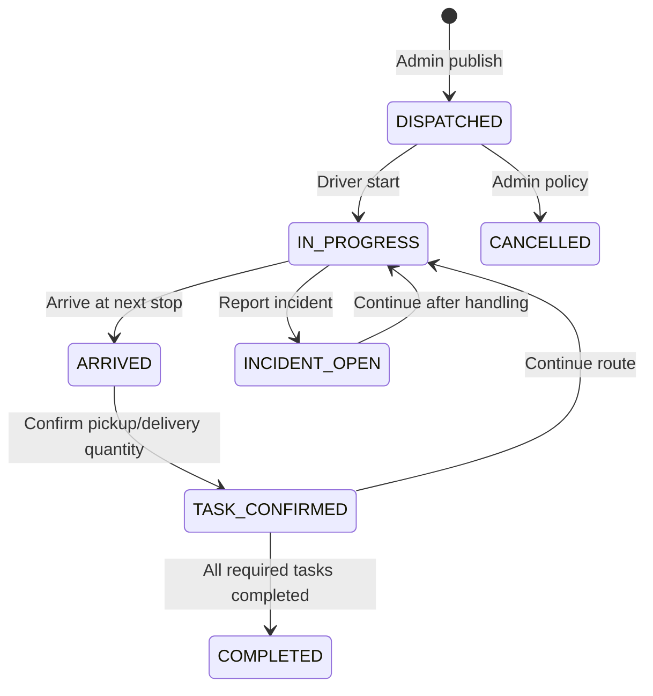

# Luồng nghiệp vụ Driver Trip

## 1. Nguồn kế hoạch

Driver không tạo hoặc sửa Trip Plan. Web Admin/Optimization tạo Trip, phân xe/tài xế và publish. Driver chỉ thực thi Trip ở trạng thái `DISPATCHED` mà mình được phân công qua `DriverAssignment`.

Enum hiện có:

```text
DRAFT -> PLANNED -> DISPATCHED -> IN_PROGRESS -> COMPLETED
   \          \            \             \
    +----------+------------+--------------+--> CANCELLED
```

`CURRENT`: backend đã có `Trip.version`, `planningSnapshot`, `expectedVersion` cho update/publish và tăng version bằng optimistic concurrency.

## 2. Quyền truy cập

`CURRENT M3.1/M3.2`:

- Driver read API resolve `JWT.sub -> User -> Driver -> DriverAssignment -> Trip`.
- Driver đọc mọi assignment role đang có status `ASSIGNED`, không giới hạn PRIMARY.
- Branch không phải bằng chứng ownership; Driver không được xem Trip khác chỉ vì cùng branch.
- Mobile chỉ hiển thị Trip `DISPATCHED`, `IN_PROGRESS`, `COMPLETED`, `CANCELLED`.
- Mobile M3.2 là read-only; chưa gửi execution command hoặc tự thay đổi status.
- Customer không gọi Driver API; Admin/Dispatcher giữ API planning/publish hiện tại.

Routes Mobile hiện có:

- `(driver)/index`: danh sách chuyến sau khi Driver đăng nhập.
- `(driver)/trips/index`: danh sách chuyến được phân công.
- `(driver)/trips/[id]`: chi tiết Trip, stops và tasks.

## 3. Luồng thực thi đề xuất



Các trạng thái `ARRIVED`, `TASK_CONFIRMED`, `INCIDENT_OPEN` là trạng thái nghiệp vụ minh họa, không phải enum Trip mới. Chúng được biểu diễn bằng `TripStop.status`, `StopTask.actualQuantity`, `ExecutionEvent`, `DeliveryAttempt` và `Incident`.

## 4. Command và actual data

| Command | Dữ liệu chính | Model hiện có | Trạng thái |
|---|---|---|---|
| Start Trip | commandId, expectedTripVersion, occurredAt | Trip, ExecutionEvent | PROPOSED |
| Arrive Stop | tripStopId, GPS, occurredAt | TripStop, ExecutionEvent | PROPOSED |
| Confirm Pickup | stopTaskId, actualQuantity, note | StopTask, Package, ExecutionEvent | PROPOSED |
| Confirm Delivery | actualQuantity, recipient, result | DeliveryAttempt, StopTask | PROPOSED |
| Upload POD | image/signature, checksum, capturedAt | PodFile | PROPOSED |
| Report Incident | type, severity, description, affected orders | Incident, IncidentOrder | PROPOSED |
| Complete Trip | expectedTripVersion, occurredAt | Trip, Order, reservations | PROPOSED |
| GPS batch | session, sequence, measuredAt, coordinates | GpsEvent | PROPOSED |

## 5. Trip version và offline

`CURRENT`: planning API dùng `expectedVersion`; publish kiểm tra Trip, Order, Driver và Vehicle snapshot trước khi tăng version.

`PROPOSED`:

- Mỗi command Mobile có `commandId`/idempotency key và `expectedTripVersion` khi command phụ thuộc kế hoạch.
- Backend phải kiểm tra assignment, trạng thái, stop/task thuộc Trip và thứ tự thực thi.
- Nếu Trip version mới hơn local snapshot, backend trả conflict có mã máy đọc được; Mobile dừng queue liên quan và tải lại Trip.
- ExecutionEvent lưu `occurredAt` từ thiết bị và `receivedAt` từ server.
- Không sửa planned data để phản ánh actual data.

Việc có tăng `Trip.version` cho mọi execution command hay chỉ khi đổi state tổng thể là `PROPOSED` và cần Web Admin review để tránh làm nhiễu planning version.

## 6. Giao thiếu và giao thất bại

`PROPOSED`:

- `actualQuantity < plannedQuantity` phải có reason/note và DeliveryAttempt.
- Giao thất bại không tự đánh dấu Order `COMPLETED`.
- Hàng còn lại phải giữ trạng thái và vị trí truy vết được; policy giao lại/trả hàng cần nhóm duyệt.
- POD bắt buộc theo policy; chưa chốt ảnh/chữ ký có bắt buộc đồng thời hay không.
- Complete Trip không tự complete mọi Order nếu có task thiếu/thất bại.

## 7. GPS và ETA

- Android background location dùng Expo Location/TaskManager, foreground-service notification và SQLite queue đã được triển khai ở M3.6C; manual QA bằng development APK trên Android thật: `PASS`.
- `GpsEvent` đã có unique `(deviceCode, deviceSessionId, sequence)` để chống trùng.
- Backend phải chấp nhận batch, lưu `measuredAt` và `receivedAt`, không dùng thứ tự nhận làm thứ tự đo.
- Planned ETA lấy từ `TripStop.plannedArrivalTime`.
- Dynamic ETA theo GPS chưa có; thuật toán/provider và tần suất cập nhật cần nhóm thống nhất.

## 8. Điều kiện nghiệm thu Driver flow

- Driver A không đọc hoặc command Trip của Driver B.
- Command retry không tạo sự kiện hoặc DeliveryAttempt trùng.
- Không thể delivery trước pickup hoặc complete trước khi xử lý các task bắt buộc.
- Offline queue đồng bộ đúng thứ tự và dừng an toàn khi version stale.
- GPS nền được kiểm thử trên thiết bị Android thật, có đo pin và hành vi khi mất mạng.
- POD liên kết đúng DeliveryAttempt và chỉ người có quyền mới tải được.
## M3.7.0 - Driver Incident Reporting (PROPOSED)

> Đây là kết quả khảo sát và thiết kế contract. Chưa có Incident API hoặc Mobile Incident runtime.

### Ranh giới nghiệp vụ

- `DeliveryAttempt FAILED` mô tả kết quả giao thất bại tại một Delivery Stop cụ thể, ví dụ người nhận vắng mặt hoặc từ chối nhận hàng.
- `Incident` mô tả sự cố vận hành có thể ảnh hưởng Trip, Vehicle hoặc nhiều Order, ví dụ xe hỏng, tai nạn, tắc đường hoặc hàng hóa bị hư hỏng.
- Không ghi cùng một business event vào cả hai model nếu không có hai ý nghĩa nghiệp vụ độc lập.
- Tạo Incident chỉ ghi nhận ngoại lệ vận hành; không tự động cancel/complete Trip, skip Stop, đổi Driver hay đổi Vehicle.

### Quyền và trạng thái Trip

- Driver tạo Incident theo chuỗi ownership `JWT.sub -> Driver.userId -> DriverAssignment -> Trip`.
- Chỉ assignment `ASSIGNED` với role `PRIMARY` được tạo Incident.
- Mọi assignment còn `ASSIGNED`, gồm `RELIEF`, được đọc Incident của Trip được phân công.
- Trip không tồn tại hoặc không thuộc Driver đều trả 404; thiếu Driver profile trả `409 DRIVER_PROFILE_NOT_FOUND`.
- **PROPOSED:** chỉ cho tạo khi Trip là `DISPATCHED` hoặc `IN_PROGRESS`; `COMPLETED` và `CANCELLED` chỉ được đọc.

### Phân loại đề xuất

- Type: `VEHICLE_BREAKDOWN`, `ACCIDENT`, `TRAFFIC_JAM`, `ROAD_BLOCKED`, `PACKAGE_DAMAGED`, `PACKAGE_MISSING`, `SECURITY_ISSUE`, `OTHER`.
- Severity: `LOW`, `MEDIUM`, `HIGH`, `CRITICAL`. Severity chỉ phản ánh mức ảnh hưởng, không tự động điều khiển Trip state.
- Driver luôn tạo status `OPEN`. Lifecycle tương lai: `OPEN -> ACKNOWLEDGED -> RESOLVED`; chỉ Dispatcher/Admin xử lý.
- `DELIVERY_ACCESS_ISSUE` không nằm trong allowlist đề xuất vì lỗi người nhận/điểm giao cụ thể thuộc DeliveryAttempt; sự cố đường vận hành dùng `ROAD_BLOCKED`.

### Order, package, location và bằng chứng

- Incident có thể không gắn Order hoặc gắn nhiều Order qua `IncidentOrder`.
- Backend chỉ chấp nhận Order thực sự xuất hiện trong Trip qua `TripStop -> StopTask -> Order`.
- Schema chưa hỗ trợ quan hệ Incident với Package hoặc TripStop; mô tả package trong text chỉ là giải pháp MVP không có tính toàn vẹn tham chiếu.
- Schema chưa có tọa độ/location snapshot và chưa có Incident attachment. M3.7.1 không nhận location hoặc photo.
- `PodFile` chỉ dành cho DeliveryAttempt và không được tái sử dụng cho Incident.

### Mobile và offline

- Driver Trip Detail có section “Sự cố”, danh sách sự cố và action “Báo sự cố” khi policy cho phép.
- Form gồm type, severity, description, occurredAt và danh sách Order bị ảnh hưởng tùy chọn.
- Online-first; timeout giữ nguyên idempotency key và payload để Driver thử lại thủ công. Không tự retry và không dùng GPS SQLite queue cho business command.

### M3.7.1 Backend status - IMPLEMENTED

- Driver create/list/detail API đã triển khai theo contract trên.
- Create chỉ cho PRIMARY + ASSIGNED ở Trip `DISPATCHED` hoặc `IN_PROGRESS`.
- PRIMARY/RELIEF còn ASSIGNED đọc được Incident ở Trip Driver-visible, gồm `COMPLETED` và `CANCELLED`.
- `occurredAt` chấp nhận trong cửa sổ 24 giờ trước đến 5 phút sau server time.
- Create ghi Incident, IncidentOrder, `INCIDENT_REPORTED` ExecutionEvent và ProcessedCommand trong cùng transaction.
- Incident không thay đổi Trip status/version. Mobile Incident và Dispatcher/Admin resolution chưa thuộc M3.7.1.

### M3.7.2 Mobile Driver Incident - IMPLEMENTED, MANUAL QA NOT RUN

- Driver Trip Detail có panel “Sự cố” với loading, empty, error độc lập, danh sách phân trang và detail đọc-only.
- PRIMARY + ASSIGNED thấy nút “Báo sự cố” ở Trip `DISPATCHED`/`IN_PROGRESS`; RELIEF, COMPLETED và CANCELLED chỉ đọc.
- Form dùng đúng type/severity Backend, description 10–2000 ký tự và affected Orders unique lấy từ StopTask của Trip.
- MVP dùng thời điểm thiết bị tại lúc mở form; chưa thêm date-time picker dependency.
- Timeout/mất mạng giữ idempotency key và payload để retry thủ công; sửa payload tạo key mới, không auto retry và không dùng GPS queue.
- Incident API lỗi không chặn execution, POD hoặc GPS trên Trip Detail.

## M3.8.1 — Offline command timestamp hardening (CURRENT)

- Offline MVP đã chốt chỉ queue `ARRIVE_STOP` và `COMPLETE_STOP`; START/COMPLETE Trip, Incident và e-POD vẫn online-only.
- Driver action time được gửi bằng `occurredAt`. Đây là business time, khác với `receivedAt`/`createdAt` là persistence time của server.
- ARRIVE ghi cùng business time vào Stop arrival và ExecutionEvent. COMPLETE ghi cùng business time vào Stop departure, ExecutionEvent, DeliveryAttempt và OrderEvent phát sinh từ command.
- Backend giữ optimistic concurrency và FIFO prerequisite: Trip phải `IN_PROGRESS`, Stop đúng trạng thái và là Stop chưa xử lý đầu tiên, `expectedTripVersion` phải đúng.
- Retry sau mất response phải giữ nguyên idempotency key, expected version, occurredAt và business payload. Backend trả result đã lưu trước khi kiểm tra lại state/version.
- Mobile hiện tại được tương thích bằng fallback server time khi thiếu `occurredAt`; M3.8.2 phải luôn gửi trường này và không được thay đổi khi retry `SENT_UNCERTAIN`.
- Tại checkpoint M3.8.1, Mobile SQLite queue chưa được triển khai; trạng thái hiện tại được cập nhật ở M3.8.2 bên dưới.

## M3.8.2 — Mobile Offline Driver Execution Queue (IMPLEMENTED)

- Chỉ `ARRIVE_STOP` và `COMPLETE_STOP` được thao tác ngoại tuyến. `START_TRIP`, `COMPLETE_TRIP`, Incident và e-POD vẫn cần mạng.
- Mọi ARRIVE/COMPLETE đi qua một luồng thống nhất: ghi command bền vững vào SQLite trước, sau đó đồng bộ ngay nếu có mạng.
- UI dùng local overlay `ARRIVED_PENDING_SYNC`/`COMPLETED_PENDING_SYNC`; không sửa giả snapshot Trip authoritative và không coi Package, Order hoặc DeliveryAttempt là đã đổi trước khi Backend xác nhận.
- Command cùng Trip chạy FIFO: ARRIVE stop N → COMPLETE stop N → ARRIVE stop N+1. Conflict/failed chặn các command phía sau.
- `occurredAt` được chụp khi Driver bấm, lưu UTC và không đổi khi retry. Sau khi request có khả năng đã tới server, retry giữ nguyên idempotency key, payload, `occurredAt` và wire expected version.
- Khi queue của Trip chưa sạch, Mobile không cho hoàn thành Trip. e-POD chỉ xuất hiện sau khi COMPLETE delivery đã sync và Backend trả DeliveryAttempt thật.
- Logout không xóa business queue. Queue được phân vùng theo `owner_user_id`, ẩn và dừng sync khi logout; đăng nhập lại đúng tài khoản mới khôi phục.
- Manual Android cho M3.8.2 chưa chạy; các trạng thái ngoại tuyến hiện mới có bằng chứng automated và Android production export.

## M3.8.3 — Android Offline Execution QA (PASS)

- Manual Android xác nhận ARRIVE/COMPLETE hoạt động khi mất mạng, queue tồn tại qua app restart, đồng bộ FIFO khi có mạng lại, cảnh báo logout và khôi phục đúng owner.
- PostgreSQL của Trip QA xác nhận đúng 4 ARRIVE, 4 COMPLETE_STOP, 4 Stop hoàn tất và một DeliveryAttempt; không có duplicate command/event/attempt.
- Complete Trip không được ghi nhận khi offline hoặc queue còn pending. Trip vẫn `IN_PROGRESS` cho tới khi gửi command online.

## M3.8.4 — Mandatory e-POD before Trip completion (IMPLEMENTED)

- Sau khi delivery sync thành công, Driver phải tải ảnh e-POD nếu policy đánh dấu ảnh bắt buộc trước khi Complete Trip.
- Ảnh bắt buộc cho `SUCCESS`, `PARTIAL` và FAILED với `ADDRESS_ISSUE`, `ACCESS_RESTRICTED` hoặc `PACKAGE_DAMAGED`. Chữ ký vẫn tùy chọn.
- Backend là nguồn quyết định cuối cùng và trả `409 POD_REQUIRED` nếu thiếu ảnh `UPLOADED` còn hiệu lực.
- Mobile ẩn nút Complete Trip cho đến khi mọi DeliveryAttempt của Trip trả `podSatisfied=true`. Lỗi tải POD hoặc chưa đọc được readiness đều fail-closed.
- Mobile cũng ẩn Complete Trip khi offline; request guard tiếp tục kiểm tra mạng và queue như lớp bảo vệ thứ hai.
- Android manual QA và hậu kiểm PostgreSQL đã **PASS** ngày 2026-11-19. Trip QA hoàn tất với đúng một COMPLETE_TRIP command/event và đủ ảnh PHOTO bắt buộc; M3.8.4 được đóng chính thức.

## M3.9.0 — Driver Map Navigation (PROPOSED, SURVEY ONLY)

- Map chỉ trực quan hóa `TripStop.sequence` và state thực thi; không reorder Stop, không thay Optimizer, không auto ARRIVE/COMPLETE.
- M3.9.1 được đề xuất mở ứng dụng bản đồ ngoài tới current/next Stop bằng tọa độ TripStop; không geocode ngầm và không cần Backend API mới.
- Local GPS lấy từ pipeline M3.6C. Không tạo watcher hoặc background session thứ hai cho map.
- Offline overlay M3.8 được giữ nguyên: Stop hoàn thành local có thể cho thấy bước tiếp theo trên thiết bị nhưng không được ghi là server-confirmed; conflict/failed chặn progression.
- Embedded Mapbox là M3.9.2 tùy chọn sau native compatibility spike. Không triển khai dynamic ETA, route polyline, turn-by-turn nội bộ hoặc offline tile trong MVP.

## M3.9.1 — Driver External Navigation (IMPLEMENTED)

- Trip `DISPATCHED` cho xem trước Stop; `IN_PROGRESS` điều hướng tới current/next operational Stop; `COMPLETED`/`CANCELLED` read-only và không có active navigation.
- Nút `Điều hướng` mở ứng dụng/bộ xử lý Google Maps universal URL bằng tọa độ TripStop. Navigation không phụ thuộc GPS hiện tại hoặc network state của Smart TMS.
- ARRIVE pending giữ current Stop; COMPLETE pending cho phép hiển thị `Tiếp theo trên thiết bị · chưa đồng bộ`; conflict/failed/blocked disable navigation tại Stop gây chặn.
- Feature không trigger command, không mutate TripStop, không thay sequence, không tác động e-POD/Incident/GPS/Complete Trip.
- Embedded map vẫn NOT IMPLEMENTED. Android manual QA vẫn NOT RUN.

## M3.9.2 — Xem bản đồ chuyến trong ứng dụng

1. Tài xế mở Trip Detail và chọn **Xem bản đồ chuyến**.
2. Ứng dụng hiển thị các điểm dừng hợp lệ theo đúng Trip Plan sequence và vị trí GPS local mới nhất nếu có.
3. Điểm current/next dùng cùng selector với M3.9.1; thao tác offline chờ sync/xung đột được trình bày nhưng Map không tạo hay đồng bộ command.
4. Tài xế có thể pan/zoom, chủ động căn lại vị trí và mở Google Maps để điều hướng turn-by-turn.
5. COMPLETED/CANCELLED chỉ xem lại, không có active navigation. Map không tự start Trip, arrive Stop hay reorder tuyến.

M3.9.2 automated đã PASS; Android manual M3.9.3 vẫn **NOT RUN**.
