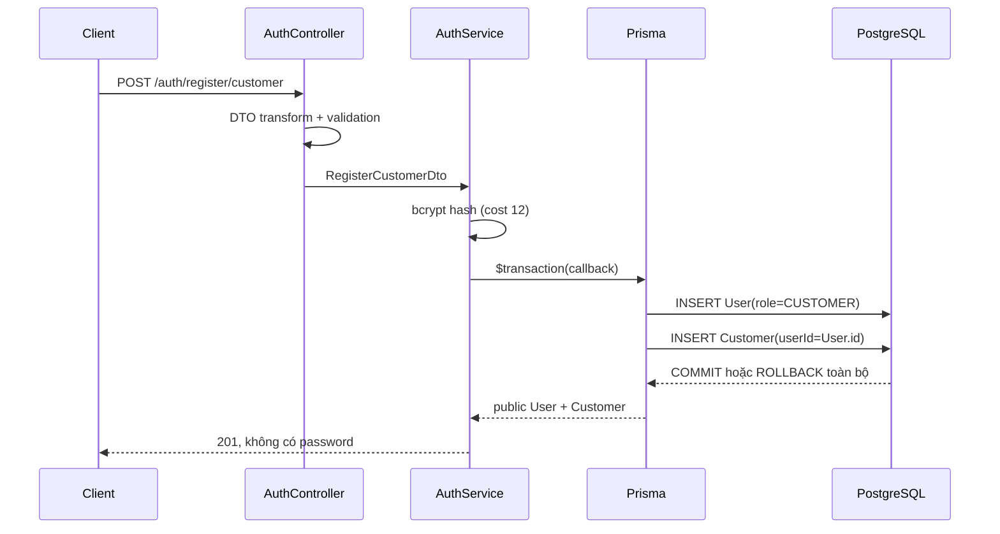
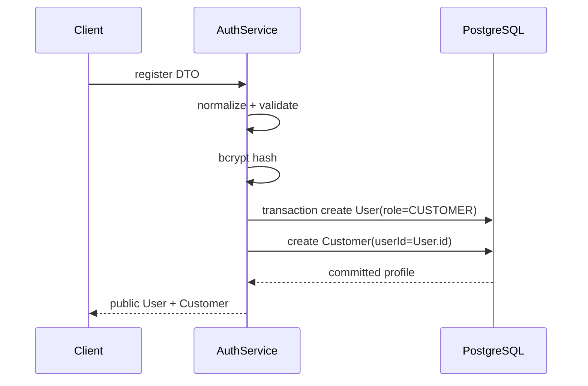

# Technical Decisions - Smart TMS Mobile

## M1 implementation decisions - CURRENT (2026-11-14)

| ID | Trạng thái | Quyết định và căn cứ |
|---|---|---|
| TD-020 | CURRENT | Đăng ký Customer chỉ nhận năm field nghiệp vụ; role luôn là `CUSTOMER` do backend gán. Global `ValidationPipe` từ chối field injection. |
| TD-021 | CURRENT | `User` và `Customer` được tạo trong một interactive Prisma transaction; lỗi bước Customer rollback bước User. Unique constraint PostgreSQL là hàng rào cuối cho request đồng thời. |
| TD-022 | CURRENT | Password được bcrypt hash với cost factor 12. Plaintext chỉ tồn tại trong request và không có trong select/response. |
| TD-023 | CURRENT | `username` đăng ký được lowercase; username đăng nhập chỉ trim để giữ tương thích tài khoản Web Admin hiện hữu. Login tiếp tục nhận `pass`, đồng thời nhận alias `password`. |
| TD-024 | CURRENT | JWT chứa `sub`, username, role, branch/location hiện hữu và hết hạn sau 7 ngày. Mỗi request profile vẫn đọc lại user active từ PostgreSQL. Refresh token chưa thuộc M1. |
| TD-025 | CURRENT | Ownership Customer bắt đầu từ `JWT sub -> User.id -> Customer.userId`; không dùng `customerId` từ client hoặc coi claim tùy ý là nguồn sự thật. M1 chưa có Customer Order API để áp dụng ownership lên Order. |
| TD-026 | CURRENT | Email là tùy chọn nhưng unique tại `User`; phone bắt buộc và unique tại `Customer`, đúng schema hiện tại. Không thay Prisma schema/migration. |
| TD-027 | CURRENT | CUSTOMER thiếu relation Customer là lỗi nhất quán dữ liệu `409/CUSTOMER_PROFILE_NOT_FOUND`; backend không tự tạo relation âm thầm khi đọc profile. |
| TD-028 | PROPOSED | Rate limit cho register/login và refresh-token rotation cần thiết trước production nhưng chưa thêm vì M1 không được tự đổi dependency/contract chung. |

### Luồng đăng ký đã triển khai

### Authentication và authorization

- Authentication trả lời “người gọi là ai”: Passport JWT kiểm tra chữ ký/hạn token, `JwtStrategy` đọc lại user và kiểm tra `active`.
- Authorization trả lời “người đó được làm gì”: role do server quản lý; ownership Customer suy ra từ relation theo JWT `sub`.
- `AuthGuard('jwt')` bảo vệ profile. Customer-only Order/Trip API chưa được triển khai trong M1.

## 1. Quy ước trạng thái

- `FINAL`: đã được người dùng chốt trong M0.
- `CURRENT`: đã được code hiện tại triển khai.
- `PROPOSED`: đề xuất cần nhóm hoặc owner module duyệt.
- `OPEN`: chưa đủ thông tin để chọn phương án.

## M2.0 Authorization Hardening - CURRENT (2026-11-15)

| ID | Trạng thái | Quyết định và căn cứ |
|---|---|---|
| TD-029 | CURRENT | API vận hành Orders, Customers, Trips, Branches, Vehicles và Drivers chỉ cho `ADMIN`/`DISPATCHER`. `STAFF` không được cấp thêm quyền vận tải; `CUSTOMER` không dùng các endpoint vận hành. |
| TD-030 | CURRENT | `ADMIN` có thể truy cập liên branch; `DISPATCHER` bắt buộc có `branchId` và chỉ truy cập tài nguyên thuộc branch đó. `branchId=null` luôn bị từ chối thay vì tạo truy vấn không filter. |
| TD-031 | CURRENT | Quyền Order theo ID được kiểm tra trên `order.branchId` đọc từ PostgreSQL, không dựa vào branch do client gửi. Quy tắc tương tự được áp dụng cho Vehicle và Driver. |
| TD-032 | CURRENT | Generic `PATCH /orders/:id` không còn nhận `status`. Chuyển trạng thái phải qua command endpoint riêng; API confirm chưa thuộc M2.0. Web Admin hiện không gửi field này nên luồng sửa dữ liệu hợp lệ được giữ nguyên. |
| TD-033 | CURRENT | Dispatcher chỉ nhận branch của mình từ `GET /branches`; ADMIN vẫn nhận danh sách active branch. Điều này giữ response dạng mảng nhưng thu hẹp dữ liệu đúng scope. |
| TD-034 | CURRENT | Quyền `DRIVER` hiện hữu chỉ được giữ trên `GET /trips/:id/load-plan`; nghiệp vụ Driver và assignment-level authorization chưa được mở rộng trong M2.0. |
| TD-035 | CURRENT | Customer Order Read dùng controller/service/DTO riêng dưới `/customer/orders`; không tái sử dụng endpoint vận hành `/orders` và không nhận `customerId`/`branchId`. |
| TD-036 | CURRENT | Ownership luôn được resolve bằng `JWT sub -> Customer.userId -> Customer.id`, sau đó đưa `customerId` vào Prisma query. Detail dùng cùng điều kiện `id + customerId`, nên Order không tồn tại và Order của Customer khác đều trả `404`. |
| TD-037 | CURRENT | `RolesGuard` kiểm tra đúng danh sách `@Roles`; ADMIN không còn bypass ngầm. Mọi endpoint hiện hữu cần ADMIN đều đã khai báo role này rõ ràng. |
| TD-038 | CURRENT | Customer response dùng Prisma `select` allowlist, không trả branch, customer, payment, totalAmount hay dữ liệu optimizer. `weightKg`/`volumeM3` lưu theo tổng dòng và được trả rõ thành line/unit values. |

## M2.2 Customer Create Order - CURRENT (2026-11-15)

| ID | Trạng thái | Quyết định và căn cứ |
|---|---|---|
| TD-039 | CURRENT | Customer chọn Branch từ `GET /customer/branches`; `POST /customer/orders` chỉ chấp nhận Branch tồn tại và active. Không dùng `CUSTOMER_ORDER_DEFAULT_BRANCH_ID` và không thay đổi `/branches` của Web Admin. |
| TD-040 | CURRENT | Chưa có service-area mapping. Một Branch active vẫn nhận Order DRAFT dù pickup ở khu vực khác; nhân viên đánh giá thủ công tại bước Confirm M2.3. Backend không hardcode tỉnh/thành, tự đổi branch hay tuyên bố phát hiện sai vùng. |
| TD-041 | CURRENT | Customer Order luôn tạo `DRAFT`; không tạo Package/Trip và không tự Confirm. `totalAmount=0` là dữ liệu kỹ thuật chưa báo giá, không được trả như giá miễn phí. |
| TD-042 | CURRENT | Client gửi `unitWeightKg`; Backend lưu `OrderItem.weightKg` theo tổng dòng và tự tính line/Order volume. DTO từ chối tổng do client gửi; service kiểm tra lại tổng hữu hạn trước transaction. |
| TD-043 | CURRENT | Giới hạn tiếp nhận MVP: 1-20 loại; quantity 1-500; unitWeightKg tối đa 1000 kg; length tối đa 1000 cm; width/height tối đa 300 cm. Đây không phải cam kết một xe có thể vận chuyển toàn Order. |
| TD-044 | CURRENT | Idempotency được khóa theo user + command + key. Order, stops, items, event và ProcessedCommand cùng transaction; lỗi ở bất kỳ bước nào rollback toàn bộ. Mã Customer Order dùng prefix riêng `ORD-CUS-YYYYMMDD-NNNN` và advisory lock theo ngày để không xung đột luồng Web Admin. |

## M2.4 Mobile Customer Transport Order - CURRENT (2026-11-15)

| ID | Trạng thái | Quyết định và căn cứ |
|---|---|---|
| TD-045 | CURRENT | M2.3 Confirm Order tạm hoãn và chưa hoàn thành. Confirm thuộc phạm vi Web Admin/thành viên 3 nhưng Backend command API chưa tồn tại; cần phân công rõ trước khi triển khai. |
| TD-046 | CURRENT | Mobile M2.4 chỉ gọi bốn API Customer M2.1/M2.2, tái sử dụng AuthProvider, SecureStore và API client M1. Không tạo auth state hoặc token storage thứ hai. |
| TD-047 | CURRENT | Form vị trí nhận địa chỉ và tọa độ thủ công. Chưa thêm Mapbox SDK, geocoding hoặc dịch vụ trả phí khi chưa có contract tương ứng. |
| TD-048 | CURRENT | Prisma lưu `packageType` dạng String, không có enum. UI giới hạn lựa chọn ở ba giá trị đã có trong dữ liệu vận tải: `CARTON`, `CRATE`, `PALLET`. |
| TD-049 | CURRENT | Mobile sinh UUID v4 bằng `expo-crypto`. Timeout/network giữ key cho cùng payload; payload thay đổi dùng key mới; không tự retry POST và khóa double tap. |

M2.4 đã qua test tự động nhưng chưa được manual test trên Android thật. Không dùng kết quả bundle/Jest để thay thế bằng chứng thiết bị thật.

## 2. Decision log

| ID | Trạng thái | Quyết định và căn cứ |
|---|---|---|
| TD-001 | FINAL | Một Expo App cho DRIVER/CUSTOMER; giảm cấu hình build và phù hợp demo nhóm 3 người. |
| TD-002 | FINAL | Android là nền tảng demo đầu tiên; GPS nền phải kiểm thử trên thiết bị thật. |
| TD-003 | FINAL | Transport Order MVP có một pickup, một delivery và nhiều dòng kiện. Optimizer hiện dùng một `OrderPair` cho một cặp pickup/delivery. |
| TD-004 | FINAL | Customer nhập `unitWeightKg`; không gửi tổng khối lượng dòng. |
| TD-005 | FINAL | Backend lưu `OrderItem.weightKg = unitWeightKg * quantity` để tương thích schema/optimizer hiện tại. |
| TD-006 | CURRENT | `OrderItem.weightKg` hiện là tổng khối lượng dòng; optimizer chia cho quantity. |
| TD-007 | FINAL | Customer Order tạo ở `DRAFT`; chỉ API duyệt riêng của ADMIN/DISPATCHER mới chuyển `DRAFT -> CONFIRMED`. Optimizer tiếp tục chỉ đọc `CONFIRMED`. M2.0 chưa triển khai create/confirm API. |
| TD-008 | PROPOSED | Customer chỉ tự hủy ở `DRAFT`/`CONFIRMED`; Order `ASSIGNED` cần Admin workflow để xử lý Trip/reservation. |
| TD-009 | FINAL (SUPERSEDED) | Phương án `CUSTOMER_ORDER_DEFAULT_BRANCH_ID` đã bị thay thế bởi TD-039: Customer chọn một Branch active. Không còn dùng biến cấu hình default branch. |
| TD-010 | PROPOSED | Time window đặt trên từng OrderStop. Đây là thay đổi schema tương lai, chưa được phép triển khai trong M0. |
| TD-011 | CURRENT | Python dùng `SetRange` cho pickup/delivery window, tức hard constraint. NestJS chưa truyền các field này. |
| TD-012 | CURRENT | Soft lateness hiện dựa trên `orderedAt + deliveryGraceDays` và branch penalty, không dựa trên Customer window. |
| TD-013 | OPEN | Delivery desired window sẽ là hard constraint hay soft preference. Optimization owner phải duyệt. |
| TD-014 | PROPOSED | Customer tracking chỉ trả last-known GPS khi Order thuộc user và Trip là `DISPATCHED`/`IN_PROGRESS`; sau complete chỉ trả kết quả giao hàng. |
| TD-015 | CURRENT | Trip planning/publish dùng optimistic concurrency qua `Trip.version`, `expectedVersion` và planning snapshot. |
| TD-016 | PROPOSED | Mobile command gửi `commandId` và `expectedTripVersion`; stale version buộc refetch snapshot. Cách tăng version khi execution cần Web Admin review. |
| TD-017 | FINAL | Retail được cô lập trước, không xóa module/schema/migration ở M0/M1. |
| TD-018 | CURRENT | PostgreSQL là nguồn sự thật; Redis/Socket.IO không thay thế lưu trữ bền vững. |
| TD-019 | PROPOSED | Socket chỉ thông báo thay đổi; Mobile luôn refetch REST snapshot sau reconnect. |

## 3. Phân loại chín quyết định cần kiểm tra

| Chủ đề | Code hỗ trợ | Có thể chốt trong Mobile | Cần thành viên khác | Chưa đủ thông tin |
|---|---|---|---|---|
| Order status | Enum có đủ; Web Admin create vẫn `CONFIRMED` | Customer create `DRAFT` đã FINAL | Confirm API cần triển khai ở M2.3 | Cancel policy chưa thuộc MVP hiện tại |
| Trip status | Có enum, planning/publish tới `DISPATCHED` | Có thể đề xuất execution transition | Web Admin review transition/version | Không |
| Hủy Order | Retail có logic; transport chưa có | Có thể thiết kế command/idempotency | Admin xử lý từ `ASSIGNED` | Policy hàng đã pickup |
| Branch | Field bắt buộc, scope vận hành đã gia cố | Customer chọn `branchId`; Backend chỉ chấp nhận Branch active | Cách chọn Branch đã CURRENT ở M2.2 | Service-area mapping và đánh giá vùng phục vụ thuộc bước sau |
| Time window | Python có, Prisma/NestJS thiếu | Mobile có thể thu thập input | Optimizer/schema owner duyệt mapping | Hard/soft delivery semantics |
| Hard/soft | OR-Tools hard range; branch late penalty soft | Không tự thay optimizer | Optimization owner | Customer window soft chưa có model |
| Weight | Schema/optimizer semantics đã rõ | Chốt input per-unit và adapter | Chỉ review contract | Không |
| Tracking | Có GpsEvent và socket emitter, chưa có API | Chốt owner-only authorization | Admin duyệt visibility policy | Dynamic ETA source |
| Trip version | Planning concurrency đã có | Gửi expected version/offline conflict | Web Admin duyệt execution increment policy | Không |

## 4. M1 - Customer Authentication design

### 4.1 Mục tiêu

Tạo Customer account an toàn, đăng nhập bằng JWT, xem profile và đảm bảo mọi Customer API suy ra Customer từ authenticated user.

### 4.2 File dự kiến tạo/sửa

| File | Thay đổi dự kiến |
|---|---|
| `backend/src/auth/dto/register-customer.dto.ts` | DTO đăng ký |
| `backend/src/auth/dto/login.dto.ts` | Thay body inline bằng DTO có validation |
| `backend/src/auth/auth.controller.ts` | Thêm register; chuẩn hóa request/response login/profile |
| `backend/src/auth/auth.service.ts` | Transaction tạo User + Customer; profile lookup |
| `backend/src/auth/jwt.strategy.ts` | Giữ lookup user active; không tin role/branch cũ trong token |
| `backend/src/customers/customers.service.ts` | Hàm lấy Customer theo userId nếu ownership phù hợp |
| `backend/test/auth/customer-registration.spec.ts` | Unit test đăng ký |
| `backend/test/auth/customer-auth.postgres.spec.ts` | Integration test unique/transaction/authorization |

Không cần đổi Prisma schema cho M1 vì `User.customer` và `Customer.userId @unique` đã tồn tại.

### 4.3 DTO và API

`RegisterCustomerDto`:

- `username`: trim, định dạng và độ dài được chốt khi triển khai.
- `password`: minimum length; không log và không trả lại.
- `fullName`: bắt buộc, trim.
- `phone`: bắt buộc, normalize và unique theo schema Customer.
- `email`: tùy chọn hoặc bắt buộc theo policy; nếu có phải hợp lệ và unique theo User.

Request không nhận role, active, branchId, locationId, customerId hoặc customer code.

### 4.4 Transaction

Nếu tạo Customer thất bại thì User phải rollback.

### 4.5 Validation và bảo mật

- Hash password bằng bcrypt; không lưu hoặc log plaintext.
- Luôn gán role `CUSTOMER` ở server.
- Dùng database unique constraint làm hàng rào cuối cho request đồng thời.
- Không cho username/email/phone enumeration chi tiết hơn mức policy cho phép.
- Login phải kiểm tra user active; code hiện đã làm việc này.
- Profile phải lookup lại User từ database qua JWT `sub`.
- Customer-owned service lấy `customer.userId == req.user.id`; không nhận customerId từ query/body.
- Rate limit đăng ký/login là `PROPOSED`; project hiện chưa có dependency tương ứng.
- Access token hiện hết hạn sau 7 ngày; refresh token là `OPEN`, chưa thêm vào M1 nếu chưa duyệt.

### 4.6 Trường hợp lỗi

- Username, email hoặc phone đã tồn tại.
- Password/fullName/phone sai định dạng.
- User tạo được nhưng Customer lỗi: transaction rollback.
- Sai password, tài khoản inactive hoặc token hết hạn.
- Role không phải CUSTOMER gọi Customer-only API.
- CUSTOMER user bị thiếu quan hệ Customer: trả lỗi cấu hình rõ, không tự tạo âm thầm.
- Hai request đăng ký đồng thời với cùng dữ liệu: chỉ một request thành công.

### 4.7 Test cần có

Unit:

- DTO nhận dữ liệu hợp lệ và loại field thừa.
- Password được hash và không xuất hiện trong response.
- Role luôn là CUSTOMER.
- Sai password/inactive user bị từ chối.
- Profile không trả password.

Integration PostgreSQL:

- Tạo User và Customer trong cùng transaction.
- Unique username/email/phone dưới request đồng thời.
- Rollback không để orphan User.
- JWT hợp lệ đọc đúng profile; token user khác không đổi ownership.
- Customer relation bị thiếu trả lỗi xác định.

### 4.8 Tiêu chí nghiệm thu M1

- Customer đăng ký và đăng nhập được bằng API thật.
- Database có đúng một User và một Customer liên kết.
- Không thể tự gán role hoặc branch.
- Profile lấy từ JWT và không lộ password.
- Unit test và PostgreSQL integration test liên quan đều chạy đạt.
- API contract và kết quả test được cập nhật vào docs.

### 4.9 Kiến thức cần hiểu khi bảo vệ

- Authentication khác authorization như thế nào.
- JWT chứa claim gì và vì sao vẫn lookup user active từ database.
- Vì sao password phải hash bằng bcrypt.
- Vì sao User và Customer phải tạo trong transaction.
- Vì sao validation API không thay thế unique constraint database.
- Vì sao không tin `customerId`, `role` hoặc `branchId` do client gửi.
- Cách idempotency và optimistic concurrency sẽ được dùng ở các milestone sau.

## 5. M3.1 Driver Trip read authorization - FINAL

- Nguồn ownership: `JWT.sub -> User.id -> Driver.userId -> Driver.id -> DriverAssignment.driverId -> Trip.id`.
- Không nhận `driverId`, `branchId` hoặc `userId` từ client.
- `User.branchId` và `Driver.homeBranchId` không được dùng làm bằng chứng sở hữu Trip; assignment hiện hành mới là nguồn sự thật.
- Assignment có mọi role đều được đọc, nhưng status phải đúng chuỗi hiện hữu `ASSIGNED`; không sáng tạo assignment status mới.
- Driver chỉ đọc Trip `DISPATCHED`, `IN_PROGRESS`, `COMPLETED`, `CANCELLED`; `DRAFT/PLANNED` chưa được publish nên không expose.
- Ownership nằm trong điều kiện Prisma query. Trip không tồn tại và Trip không thuộc Driver cùng trả 404 để chống IDOR.
- User role DRIVER thiếu Driver relation trả `409 DRIVER_PROFILE_NOT_FOUND`; Backend không tự tạo profile ngầm.
- Generic `/trips/:id/load-plan` chỉ còn ADMIN/DISPATCHER. Driver-specific load-plan để milestone sau nếu Mobile chứng minh cần.
- Không thay Prisma schema/migration/seed; integration test tự tạo User-Driver-Assignment fixture và dọn đúng dữ liệu của test.

## 6. M3.5 Driver e-POD - FINAL trong phạm vi MVP

- Chọn mô hình hoàn tất Delivery trước, tạo `DeliveryAttempt`, rồi upload bằng chứng cho attempt đó. Cách này không giữ transaction database trong lúc gọi Cloudinary.
- `PodFile` bổ sung `evidenceType` (`PHOTO`/`SIGNATURE`) và `sizeBytes` bằng additive migration; không thay đổi dữ liệu nghiệp vụ cũ.
- Ảnh giao hàng là JPEG tối đa 5 MiB; chữ ký là PNG tối đa 2 MiB. Backend kiểm tra đồng thời MIME, magic bytes, kích thước và tự tính SHA-256.
- Cloudinary dùng asset authenticated/private và deterministic storage key. Response không trả public URL, storage key hoặc checksum.
- Upload gồm ba pha: reserve trong transaction, upload ngoài transaction, finalize trong transaction. Trạng thái `FAILED` cùng deterministic key cho phép reconciliation/retry khi storage đã nhận file nhưng client hoặc database chưa nhận kết quả cuối.
- Idempotency scope là actor + `UPLOAD_DELIVERY_POD` + UUID; request hash bao gồm Trip/Stop/Attempt, evidence type, checksum và captured time.
- Chỉ PRIMARY Driver đang `ASSIGNED` được quản lý POD của Trip `IN_PROGRESS` hoặc `COMPLETED`. Mọi mismatch ownership trả cùng `404` để hạn chế IDOR.
- Mobile chỉ mở camera cho PHOTO, không mở gallery. Ảnh được xem trước local và chỉ upload sau khi Driver xác nhận; có thể chụp lại hoặc hủy trước upload. Chữ ký được giữ tạm trong bộ nhớ/file cache để upload PNG; app không lưu JWT hay binary POD vào state bền vững.
- Mobile không tự retry POST. Khi timeout/503 hoặc command đang xử lý, hook giữ nguyên idempotency key và file payload để người dùng chủ động thử lại; đổi file tạo key mới.
- Driver xem lại POD bằng signed URL 5 phút. File sai sau upload được thay thế qua `supersedesId`; file cũ vẫn được giữ và đánh dấu `isSuperseded`, không hard delete bằng chứng.
- Khi kiểm tra asset Cloudinary, lỗi SDK có thể đặt HTTP status ở `error.http_code` thay vì top-level; adapter phải chuẩn hóa lỗi provider trước khi quyết định asset không tồn tại hay upload thất bại.
- Không dùng số byte Cloudinary trả về để đòi bằng tuyệt đối với file nguồn vì provider có thể biến đổi/optimize nội dung. Tính toàn vẹn và retry dựa trên checksum request, deterministic storage key, idempotency và metadata phù hợp với asset đã lưu.
- Trên Expo/React Native, upload multipart thực tế dùng cơ chế file upload tương thích native hiện có; không tự đặt `Content-Type` multipart boundary. Manual Android đã xác nhận PHOTO và SIGNATURE tới Cloudinary thật.
- M3.5 chưa cung cấp Customer/Admin POD view, background upload, offline queue hoặc job dọn orphan Cloudinary asset.

## 7. M3.6B Backend GPS ingest/latest - FINAL

- Tái sử dụng `GpsEvent`; không thêm TrackingSession, migration hoặc `ProcessedCommand` cho telemetry stream.
- Driver GPS ownership lấy từ JWT User → Driver → assignment `ASSIGNED` role `PRIMARY` → Trip. Branch không phải ownership và client không được gửi Driver/User/Vehicle/Branch ID.
- Ingest chỉ nhận Trip `IN_PROGRESS`. Backlog của Trip `COMPLETED` được nhận tối đa 30 phút sau actual end nếu toàn bộ point được đo trong actual trip interval.
- `deviceCode` và `deviceSessionId` là UUID; sequence là safe positive integer. Advisory lock theo session bảo đảm hai first-request concurrent không gắn cùng session vào hai Trip khác nhau.
- Dedupe dùng database unique `(deviceCode, deviceSessionId, sequence)` với bulk `createMany(skipDuplicates)`; response phân biệt accepted và duplicate.
- Mobile gửi speed m/s; Backend đổi sang km/h theo schema. `receivedAt` luôn do server tạo; point quá hai phút trong tương lai bị từ chối.
- Vehicle latest chỉ được update bằng điều kiện `incoming.measuredAt > lastLocationAt`; point đến muộn vẫn vào history nhưng không làm vị trí mới nhất lùi thời gian.
- Latest-position chỉ cho ADMIN/DISPATCHER, Dispatcher theo managing branch hoặc vehicle home branch fallback; STAFF/DRIVER/CUSTOMER không được cấp.
- Không phát raw GPS qua branch Socket.IO room hiện tại, không có history/customer API, rate-limit dependency hay retention job trong M3.6B.

## 8. M3.6C Mobile Driver Background GPS - IMPLEMENTED, MANUAL QA PASS

- Background location dùng Expo Location + TaskManager; task được define ở module scope và Android dùng foreground-service notification không chứa tọa độ/JWT/Customer.
- `deviceCode` là installation UUID lưu trong SecureStore. `deviceSessionId`, sequence và GPS queue lưu trong SQLite; không lưu JWT trong queue.
- START_TRIP phải được Backend xác nhận `IN_PROGRESS` trước khi tạo/restore session và xin quyền. Background denied fallback sang foreground watcher; Trip không bị rollback vì telemetry lỗi.
- Queue tách theo user/trip/session, tối đa 6000 point hoặc 24 giờ; nếu bắt buộc eviction thì giữ point mới hơn và hiển thị warning.
- Upload tối đa 20 point theo sequence; accepted và duplicate đều cleanup đúng danh sách sequence đã gửi. Network error giữ queue và dùng exponential backoff tối đa 5 phút.
- COMPLETE success dừng lấy mẫu mới rồi flush backlog; timeout phải refetch Trip trước khi quyết định dừng. Backlog quá cửa sổ 30 phút được cleanup, không retry vô hạn.
- Logout dừng native task và xóa queue/session để tránh cross-account leak; tradeoff là backlog chưa gửi bị mất khi tài xế chủ động logout.
- Expo Go không phải bằng chứng GPS nền. Manual QA bằng development APK trên Android thật đã PASS với background/screen-off, offline/reconnect, revoke permission, logout/resume và completion.

## 9. M3.6D.1 Customer Tracking Backend - IMPLEMENTED

- Contract dùng `trips[]` vì một Order có thể được chia qua nhiều Trip; không giới hạn Optimizer để đơn giản hóa API.
- Ownership đi từ `JWT.sub → Customer.userId → Order.customerId`; client không gửi Customer/Trip identity đáng tin cậy.
- Liên kết Order–Trip được suy ra từ `StopTask.orderId → TripStop.tripId`; không thêm FK hoặc migration.
- Latest location truy vấn theo từng `Trip.gpsEvents`; tuyệt đối không dùng `Vehicle.currentLocation` cho Customer.
- Stale threshold thống nhất với Admin latest-position là 2 phút. ETA MVP chỉ là `plannedDeliveryAt`, source `PLANNED`.
- M3.6D.1 không gồm Mobile polling, dynamic ETA, Socket.IO, GPS history hoặc map route.

## 10. M3.6D.2 Mobile Customer Tracking - IMPLEMENTED, MANUAL QA NOT RUN

- Dùng polling HTTP 30 giây khi Order Detail đang focus và app ở foreground; chưa thêm WebSocket vì MVP chỉ cần last-known location.
- Tracking có state và lỗi độc lập với Order Detail. Một lần polling lỗi không làm mất nội dung Order hoặc snapshot tracking gần nhất.
- AppState và focus cùng quyết định vòng đời polling; request cũ bị vô hiệu hóa theo generation khi screen blur/background để tránh state update muộn.
- UI render đầy đủ `trips[]`. `NOT_ASSIGNED` là empty state hợp lệ; `vehicleLocation = null` không bị coi là lỗi.
- Trip hoàn thành dùng wording “Vị trí cuối của chuyến”, không gọi là vị trí hiện tại. ETA chỉ ghi “Dự kiến theo kế hoạch”.
- Không thêm map SDK, WebSocket, GPS history, dynamic ETA hoặc thay đổi Backend trong M3.6D.2.

## 11. M3.6D.3 Customer Tracking QA Fixture - IMPLEMENTED, ANDROID QA PASS

- Fixture QA có namespace riêng `QA-M36D3-*`, chỉ chấp nhận chính xác `127.0.0.1:55433/tms_auth_test` và không chạy seed tổng, reset hoặc xóa dữ liệu khác.
- Seed dùng upsert cho User, Customer, Branch, Vehicle, Order, Trip, StopTask và GPS point. Chạy lại giữ nguyên ID và chỉ làm mới timestamp case Fresh thuộc fixture.
- GPS của fixture được ghi rõ là generated local/test data, không được dùng làm bằng chứng GPS Android thật.
- Năm Order riêng biểu diễn NOT_ASSIGNED, Fresh, Stale, Multi-Trip và Completed; Customer thứ hai phục vụ ownership 404.
- Credential chỉ là local/test. Tài liệu không lưu mật khẩu, JWT hoặc connection string.
- Android manual QA đã PASS cho NOT_ASSIGNED, Fresh, Stale, Multi-Trip, Completed wording, polling foreground, background/foreground, network recovery và ownership. GPS dùng trong QA là fixture-generated, không phải GPS Driver APK.
## 12. M3.7.0 Driver Incident Reporting - PROPOSED

- Tái sử dụng model `Incident` và `IncidentOrder` hiện hữu cho Driver report/read MVP; không migration trong M3.7.1 nếu location, photo, Package/Stop relation và resolution metadata vẫn ngoài phạm vi.
- Incident type/severity/status hiện là `String`; API phải dùng strict allowlist, không chấp nhận chuỗi tùy ý từ Mobile.
- Identity/context do Backend suy ra: reporter từ JWT, Driver từ `Driver.userId`, Vehicle từ Trip và status luôn `OPEN` khi tạo.
- PRIMARY + ASSIGNED được tạo; mọi role ASSIGNED được đọc. Branch không phải Driver ownership.
- **PROPOSED:** tạo ở `DISPATCHED` và `IN_PROGRESS`; `COMPLETED`/`CANCELLED` chỉ đọc. Báo hồi tố sau hoàn thành để workflow Admin/Dispatcher tương lai.
- Incident không làm thay đổi `Trip.status` hoặc `Trip.version` và không kích hoạt cancel, reassign, vehicle replacement hay skip-stop.
- Affected Orders là tùy chọn 0..N; Backend xác minh bằng `StopTask.orderId` của chính Trip. ID trùng bị reject thay vì tự dedupe.
- Create dùng `ProcessedCommand` với command type `CREATE_DRIVER_INCIDENT`, advisory lock và request hash chuẩn hóa. Same key/same payload replay Incident cũ; same key/different payload trả conflict.
- Transaction tạo Incident, IncidentOrder, `ExecutionEvent` loại chuỗi `INCIDENT_REPORTED` và ProcessedCommand hoàn tất. Bất kỳ bước database nào lỗi đều rollback.
- Không dùng `AuditLogService.log()` làm audit bắt buộc vì service hiện nuốt lỗi và nằm ngoài transaction. `ExecutionEvent` là operational audit timeline cho MVP.
- Không dùng `DriverActivityEvent` vì model đó biểu diễn hoạt động/ca tài xế; không dùng Outbox khi chưa có notification/realtime consumer.
- Không nhận location và photo trong contract MVP: schema chưa hỗ trợ Incident location/attachment; `PodFile` không đúng ownership semantics.
- Mobile online-first, không tự retry POST và không tái sử dụng GPS queue cho Incident.
- Dispatcher/Admin workflow tương lai cần branch scope theo `Trip.managingBranchId`, fallback `Vehicle.homeBranchId`; STAFF và CUSTOMER không được cấp quyền Incident trong MVP.
- Resolution workflow đầy đủ nhiều khả năng cần migration bổ sung `acknowledgedAt/by` và `resolvedAt/by`; quyết định này chưa nằm trong M3.7.1.

## 13. M3.7.1 Backend Driver Incident API - FINAL trong phạm vi Driver MVP

- Type allowlist gồm `VEHICLE_BREAKDOWN`, `ACCIDENT`, `TRAFFIC_JAM`, `ROAD_BLOCKED`, `PACKAGE_DAMAGED`, `PACKAGE_MISSING`, `SECURITY_ISSUE`, `OTHER`; severity gồm `LOW`, `MEDIUM`, `HIGH`, `CRITICAL`.
- Driver chỉ tạo status `OPEN`; request không nhận identity, vehicle, branch, status, resolution, location hoặc file.
- Create dùng cùng trip advisory-lock namespace với Driver execution để state check không race với command hoàn thành Trip.
- Idempotency canonical hash gồm Trip, type, severity, description đã trim, occurredAt chuẩn ISO và affected Order IDs đã sort.
- Affected Order được xác minh authoritative qua StopTask của chính Trip; duplicate ID bị DTO từ chối và foreign Order trả `INCIDENT_ORDER_NOT_IN_TRIP`.
- Incident, IncidentOrder, ExecutionEvent và ProcessedCommand là một atomic transaction. Audit failure rollback cả Incident.
- Read ownership luôn nằm ở DriverAssignment `ASSIGNED`; foreign/nonexistent được che bằng 404. Branch không tham gia Driver ownership.
- Create không mutate Trip status/version. Không migration cho M3.7.1.

## 14. M3.7.2 Mobile Driver Incident - IMPLEMENTED

- Feature độc lập `src/features/driver-incidents`; tái sử dụng API client, SecureStore token và Driver auth error handler hiện hữu.
- Runtime parser strict với identity/type/severity/timestamps/affected Orders, nhưng status dùng safe fallback để tương thích lifecycle tương lai.
- Order selector được suy ra từ unique `TripStop.tasks[].order`; Mobile không nhận UUID tùy ý.
- Form giữ `occurredAt` tại thời điểm mở vì dự án chưa có date-time picker; Backend vẫn authoritative với cửa sổ 24 giờ/5 phút.
- Idempotency pending command nằm trong hook ở bộ nhớ: same payload retry cùng key, changed payload key mới, double tap bị khóa, không auto retry.
- List state độc lập với Trip Detail; lỗi Incident không làm mất Trip execution/POD/GPS UI.
- Đồng bộ sáu Expo package patch trong cùng SDK 58 theo Expo Doctor; không đổi major hoặc thêm dependency nghiệp vụ.

## M3.8.1 — Business time cho offline execution

- `occurredAt` là thời điểm Driver thực hiện ARRIVE/COMPLETE trên thiết bị; database `createdAt`/`receivedAt` vẫn do server quản lý để bảo toàn audit hai mốc thời gian.
- Policy thời gian: tối đa 24 giờ trước, tối đa 5 phút sau server time, không trước Trip start; complete không trước arrival và được phép bằng arrival.
- Validation temporal nằm trong mutation transaction sau bước idempotency lookup. Vì vậy exact replay vẫn trả result cũ dù command được retry sau khi cửa sổ 24 giờ đã trôi qua.
- Canonical hash dùng ISO UTC của `occurredAt`; hai biểu diễn timezone của cùng một instant có cùng hash.
- Trường được giữ optional ngắn hạn để không phá Mobile M3.4 đang chạy. M3.8.2 phải coi `occurredAt` là bắt buộc ở client.
- Không thêm schema, batch endpoint, versionless command hoặc command-status endpoint.

## M3.8.2 — Kiến trúc Mobile offline execution

- Dùng database riêng `smart-tms-driver-offline.db`, không dùng chung `driver_gps_queue`. Business mutation và telemetry có retention, ordering và retry semantics khác nhau.
- SQLite bật WAL, `busy_timeout=5000`, serialize write và retry `SQLITE_BUSY`. Bảng chứa owner/trip/stop/type/sequence, idempotency, fingerprint, observed/wire version, transmission/queue state và metadata retry; không lưu JWT hay Authorization header.
- Persist-first được dùng cả online và offline để lost response chỉ có một cách xử lý. Trước HTTP đầu tiên, client persist `wireExpectedVersion` và `SENT_UNCERTAIN`.
- Sync tuần tự toàn cục và single-flight; trigger từ auth restore, reconnect, foreground, command mới và nút thử đồng bộ.
- Rebase bảo thủ: external version change luôn thành conflict; không đoán version bằng `observed + số command`.
- Queue owner-scoped và không bị xóa khi logout. GPS logout policy giữ nguyên, không dùng chung mutex/storage.
- SQLite Android sandbox không mã hóa được chấp nhận cho MVP; production hardening có thể cần encrypted database.

## M3.8.4 — e-POD completion gate

- Policy ảnh POD được tách thành helper dùng chung giữa POD API và Driver execution để tránh hai định nghĩa khác nhau.
- Complete Trip kiểm tra dữ liệu authoritative trong cùng transaction với state transition. Ẩn nút Mobile chỉ là UX, không thay thế Backend authorization/precondition.
- Chỉ file `UPLOADED` và đang active mới thỏa điều kiện; `PENDING`, `UPLOADING`, `FAILED` hoặc file đã superseded không được tính.
- Mobile nhận readiness từ POD endpoint hiện có, không mở rộng Trip Detail contract và không thêm schema/migration.
- Connectivity được kiểm tra cả lúc render nút và trước request; trạng thái mạng chưa xác định được xử lý fail-closed.

## M3.9.0 — Driver Map Navigation Survey (PROPOSED)

- Khuyến nghị M3.9.1 chỉ mở external navigation bằng universal HTTPS URL và `TripStop` coordinates; không cần API key, dependency hoặc native rebuild.
- Nếu làm embedded map ở M3.9.2, dùng Mapbox theo stack đã chốt. `@rnmapbox/maps` cần config plugin và development build, không chạy trong Expo Go; phải có compatibility spike với Expo 58/RN 0.88.
- Driver current location phải tái sử dụng M3.6C SQLite/tracking snapshot; không tạo watcher, permission flow hoặc Backend polling thứ hai.
- Stop sequence là authoritative từ Trip Plan. Local M3.8 overlay được trình bày rõ `LOCAL_PENDING`, không giả thành server-confirmed và conflict không được promote Stop sau.
- Không vẽ straight polyline hoặc tự gọi Directions. Driver API hiện không trả authoritative `routeGeometry`.
- Chi tiết contract, test plan và quyết định mở nằm tại `driver-map-navigation-survey.md`.

## M3.9.1 — Driver External Navigation MVP (IMPLEMENTED)

- Dùng `expo-linking` hiện hữu để mở Google Maps universal HTTPS URL; không hardcode Android package và không cần API key/token bản đồ.
- Tọa độ phải là number hữu hạn trong range latitude/longitude; invalid target không gọi Linking.
- Stop selector giữ authoritative sequence, tái sử dụng M3.8 presentation overlay và phân biệt `SERVER`, `LOCAL_PENDING`, `PREVIEW`.
- Conflict/failed/blocked giữ focus tại Stop lỗi và disable navigation; không promote Stop sau. COMPLETED/CANCELLED không có active target.
- Không dùng current GPS, không tạo watcher/polling và không thay đổi GPS, execution, e-POD, Incident hoặc Complete Trip policy.
- Automated PASS; Android manual vẫn NOT RUN.

## M3.9.2 — Embedded Driver Mapbox (IMPLEMENTED)

- Chọn `@rnmapbox/maps@10.3.18` để thống nhất provider; Expo Go không được dùng vì package có native module. CNG plugin được khai báo trong `app.json` và EAS development APK là runtime kiểm thử bắt buộc.
- Public token dùng biến `EXPO_PUBLIC_MAPBOX_ACCESS_TOKEN`; không dùng secret/download/admin token trong JavaScript bundle.
- Map screen tách khỏi execution screen để native map mount/unmount độc lập. Lỗi cấu hình hoặc render được cô lập; Trip Detail và external navigation vẫn dùng được.
- Local GPS snapshot là read-only consumer của M3.6C. Marker vị trí quá 2 phút được đánh stale; không có GPS vẫn render Stop markers.
- Camera chỉ tự fit lúc mount và không bám theo mỗi GPS sample; tài xế chủ động dùng “Vị trí của tôi”.
- Không thay đổi Backend/Driver API và không expose `routeGeometry`.
