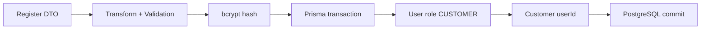
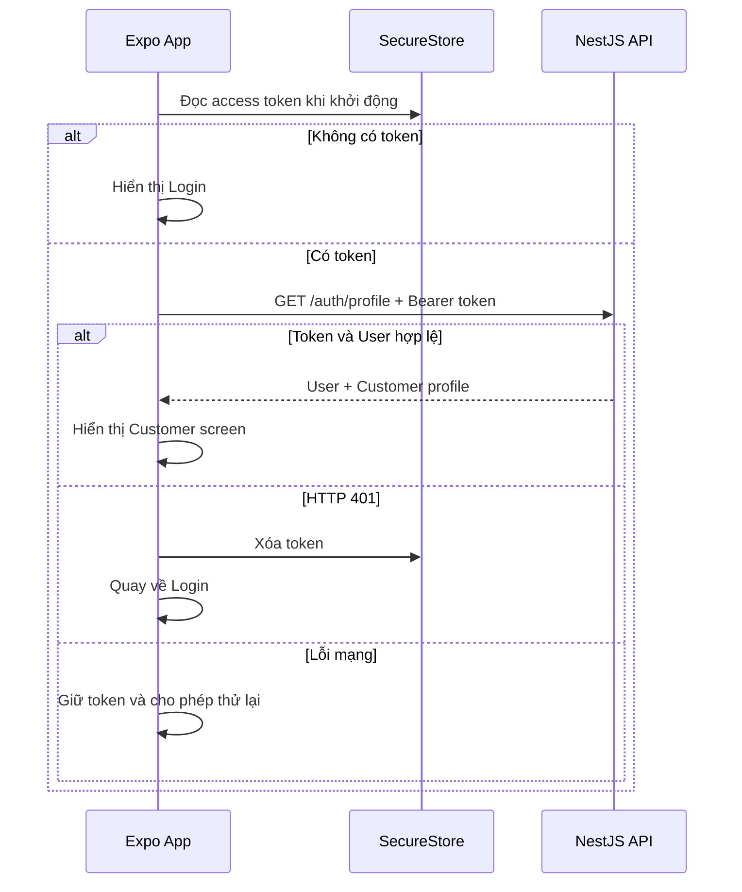
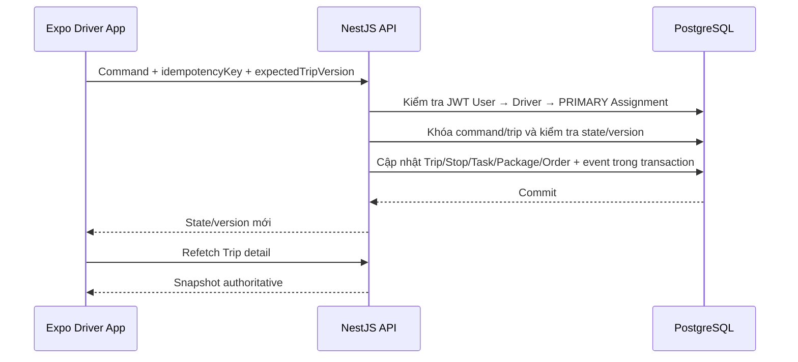

# Graduation Notes - M1 Customer Authentication

## 1. Cách trình bày ngắn gọn

M1 tạo hai bản ghi có vai trò khác nhau: `User` phục vụ đăng nhập/phân quyền, `Customer` phục vụ dữ liệu nghiệp vụ vận tải. Hai record liên kết 1-1 qua `Customer.userId` và được tạo trong cùng Prisma transaction.

## 2. Kiến thức phải hiểu

### Authentication và authorization

- Authentication xác định danh tính bằng username/password rồi phát JWT.
- Authorization kiểm tra role và ownership sau khi đã biết danh tính.
- Role và customerId không được tin từ request vì client có thể sửa payload.

### JWT

- JWT được ký bằng secret; sửa payload sẽ làm chữ ký không hợp lệ.
- `sub` chứa User id. Backend dùng id này để đọc lại trạng thái `active` và relation Customer.
- JWT không mã hóa nội dung; không đặt password hoặc dữ liệu nhạy cảm trong claim.

### Password hashing

- Bcrypt là hàm băm chậm có salt, giúp tăng chi phí brute-force và chống rainbow table.
- Backend lưu hash, không thể “giải mã” để lấy lại mật khẩu gốc.
- Cost 12 là quyết định hiện tại; cần benchmark lại nếu hạ tầng production khác.

### Transaction và unique constraint

- Transaction bảo đảm tính atomic: hoặc cả User và Customer cùng tồn tại, hoặc không record nào được commit.
- Kiểm tra trước bằng `findUnique` không đủ chống race condition. Unique constraint PostgreSQL mới là hàng rào cuối khi hai request đến đồng thời.
- Prisma báo unique violation bằng `P2002`; service chuyển thành HTTP 409.

### Validation

- DTO chặn input sai sớm và chuẩn hóa username/email/phone.
- Validation ở ứng dụng không thay thế constraint database.
- `forbidNonWhitelisted` biến role injection thành 400 thay vì âm thầm nhận dữ liệu nguy hiểm.

## 3. Câu hỏi hội đồng có thể đặt

**Vì sao không gộp User và Customer?**\
User là danh tính kỹ thuật dùng chung cho nhiều role; Customer là hồ sơ nghiệp vụ. Tách ra giảm field thừa và giữ mô hình role hiện hữu.

**Vì sao cần transaction?**\
Nếu tạo User thành công nhưng Customer thất bại, hệ thống sẽ có tài khoản CUSTOMER không có hồ sơ nghiệp vụ. Transaction rollback tránh trạng thái mồ côi này.

**Vì sao không tin customerId từ mobile?**\
Người dùng có thể sửa request để truy cập dữ liệu khách khác. Server phải suy ra Customer từ JWT `sub` và relation trong database.

**JWT hợp lệ có đủ chưa?**\
Chưa. User có thể đã bị khóa sau khi token được phát, nên `JwtStrategy` đọc lại database và kiểm tra `active`.

**Hai request đăng ký cùng lúc xử lý thế nào?**\
Cả hai có thể cùng vượt qua validation, nhưng unique constraint chỉ cho một transaction commit; request còn lại nhận P2002 và HTTP 409.

**Tại sao chưa có refresh token?**\
Để không tự thay đổi contract dùng chung trong M1. Đây là quyết định cần thiết kế storage, rotation và revoke trước khi triển khai.

**M1 đã bảo vệ Order ownership chưa?**\
Chưa có Order API trong M1. M1 thiết lập nền tảng ownership `JWT sub -> User -> Customer`; M2 phải dùng relation này trong mọi truy vấn Order.

## 4. Demo đề xuất

1. Đăng ký Customer và chỉ ra hai record liên kết trong database.
2. Thử gửi `role=ADMIN` để thấy 400.
3. Đăng nhập lấy access token.
4. Gọi profile bằng Bearer token và chỉ ra không có password.
5. Khóa user rồi dùng lại token để thấy request bị từ chối.

## 5. Phần Mobile cần trình bày khi bảo vệ

### Luồng khôi phục phiên

### Điểm kiến trúc cần giải thích

- Screen không gọi HTTP trực tiếp; Screen gọi hook/AuthProvider, tầng service dùng API client chung.
- `AuthProvider` là nguồn trạng thái đăng nhập duy nhất; `useAuth` chỉ truy cập context, không tạo state cạnh tranh.
- SecureStore phù hợp hơn AsyncStorage cho access token vì sử dụng vùng lưu trữ an toàn của hệ điều hành.
- TypeScript chỉ kiểm tra lúc biên dịch, nên response API vẫn được kiểm tra runtime trước khi đưa vào state.
- Protected route là bảo vệ giao diện, không thay thế authorization ở Backend. Backend vẫn phải kiểm tra role và ownership cho từng tài nguyên.
- Không tự refresh hoặc retry login/register vì Backend chưa có refresh-token contract và retry command không được kiểm soát có thể tạo side effect lặp.

## M2.2 - Các ý cần hiểu khi bảo vệ Customer Create Order

- Vì sao `customerId` lấy từ quan hệ theo JWT nhưng `branchId` được Customer chọn và Backend vẫn phải kiểm tra Branch active.
- Vì sao Branch active khác khu vực vẫn được nhận ở DRAFT: schema chưa có service-area mapping, nên không hardcode tỉnh/thành hoặc tuyên bố tự động phân vùng.
- Vì sao `OrderItem.weightKg` và `volumeM3` là tổng của dòng, còn request nhận khối lượng/kích thước một kiện.
- Giới hạn 1000 kg/1000x300x300 cm là giới hạn tiếp nhận, không phải cam kết tải được lên một xe; tổng Order không bị ràng buộc bằng tải trọng một xe.
- Global ValidationPipe loại field đặc quyền; service kiểm tra lại `Number.isFinite` để phòng kết quả tính toán không hữu hạn.
- Order, stops, items, event và ProcessedCommand cùng transaction để không có dữ liệu mồ côi.
- Idempotency khác optimistic concurrency: M2.2 dùng key + payload hash chống tạo lặp; M2.3 cần version khi chuyển trạng thái.
- Hai advisory transaction lock giải quyết hai race condition riêng: cùng idempotency key và cấp orderNumber đồng thời.
- Prefix Customer Order riêng giữ an toàn concurrency mà không đổi contract tạo Order hiện hữu của Web Admin.
- DRAFT không được điều phối/Optimizer đọc vì nguồn hiện chỉ lấy `CONFIRMED`; bước duyệt riêng thuộc M2.3.

### Bằng chứng nghiệm thu

- Automated: Backend PostgreSQL 13/13, backend regression 158/158, Mobile Jest 13/13, TypeScript/ESLint/Expo Doctor/Android bundle đều PASS.
- Manual Android thật: đăng ký, đăng nhập, khôi phục phiên/profile, đăng xuất, validation, tài khoản tồn tại, sai mật khẩu và lỗi mạng đều PASS.
- Cần nói rõ với hội đồng: automated test và manual device test là hai lớp kiểm chứng khác nhau; kết quả Android thật không được mô tả là Jest test.

### M2.4 Mobile Customer Order

- Screen chỉ quản lý UI/form; service gọi HTTP và kiểm tra response runtime; hook quản lý loading/error/idempotency.
- SecureStore giữ JWT, còn idempotency key chỉ sống cùng lần gửi form chưa rõ kết quả; không dùng AsyncStorage và không log dữ liệu nhạy cảm.
- Không tự retry POST vì retry không kiểm soát có thể tạo side effect; Backend và Mobile phối hợp bằng UUID + payload hash.
- `expo-crypto.randomUUID()` tạo UUID v4 an toàn và có trong Expo Go SDK 58.
- Protected route chỉ bảo vệ UI; Backend vẫn là nơi thực thi role CUSTOMER và ownership.
- M2.4 đã manual test trên Android thật bằng Expo Go: login, list/filter/refresh, Branch, tạo DRAFT, detail, totals, ẩn giá và validation đều PASS.
- Ba tình huống chưa manual test phải trình bày là NOT RUN: Branch chuyển inactive giữa lúc tạo; mất mạng/timeout khi POST rồi retry; server commit nhưng client mất response.
- Automated tests và manual Android QA là hai loại bằng chứng khác nhau: Jest kiểm tra logic cô lập/regression; thiết bị thật kiểm tra UI, navigation và tích hợp API thực tế.
- M2.4 hoàn thành trong phạm vi Customer Mobile; end-to-end DRAFT → CONFIRMED → Trip vẫn BLOCKED bởi M2.3.
- M2.3 chưa hoàn thành; Mobile không giả lập nút Confirm hoặc trạng thái CONFIRMED.

### Câu hỏi bổ sung hội đồng có thể đặt

**Vì sao đóng/mở app vẫn đăng nhập?**\
Access token được lưu trong SecureStore. Khi app khởi động, AuthProvider đọc token và gọi `/auth/profile`; profile chỉ được hiển thị sau khi Backend xác thực token và trạng thái User.

**Vì sao không tin role lưu ở Mobile?**\
Role trên Mobile chỉ phục vụ điều hướng. Backend đọc lại User từ PostgreSQL qua JWT `sub` và áp dụng authorization; client có thể bị sửa nên không phải nguồn tin cậy.

**Khi mất mạng có xóa token không?**\
Không. Lỗi mạng khác HTTP 401. App giữ token, hiển thị trạng thái lỗi phiên và cho phép thử lại; chỉ token không hợp lệ/hết hạn mới dẫn tới xóa phiên.

## M3.1 - Các ý cần hiểu khi bảo vệ Driver Trip Read

- Role DRIVER chỉ xác nhận loại người dùng; quyền đọc một Trip còn cần relation User-Driver và DriverAssignment của chính Driver đó.
- Branch match không đủ chống IDOR: hai tài xế cùng chi nhánh không được xem chuyến của nhau.
- Ownership phải nằm trong câu query database để dữ liệu ngoài quyền không bao giờ được tải rồi mới lọc bằng JavaScript.
- Trip chưa publish (`DRAFT/PLANNED`) không xuất hiện cho Driver; Driver chỉ đọc bốn trạng thái đã chốt từ `DISPATCHED` trở đi.
- Trả cùng 404 cho ID không tồn tại và ID thuộc tài xế khác giúp giảm khả năng dò tài nguyên.
- `Package.weightG` là BigInt; response phải map sang number `weightKg` trước khi JSON serialization và đổi mm sang cm theo contract Mobile.
- Response DTO dùng allowlist để tránh lộ Customer profile, giá, planning snapshot và dữ liệu nội bộ Optimizer.
- Generic load-plan từng chỉ kiểm tra branch; M3.1 loại quyền DRIVER khỏi endpoint đó để đóng lỗ hổng trước khi có endpoint assignment-scoped.
- M3.1 là read-only. Trip execution, GPS và e-POD cần idempotency, optimistic concurrency và state transition riêng ở M3.3.

## M3.2 - Các ý cần hiểu khi bảo vệ Mobile Driver Read

- Expo Router chỉ bảo vệ và điều hướng UI theo role; Backend vẫn là nơi quyết định Driver có ownership Trip hay không.
- Mobile không gửi driverId/branchId và không tự lọc ownership; nó chỉ gửi status/page/limit rồi hiển thị snapshot Backend trả về.
- Service kiểm tra response runtime vì TypeScript không bảo đảm JSON nhận qua mạng đúng contract.
- Parser dùng allowlist để dữ liệu nội bộ không đi vào state/UI ngay cả khi server vô tình trả dư field.
- 401 khác lỗi mạng: 401 xóa phiên; 403/404/409 giữ phiên và hiển thị thông báo phù hợp.
- 404 cố ý dùng một thông báo chung, không cho Mobile biết Trip không tồn tại hay thuộc Driver khác.
- Pagination loại ID trùng để UI ổn định nếu dữ liệu thay đổi giữa hai lần tải trang; Backend vẫn là nguồn total và ownership.
- Pull-to-refresh tải lại trang đầu; callback được memo hóa để tránh vòng lặp `useFocusEffect` từng gặp ở M2.4.
- M3.2 không tạo trạng thái mới và không có nút thay đổi Trip/Stop/Task; toàn bộ execution để M3.3.
- Android bundle PASS không đồng nghĩa manual device PASS; M3.2 chưa được kiểm thử thủ công với tài khoản Driver thật.
## M3.4 - Các ý cần hiểu khi bảo vệ Mobile Driver Execution

### Luồng và nguồn dữ liệu tin cậy

- Role DRIVER chưa đủ để thực thi Trip. Backend còn kiểm tra `Driver.userId`, assignment `ASSIGNED` và role `PRIMARY`.
- Branch không phải ownership của Driver Trip; quyền đến từ assignment cụ thể để ngăn hai tài xế cùng chi nhánh thao tác chuyến của nhau.
- `expectedTripVersion` chống ghi đè khi Mobile đang giữ snapshot cũ. HTTP 409 yêu cầu refetch thay vì tự đoán state mới.
- Idempotency xử lý retry của cùng business command; cùng key nhưng payload khác phải bị từ chối.
- Mobile không tự cập nhật state thành công trước khi API xác nhận. Sau mutation, ứng dụng refetch để PostgreSQL/Backend tiếp tục là nguồn sự thật.
- Stop phải được xử lý theo sequence. Pickup đổi Package `ALLOCATED → LOADED`; delivery hợp lệ đổi `LOADED → DELIVERED` và có thể cập nhật Order.
- `DeliveryAttempt` hiện ghi recipient/result/failure reason khi hoàn tất delivery, nhưng chưa phải e-POD vì chưa có file ảnh/chữ ký liên kết.

### Bằng chứng nghiệm thu

- Automated Backend Driver: unit mục tiêu 29/29 PASS.
- PostgreSQL integration Driver: 34/34 PASS, kiểm tra transaction, ownership, state/version và idempotency trên PostgreSQL thật.
- Mobile automated: Jest regression 78/78 PASS; TypeScript và ESLint PASS.
- Android thật: login DRIVER PRIMARY, mở Trip DISPATCHED, start/arrive/complete pickup-delivery-depot, complete Trip và refetch state/version đều PASS.

Phải phân biệt rõ: unit/Jest kiểm tra logic cô lập; PostgreSQL integration kiểm tra persistence/concurrency thật; Android manual QA kiểm tra UI, navigation và tích hợp thực tế trên thiết bị.

### Câu hỏi hội đồng có thể đặt

**Vì sao command cần cả idempotency key và version?**\
Idempotency chống xử lý lặp khi retry cùng yêu cầu; version phát hiện client đang thao tác trên snapshot cũ. Hai cơ chế giải quyết hai loại race condition khác nhau.

**Vì sao không cho mọi Driver được thực thi Trip cùng branch?**\
Branch chỉ biểu diễn phạm vi tổ chức. Assignment mới chứng minh tài xế được giao chuyến; role `PRIMARY` xác định người có quyền mutation.

**Tại sao Mobile phải refetch sau command?**\
Một command có thể cập nhật đồng thời Trip, Stop, Task, Package, Order và event. Refetch tránh Mobile tự tái tạo thiếu hoặc sai snapshot đã commit.

**Manual QA PASS có chứng minh offline/GPS/POD hoạt động không?**\
Không. M3.4 chỉ nghiệm thu Driver Execution MVP khi có kết nối. e-POD, GPS background, Incident, offline queue/sync, Driver-specific load-plan và map navigation là milestone riêng.

### Dependency còn lại

M2.3 Confirm Order chưa hoàn thành, nên chưa thể tuyên bố end-to-end `Customer DRAFT → CONFIRMED → Optimizer → Trip → Driver` đã hoàn chỉnh. M3.4 chỉ chứng minh execution hoạt động khi Trip hợp lệ đã tồn tại và được phân công.

## M3.5 - Các ý cần hiểu khi bảo vệ Driver e-POD

- e-POD là bằng chứng gắn với một lần giao (`DeliveryAttempt`), không chỉ là một ảnh gắn chung vào Trip.
- Không gọi Cloudinary bên trong transaction database vì network có thể chậm hoặc thất bại, làm giữ connection/lock lâu. Hệ thống reserve metadata, upload ngoài transaction rồi finalize.
- MIME do client gửi không đủ tin cậy; Backend kiểm tra thêm magic bytes JPEG/PNG, kích thước và checksum SHA-256.
- Asset để authenticated/private, response chỉ trả metadata allowlist. Không lộ storage key, checksum hay URL công khai lâu dài.
- Idempotency ngăn double tap/retry tạo file lặp; deterministic storage key giúp tìm lại asset khi provider thành công nhưng finalize database thất bại.
- `UPLOADING` không có nghĩa file đã lưu thành công. Chỉ sau khi provider metadata khớp và database finalize mới chuyển `UPLOADED`.
- Role DRIVER chưa đủ quyền: Backend còn kiểm tra User-Driver relation, assignment `ASSIGNED`, role `PRIMARY`, Trip state và chuỗi Trip-Stop-DeliveryAttempt.
- 404 thống nhất cho resource không tồn tại/không thuộc Driver giúp giảm IDOR; lỗi cấu hình profile hoặc Driver không PRIMARY dùng conflict rõ nghĩa.
- Mobile camera-only giảm nguy cơ chọn nhầm ảnh cũ; chữ ký là tùy chọn trong MVP. Client không tự retry POST để tránh gửi lặp ngoài kiểm soát.
- Ảnh được preview local trước upload. Hủy/chụp lại trước upload không tạo PodFile hoặc Cloudinary asset.
- Sau upload không hard delete bằng chứng. File sửa sai tạo PodFile mới có `supersedesId`; file cũ giữ lại để audit và được đánh dấu đã thay thế.
- Driver xem private asset bằng signed URL hết hạn sau 5 phút. Backend kiểm tra ownership trước khi cấp URL; Mobile không lưu URL lâu dài.

### Câu hỏi hội đồng có thể đặt

**Nếu Cloudinary nhận ảnh nhưng database finalize thất bại thì sao?**\
Retry dùng cùng idempotency key và deterministic storage key. Backend kiểm tra asset đã tồn tại, đối chiếu public ID/kích thước rồi finalize thay vì upload bản sao.

**Vì sao vẫn cần checksum khi đã có idempotency key?**\
Key nhận diện ý định retry; checksum đưa nội dung file vào request hash, nhờ đó cùng key nhưng file khác bị từ chối.

**M3.5 đã được kiểm chứng thực tế đến đâu?**\
Manual QA trên Android thật đã PASS chụp/upload PHOTO, ký một ngón tay/upload SIGNATURE, khôi phục metadata POD sau khi mở lại và retry sau lỗi. PostgreSQL local/test xác nhận PodFile `UPLOADED`, còn Cloudinary xác nhận asset `authenticated` thực tế. Automated verification mới nhất gồm M3.5 PostgreSQL 18/18, toàn bộ PostgreSQL 116/116, Backend regression 222/222 và Mobile Jest 97/97; TypeScript, ESLint, Nest build, Expo Doctor và Android bundle đều PASS.

**Manual QA có thay thế automated test hoặc ngược lại không?**\
Không. Jest/unit kiểm tra logic cô lập; PostgreSQL integration kiểm tra persistence, ownership, idempotency và concurrency; Android/Cloudinary manual verification kiểm tra camera, thao tác ký, mạng thiết bị và provider thật. Kết luận M3.5 dựa trên cả ba lớp bằng chứng.

**M3.5 hoàn thành có đồng nghĩa toàn bộ Driver App đã xong không?**\
Không. M3.5 chỉ hoàn thành Driver e-POD MVP. GPS tracking nền, Incident, offline execution queue, Customer live tracking và M2.3 Confirm Order vẫn chưa hoàn thành.

## M3.6B - Các ý cần hiểu khi bảo vệ Backend GPS Tracking

- JWT role DRIVER chỉ là lớp đầu. Backend còn resolve `Driver.userId`, kiểm tra assignment `ASSIGNED`, role `PRIMARY` và Trip cụ thể để chống IDOR.
- Client không được gửi `driverId`, `vehicleId` hoặc branch đáng tin cậy; Backend derive các quan hệ này từ JWT và dữ liệu phân công.
- `measuredAt` là thời điểm thiết bị đo; `receivedAt` là thời điểm server nhận. Hai mốc này phải tách riêng để xử lý mạng chậm và điểm đến muộn.
- Dedupe ở database bảo đảm retry hoặc hai request đồng thời không tạo hai GPS event. Advisory transaction lock bổ sung kiểm tra một session không bị gắn chéo Trip/Driver/Vehicle.
- `Vehicle.lastLocationAt` chỉ tiến về phía trước. GPS event cũ vẫn có thể được lưu phục vụ lịch sử nhưng không được làm latest position lùi lại.
- Trip hoàn thành chỉ nhận backlog trong 30 phút, và điểm đo phải nằm trong khoảng thực thi thực tế. Quy tắc này hỗ trợ đồng bộ chậm mà không mở quyền ghi vô thời hạn.
- Latest tracking dùng branch scope cho DISPATCHER, response allowlist và cờ stale sau 2 phút; không trả device session hoặc dữ liệu nội bộ.

### Câu hỏi hội đồng có thể đặt

**Tại sao cần cả unique constraint và advisory lock?**\
Unique constraint giải quyết trùng sequence một cách chắc chắn tại PostgreSQL. Advisory lock tuần tự hóa các request cùng session để kiểm tra session có bị tái sử dụng chéo quan hệ hay không. Hai cơ chế bảo vệ hai invariant khác nhau.

**Tại sao không bỏ điểm GPS đến muộn?**\
Điểm đến muộn vẫn hữu ích cho lịch sử hành trình. Hệ thống lưu event nhưng dùng conditional update để nó không ghi đè vị trí mới nhất của Vehicle.

**M3.6B đã chứng minh GPS nền trên Android hoạt động chưa?**\
Chưa. M3.6B chỉ chứng minh contract, authorization, persistence, dedupe/concurrency và latest-position API ở Backend. Background task, quyền vị trí và khả năng hoạt động khi ứng dụng bị đưa xuống nền cần được kiểm thử ở milestone Mobile riêng.

**Kết quả kiểm thử mới nhất là gì?**\
Unit M3.6B 17/17, PostgreSQL M3.6B 15/15, toàn bộ PostgreSQL integration 131/131 và regression không-PostgreSQL 239/239 đều PASS; ESLint, TypeScript check và Nest build cũng PASS.

## M3.6C - Các ý cần hiểu khi bảo vệ Mobile Background GPS

- START_TRIP và GPS tracking là hai kết quả độc lập: Backend phải xác nhận Trip `IN_PROGRESS` trước; nếu xin quyền GPS thất bại, Trip vẫn đang chạy và UI cảnh báo telemetry chưa đầy đủ.
- TaskManager nhận location ở foreground/background mà không dùng `setInterval`. Android foreground service giúp tiến trình được ưu tiên hơn nhưng không vượt qua force-stop hoặc mọi chính sách tiết kiệm pin của hãng.
- Installation UUID khác tracking-session UUID: installation ID ổn định trên thiết bị; session mới theo Trip và được restore khi app restart trong cùng Trip.
- SQLite giữ sequence và queue qua restart/mất mạng. JWT vẫn ở SecureStore và không được ghi vào queue.
- Unique constraint Backend cung cấp dedupe cuối cùng; Mobile vẫn phải giữ nguyên sequence/measuredAt khi retry và chỉ xóa đúng các sequence trong batch đã được xác nhận.
- Logout chủ động xóa queue chưa gửi để không gửi GPS của User A bằng token User B. Đây là lựa chọn privacy ưu tiên hơn giữ backlog sau logout.
- Automated Jest chứng minh state/queue/batch/error policy; Android development-build manual QA mới chứng minh background, screen-off và hành vi ROM thực tế.

### Câu hỏi hội đồng có thể đặt

**Vì sao không dùng AsyncStorage/SecureStore cho toàn bộ GPS queue?**\
Queue có thể tới hàng nghìn row, cần transaction, ordering và xóa batch chính xác. SQLite phù hợp dữ liệu có cấu trúc; SecureStore chỉ giữ token và installation UUID nhỏ.

**Mất mạng rồi bật lại có tạo điểm trùng không?**\
Không tạo sample mới cho retry. Mobile giữ nguyên session/sequence/measuredAt; Backend dedupe bằng `(deviceCode, deviceSessionId, sequence)` và Mobile cleanup cả accepted lẫn duplicate đã xác nhận.

**Tại sao Expo Go không đủ để nghiệm thu?**\
Background location phụ thuộc native permission, foreground service và TaskManager registration trong Android build. JS bundle/Jest/Expo Go không chứng minh tiến trình tiếp tục khi app background hoặc màn hình tắt.

**Trạng thái kiểm thử mới nhất?**\
Mốc triển khai ban đầu có target M3.6C 37/37. Sau hardening trạng thái/quyền, focused service/component Jest 14/14 và toàn bộ Mobile Jest 132/132 đều PASS; TypeScript, ESLint và Android JS export PASS. Manual retest Android sau hardening vẫn NOT RUN.

Sau manual QA phát hiện SQLite contention, Mobile bổ sung WAL `busy_timeout`, retry giới hạn và tuần tự hóa ghi. Focused contention test 19/19, toàn bộ Mobile Jest 137/137, TypeScript/ESLint PASS. Retest background/reopen trên Android thật đã PASS; PostgreSQL local xác nhận Trip hoàn thành với 54 GPS points và 0 point sau `actualEndTime`.

Manual QA tiếp theo xác nhận revoke permission và logout dừng tracking đều PASS. Reconnect đã upload backlog (pending 3 → 1) nhưng chưa đủ bằng chứng queue ổn định về 0. Sau logout, đăng nhập lại không tự resume tracking cho Trip `IN_PROGRESS`; đây là giới hạn lifecycle cần xử lý trước khi tuyên bố M3.6C hoàn toàn khép kín.

Giới hạn resume-after-login đã được xử lý ở Mobile: nếu local session không còn và Backend trả đúng một Trip `IN_PROGRESS`, ứng dụng hỏi tài xế trước khi tạo session mới. Nếu có nhiều Trip, ứng dụng không tự chọn. Manual resume, offline/reconnect và nút bật lại sau `Để sau` đã PASS bằng development APK trên Android. Automated verification là 143/143 Mobile Jest cùng TypeScript/ESLint/Android export PASS. PostgreSQL xác nhận GPS tiếp tục được ingest và không phát sinh sau completion. M3.6C đã đóng chính thức.

## M3.6D.1 - Các ý cần hiểu khi bảo vệ Customer Tracking Backend

- Order không có `tripId`; quan hệ thật là `Order → StopTask → TripStop → Trip`, nên response bắt buộc hỗ trợ `trips[]`.
- Customer chỉ gửi Order ID. Backend lấy Customer từ JWT và lọc ownership trước khi truy vấn Trip; Order không thuộc Customer trả cùng 404 với Order không tồn tại.
- Latest GPS phải lấy từ `GpsEvent.tripId`, không lấy Vehicle current location vì xe có thể đã chạy Trip khác.
- `isStale` dựa trên `measuredAt`, không phải `receivedAt`; point gửi trễ vẫn phải phản ánh thời điểm thiết bị thực sự đo.
- Planned delivery không phải dynamic ETA. `etaSource = PLANNED` nói rõ giới hạn dữ liệu.
- Kết quả kiểm thử: unit 4/4, PostgreSQL 10/10, full PostgreSQL 141/141, regression 243/243, build/lint PASS.

## M3.6D.2 - Các ý cần hiểu khi bảo vệ Mobile Customer Tracking

- Polling phù hợp MVP vì dữ liệu là last-known location và chưa cần độ trễ realtime; chu kỳ 30 giây giảm tải so với gọi liên tục.
- Polling chỉ chạy khi screen focus và app foreground để tránh request thừa. Khi foreground trở lại, ứng dụng tải ngay thay vì chờ hết chu kỳ.
- Tracking và Order Detail là hai state độc lập: lỗi telemetry không được làm Customer mất nội dung đơn hàng.
- Snapshot thành công gần nhất được giữ khi request sau lỗi. Đây là stale-while-error ở tầng UI, không phải giả dữ liệu mới.
- Response có `trips[]` vì một Order có thể liên quan nhiều Trip qua StopTask. Mobile phải render tất cả, không tự chọn Trip đầu tiên.
- `isStale` do Backend quyết định; Mobile chỉ trình bày. Trip hoàn thành được gọi là “vị trí cuối”, tránh hiểu nhầm xe vẫn đang ở đó.
- Automated verification: target 25/25, full Mobile 164/164, TypeScript/ESLint/Expo Doctor/Android export PASS. Manual Android vẫn NOT RUN.

## M3.6D.3 - Các ý cần hiểu khi bảo vệ Integration QA

- Fixture integration khác manual Android: fixture chứng minh quan hệ database, ownership và API contract; không chứng minh lifecycle/polling UI trên thiết bị thật.
- Seed QA phải fail-closed với database target. Việc tên database chứa “test” chưa đủ; script này yêu cầu đúng host, port và database local đã thống nhất.
- Idempotent fixture giúp chạy lại để làm mới Fresh GPS mà không tạo Order/Trip trùng. Các mã `QA-M36D3-*` tách dữ liệu QA khỏi dữ liệu thành viên khác.
- Case Multi-Trip chứng minh Mobile/API không được suy luận một Order chỉ có một Trip. Mỗi Trip giữ status, planned delivery và latest GPS riêng.
- Case Completed đặt Vehicle current location khác GPS cuối của Trip để chứng minh Customer không theo dõi xe sau khi chuyến cũ kết thúc.
- Bằng chứng hiện có: fixture API A–E PASS, ownership 404 PASS, PostgreSQL target 10/10 PASS và Android manual A–I PASS. GPS Driver APK riêng vẫn chưa được dùng trong lượt QA này; dữ liệu GPS là fixture-generated. M3.6D Customer Tracking MVP đã đóng trong phạm vi polling/last-known location, không gồm map, realtime, dynamic ETA hay GPS history.
## M3.7.1 — Driver Incident Reporting Backend

### Điểm cần trình bày

- Incident là ngoại lệ vận hành của Trip/Vehicle/cargo; DeliveryAttempt FAILED là kết quả giao thất bại tại một điểm giao cụ thể.
- Backend không tin Driver/Vehicle/Order identity do Mobile gửi. Identity được suy ra từ JWT và assignment; affected Orders được đối chiếu qua StopTask.
- Advisory lock và ProcessedCommand bảo đảm double tap/concurrent retry không tạo hai Incident.
- Một transaction chứa business record, relation Order, operational audit và idempotency result; audit lỗi thì toàn bộ rollback.
- Incident severity chỉ là metadata, không âm thầm cancel Trip hoặc thay đổi state machine.
- Trip status/version không đổi khi báo Incident vì đây không phải planning/execution transition.

### Câu hỏi hội đồng có thể hỏi

1. Vì sao Incident không dùng DeliveryAttempt? Vì Incident có thể ảnh hưởng toàn Trip/nhiều Order và không nhất thiết xảy ra tại Delivery Stop.
2. Vì sao cần idempotency? Mạng di động có thể timeout sau khi server đã tạo record; retry cùng key phải trả cùng kết quả.
3. Vì sao dùng transaction? Để không tồn tại Incident thiếu affected-order relation, audit hoặc command result.
4. Vì sao không tự dừng Trip khi severity CRITICAL? Quyết định điều phối cần Dispatcher/Admin; severity không được điều khiển workflow ngầm.
5. Vì sao chưa có ảnh/vị trí? Schema hiện không có ownership relation phù hợp; thêm mù quáng PodFile hoặc generic upload sẽ làm sai domain và authorization.

## M3.7.2 — Mobile Driver Incident

- Feature tách riêng khỏi Driver Trip để lỗi Incident không phá luồng execution/POD/GPS.
- Mobile dùng allowlist và parser runtime thay vì tin JSON từ server; status lạ có fallback để không crash khi lifecycle mở rộng.
- Affected Orders chỉ được chọn từ Trip Detail, nhưng Backend vẫn kiểm tra ownership lần cuối.
- Idempotency xử lý tình huống server có thể đã tạo Incident nhưng Mobile mất response; cùng payload retry cùng key, sửa payload dùng key mới.
- Không dùng GPS SQLite queue cho Incident vì telemetry và business command có semantics/retry khác nhau.
- Giới hạn MVP: occurredAt cố định tại lúc mở form, chưa có ảnh/location/offline queue hoặc Driver edit/resolve.

## M3.7.3 — Bằng chứng Android và PostgreSQL cho Driver Incident

- Android manual chứng minh UI thực tế: empty/list/detail/create, validation, affected Order selector, double tap, retry mất mạng và read-only theo Trip/assignment.
- PostgreSQL verification chứng minh persistence: 6 Incident hợp lệ tương ứng đúng 6 audit event và 6 ProcessedCommand, không duplicate IncidentOrder/event/command result.
- Trip vẫn `DISPATCHED`, version vẫn `1`; báo sự cố là ghi nhận ngoại lệ vận hành, không phải transition của Trip.
- No-order, one-order và multi-order đều được kiểm tra. Affected Order không phải UUID tùy ý mà phải xuất hiện trong StopTask của Trip.
- COMPLETED/CANCELLED/RELIEF chỉ đọc; foreign Driver bị che bằng 404 theo integration test.
- Network manual kiểm tra offline/retry thông thường; automated/PostgreSQL test bổ sung nhánh khó tái hiện khi server đã commit nhưng response bị mất.
- Ba lớp bằng chứng không thay thế nhau: Jest kiểm tra logic Mobile, PostgreSQL kiểm tra transaction/ownership/idempotency, Android kiểm tra thao tác và feature coexistence thật.

**Kết luận bảo vệ:** M3.7 Driver Incident MVP đã đóng với create/list/detail cho Driver, audit và idempotency. Dispatcher/Admin acknowledge/resolve, ảnh/vị trí Incident, package-level incident, offline business-command queue và Customer Incident view chưa thuộc phạm vi này.

## M3.8.1 — Kiến thức bảo vệ Offline Command Hardening

- Business time và persistence time là hai khái niệm khác nhau: `occurredAt` trả lời “tài xế thao tác lúc nào”, còn `receivedAt`/`createdAt` trả lời “server nhận/lưu lúc nào”. Mất mạng làm hai thời điểm này khác nhau.
- Idempotency key một mình chưa đủ; Backend hash cả payload, expected version và action time. Retry chính xác trả result cũ, còn tái sử dụng key cho nội dung khác bị từ chối.
- Advisory lock tuần tự hóa request cùng key và lock Trip; optimistic version ngăn hai business command khác nhau cùng áp dụng lên một snapshot cũ.
- Stop, Package, Order, DeliveryAttempt, audit event và ProcessedCommand nằm trong một transaction nên không tồn tại kết quả nửa chừng nếu một bước lỗi.
- Timestamp thiết bị không được tin tuyệt đối: Backend giới hạn 24 giờ quá khứ/5 phút tương lai và đối chiếu Trip start/Stop arrival.
- `createdAt` không bị ghi bằng device time, nhờ đó audit vẫn phân biệt được thao tác offline với thời điểm đồng bộ.
- Automated evidence: target unit 16/16, target PostgreSQL 17/17, full PostgreSQL 165/165, Backend regression 262/262, lint/build PASS.
- M3.8.1 chưa tạo SQLite queue; phần persistence, FIFO, reconnect và local pending overlay thuộc M3.8.2.

## M3.8.2 — Kiến thức bảo vệ Mobile Offline Queue

- Persist-first nghĩa là business intent được lưu bền vững trước HTTP; vì vậy đóng app hoặc mất response không làm mất thao tác.
- `observedTripVersion` là version Driver nhìn thấy khi thao tác; `wireExpectedVersion` là version thực sự đã gửi. Hai trường khác nhau để vừa audit snapshot cũ vừa exact replay request.
- `NEVER_SENT` có thể đối chiếu server trước lần gửi đầu. `SENT_UNCERTAIN` tuyệt đối không được rebase vì server có thể đã commit request cũ.
- Idempotency ngăn duplicate mutation, nhưng FIFO và optimistic version vẫn cần để bảo vệ thứ tự nghiệp vụ và external change.
- Local overlay chỉ là trạng thái trình bày; server snapshot, Package, Order và DeliveryAttempt vẫn authoritative.
- Business queue tách GPS queue vì GPS cho phép batch/drop policy, còn execution command không được mất hoặc đổi thứ tự.
- Logout không xóa bằng chứng nghiệp vụ; owner scope ngăn Driver B thấy hoặc replay queue Driver A.
- Bằng chứng automated: 236/236 Mobile Jest, TypeScript/ESLint, Expo Doctor 20/20 và Android export PASS. Manual Android M3.8.3 vẫn **NOT RUN**, nên chưa tuyên bố offline end-to-end PASS trên thiết bị/PostgreSQL.

## M3.8.3–M3.8.4 — Offline evidence và e-POD gate

- Offline COMPLETE_STOP chỉ tạo intent cục bộ; DeliveryAttempt và POD readiness chỉ tồn tại sau khi Backend sync thành công.
- Complete Trip là online-only. PostgreSQL chứng minh thao tác offline không tạo COMPLETE_TRIP event/command.
- DeliveryAttempt chưa đủ chứng minh giao hàng: nếu policy yêu cầu ảnh thì phải có PodFile `UPLOADED` đang active. Backend kiểm tra điều này trước state transition.
- Mobile fail-closed khi POD đang tải, lỗi hoặc chưa xác định; tuy nhiên Backend vẫn là lớp bảo vệ authoritative chống client cũ hoặc request trực tiếp.
- Signature là bằng chứng bổ sung tùy chọn, không được dùng để thay ảnh bắt buộc.
- Automated M3.8.4 và manual Android completion gate đều **PASS**; milestone đã đóng chính thức.
- Bằng chứng PostgreSQL của Trip QA: Trip và Order đều `COMPLETED`, chỉ có một COMPLETE_TRIP command/event, DeliveryAttempt `SUCCESS`, ảnh PHOTO bắt buộc và SIGNATURE đều active/`UPLOADED`, không có command bị nhân đôi.
- Đây là ví dụ về defense in depth: Mobile hướng dẫn và chặn sớm để cải thiện UX, còn Backend kiểm tra e-POD trước state transition và PostgreSQL cung cấp bằng chứng hậu kiểm.

## M3.9.1 — External navigation và ranh giới routing

- Smart TMS không tự trở thành turn-by-turn navigator. Mobile chỉ truyền destination coordinate authoritative của TripStop sang universal Google Maps URL.
- Stop sequence vẫn do Trip Plan/Optimizer quyết định; external map không được dùng để reorder hay ghi lại route.
- M3.8 local overlay là presentation state: COMPLETE pending có thể mở bước tiếp theo trên thiết bị nhưng UI phải nói chưa đồng bộ; conflict không được quảng bá bước sau.
- Không cần current GPS để mở destination navigation, nên feature không tạo watcher/polling thứ hai và không ảnh hưởng pin/GPS queue.
- Public UX guard không thay đổi Backend state; bấm Điều hướng không tạo ExecutionEvent, không cập nhật TripStop và không tự ARRIVE.
- Automated Mobile PASS; Android manual external-app behavior vẫn cần M3.9.3 trước khi tuyên bố thiết bị thật PASS.

## M3.9.2 — Điểm bảo vệ Embedded Mapbox

- Embedded Map trả lời câu hỏi “chuyến đang ở đâu và các điểm dừng nào”, còn Google Maps xử lý turn-by-turn; hai chức năng không thay thế nhau.
- Stop order đến từ Optimizer/Trip Plan (`sequence`), Mobile không tự tối ưu lại và không vẽ đường thẳng giả làm route.
- GPS marker tái sử dụng pipeline background tracking, vì watcher thứ hai gây tốn pin và tạo hai nguồn trạng thái.
- Offline command chỉ tạo presentation overlay; state local pending không được trình bày như Backend đã xác nhận.
- Public token nằm trong app bundle nên chỉ được có scope public tối thiểu; secret token không được đưa vào Mobile.
- Jest chỉ kiểm tra logic/component với Mapbox mock. Bản native thật phải QA bằng development APK; M3.9.3 hiện **NOT RUN**.
