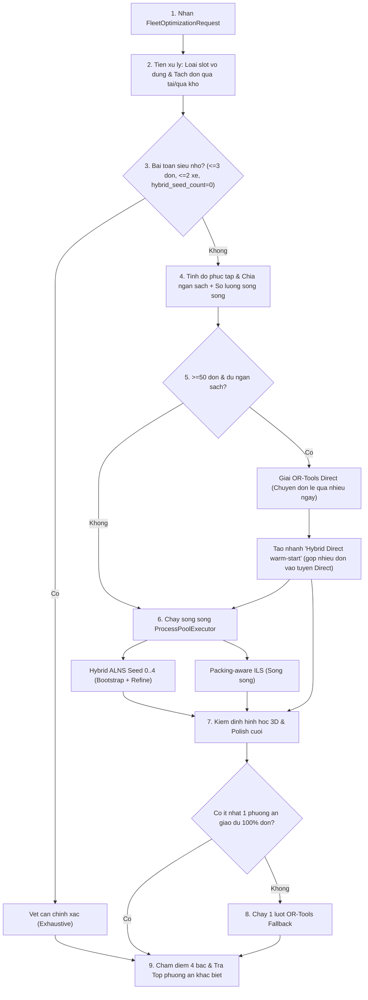

# Giải thích chi tiết thuật toán tối ưu hệ thống TMS (từ đầu đến cuối)

Tài liệu này mô tả **luồng chạy thực tế hiện tại** của engine tối ưu tuyến và xếp hàng 3D trong thư mục `optimizer/app/`, đi từ lúc nhận request cho tới khi trả ra danh sách phương án đã kiểm chứng và xếp hạng.

---

## 1. Bức tranh tổng quan (Ý tưởng cốt lõi)

Bài toán của hệ thống không chỉ là **VRP thông thường** (tìm đường ngắn nhất) mà là **VRPPDTW + 3D Dynamic LIFO Packing + Multi-Day Resource Scheduling**:
- **Pickup & Delivery với Time Window:** Mỗi đơn hàng phải **lấy hàng trước rồi mới giao**, đúng khung giờ mở cửa và đúng ca làm việc theo ngày của xe và tài xế.
- **Xe - tài xế theo từng ngày (`service_day_index`):** Một xe vật lý mở qua nhiều ngày được nhân bản thành các slot `xe-ngày` (ví dụ xe A Ngày 0, xe A Ngày 1...), ghép cặp đúng hạng bằng lái với tài xế cùng ngày.
- **Xếp hàng 3D động theo từng điểm dừng (Dynamic LIFO + Stacking):** Mỗi lần xe dừng bốc hoặc dỡ hàng, khối hàng trên thùng xe phải xếp lọt vào không gian 3D (mặc định xếp chồng tối đa 3 tầng), không đè vỡ hàng dễ vỡ/quá tải đỉnh, giữ thăng bằng trọng tâm và **không bị hàng của đơn khác chắn đường ra cửa sau** khi dỡ. Hàng đã lên xe **không được tự ý xê dịch sang chỗ khác**.

Vì OR-Tools thuần rất mạnh về chia chặng thời gian nhưng **không tự hiểu hình học 3D động theo từng chặng**, còn thuật toán heuristic (ALNS/ILS) lại **hiểu trực tiếp ràng buộc xếp hàng**, hệ thống hiện tại dùng kiến trúc **Hybrid-first Multi-Start**:
> Chạy song song nhiều chiến lược độc lập — **OR-Tools Direct (làm baseline + mồi Direct warm-start)**, **5 luồng Packing-aware Hybrid ALNS (seed 0..4)** và **Packing-aware ILS** — tất cả dùng chung **một bộ thẩm định 3D (`SpatialValidator`)** và **một hàm mục tiêu 4 bậc (`planning_objective`)** để chọn ra top phương án tốt nhất.

---

## 2. Đi từng bước từ đầu đến cuối

### Bước 1: Điểm vào API (`optimizer/app/main.py`)

Hệ thống FastAPI nhận dữ liệu qua 2 endpoint chính cho bài toán đội xe:
- `POST /optimize-fleet`: trả về **1 phương án tốt nhất** (`max_candidates=1`).
- `POST /optimize-fleet/candidates`: chạy `MultiStartFleetOptimizer(request).solve(max_candidates=3)`, trả về tối đa **3 phương án có lộ trình khác biệt nhau**.
- Ngoài ra có `POST /optimize` (cho bài toán 1 tuyến/VRPPDTW cổ điển) và `POST /validate-spatial` (chỉ kiểm tra tính hợp lệ xếp hàng 3D của một chuỗi dừng có sẵn).

---

### Bước 2: Tiền xử lý không làm mất nghiệm (`optimizer/app/request_preprocessor.py`)

Khi khởi tạo `MultiStartFleetOptimizer`, trước khi giải, dữ liệu đi qua 2 bước làm sạch:
1. **`prune_unserviceable_virtual_resources`**:
   Kiểm tra theo cận dưới thời gian di chuyển = 0: nếu một khung `xe-ngày` không đủ thời gian ca để phục vụ nổi *bất kỳ một đơn nào* (`pickup_window` -> `service` -> `delivery_window`), loại bỏ khung xe đó khỏi ma trận khoảng cách/thời gian để thu gọn đồ thị tìm kiếm.
2. **`split_orders_within_deadline`** (giới hạn tối đa `ORDER_SPLIT_BUDGET_SHARE = 20%` ngân sách tìm kiếm):
   Nếu một đơn có nhiều kiện mà tổng trọng lượng vượt tải trọng hoặc không có bất kỳ xe hợp lệ nào xếp vừa toàn bộ đơn theo hình học 3D, thuật toán chia nhỏ đơn thành các phần `::split:1`, `::split:2`, ... (`source_order_id` vẫn giữ chung ID gốc) và nhân bản hàng/cột tương ứng trong ma trận khoảng cách & thời gian. Các phần tách này vẫn có thể được ghép lại lên cùng 1 xe nếu còn chỗ hoặc chở riêng xe khác, nhưng luôn bị ưu tiên gom ít chuyến nhất ở hàm mục tiêu.

---

### Bước 3: Tính độ phức tạp & Phân bổ ngân sách đa luồng (`search_policy.py` & `multi_start.py`)

Từ số đơn ($N_{\text{order}}$), số kiện ($N_{\text{item}}$), số xe vật lý ($N_{\text{phys}}$) và số slot xe-ngày ($N_{\text{virt}}$), hệ thống tính điểm phức tạp:

$$\text{complexity\_score} = 1.10 \cdot N_{\text{order}} + 0.15 \cdot N_{\text{item}} + 0.75 \cdot N_{\text{phys}} + 0.10 \cdot N_{\text{virt}}$$

Cơ chế chia ngân sách và tiến trình (`ProcessPoolExecutor`):
- **Bài toán siêu nhỏ** (`<= 3` đơn, `<= 2` xe vật lý, `hybrid_seed_count == 0`): chạy **Vét cạn (`solve_exhaustive_tiny_candidates`)** để tìm nghiệm tối ưu chính xác tuyệt đối; nếu bất khả thi mới fallback về Hybrid.
- **Chế độ thích nghi (`early_stop_patience > 0`)**: tổng trần thời gian là `max_time_seconds`, trong đó:
  - Số tiến trình đồng thời `worker_cap`: tự co giãn tối đa lên tới **`8` worker** khi máy có `>= 5` CPU cores (`min(8, max(4, cpu_count - 1))`).
  - **Mọi Hybrid seed (`0..4`) được cấp cùng một ngân sách công bằng (`equal_seed_budget`)** thay vì dồn hết thời gian cho `seed 0`.
  - Mỗi Hybrid seed được tách thành **2 chặng (`bootstrap` -> `refine`)** nếu còn dư thời gian: chặng đầu chạy tìm phương án hợp lệ đã kiểm chứng (`early_stop_patience=0`), trả checkpoint về tiến trình cha để chắc chắn có nghiệm giữ lưng; chặng sau lấy checkpoint đó làm `warm_plan` để tinh chỉnh tiếp cho tới khi hết ngân sách hoặc chạm ngưỡng `early_stop_patience` vòng hợp lệ liên tiếp không cải thiện.

---

### Bước 4: Baseline `Direct` và Luồng `Direct warm-start` (`baseline_calculator.py` & `multi_start.py`)

Với các bài toán từ **`>= 50` đơn** và đủ thời gian (`>= 12s`), hệ thống chạy `BaselineCostCalculator.compute_direct_dedicated()` **trước khi** hoặc **đồng thời để làm mồi**:

1. **Giải bài toán Direct bằng OR-Tools (`_solve_direct_schedule`):**
   - Mỗi chuyến trong Direct chỉ phục vụ **đúng 1 đơn** (`pickup -> delivery`), nhưng một cặp `xe-tài xế` được chạy **nhiều chuyến nối tiếp nhau trong cùng 1 ca** (`paired_slots`).
   - Hệ thống thử theo từng chân trời ngày tăng dần `horizons` (ví dụ thử 1 ngày, rồi 2 ngày, ...).
   - **Điểm quan trọng (`_min_required_day`):** Khi một chân trời `day_limit` ngắn hơn chứng minh bất khả thi hoặc timeout, `_min_required_day` được nâng lên `day_limit + 1`. Trong `_solve_direct_schedule`, chỉ những ngày vượt quá ngưỡng bắt buộc này (`excess_day = max(0, service_day_index - _min_required_day)`) mới chịu thuế mở thêm ngày. Nhờ vậy, khi 1 ngày chắc chắn không chở hết (như `BRANCH-DAD` cần 2 ngày), Ngày 1 **không bị phạt oan `5,000,000đ` mỗi slot**, giúp OR-Tools chia đều `18` xe rẻ qua Ngày 0–1 thay vì nhồi `26` xe đắt vào Ngày 0.
2. **Biến kết quả Direct thành mồi `Packing-aware Hybrid ALNS (Direct warm-start)`:**
   - Thay vì vứt bỏ lịch trình sạch sẽ mà OR-Tools Direct vừa xếp trải đều nhiều xe qua `target_days` ngày, `_search_direct_span` lấy chuỗi chuyến đơn lẻ trên từng `xe-ngày`, gộp thành lịch ban đầu cho đúng những xe đó, rồi gọi **`refine_direct_span`**:
     - `_consolidate_delivery_cycles`: thử ghép nhiều chu trình lấy-giao rời rạc của **cùng 1 xe** để **nhận hàng nối chuyến (overlapping)** thay vì về gần kho/giao xong mới lấy đơn sau -> cắt mạnh số km chạy rỗng.
     - `_consolidate_across_routes`: chuyển các đơn từ tuyến thưa sang tuyến lân cận cùng hướng để **xóa bớt tuyến dư**.
     - `_polish_audited_response`: tái sắp xếp thứ tự dừng ngắn (`ranked_short_route_sequences`), chuyển dừng giữa các tuyến và kiểm chứng lại bằng `SpatialValidator` trên từng thành phần liên thông (nếu một nhóm tuyến sau gộp bị vướng xếp hàng 3D thì rollback đúng nhóm đó, giữ nguyên các phần thắng khác).

> **Tại sao `Direct warm-start` hay đứng #1 trên các bộ 75–200 đơn?**  
> Vì với hàng trăm đơn và hàng chục xe, thuật toán tham lam đơn lẻ khó tự phát hiện được bộ khung chia đều `18` xe / `2` ngày có cấu trúc cân bằng như OR-Tools Direct. Xuất phát từ khung chuẩn đó rồi tiến hành gộp chuyến + kiểm chứng 3D thường đi tới vùng cực tiểu sâu hơn hẳn xuất phát từ đầu.

---

### Bước 5: 5 Seed khởi tạo + Thuật toán `Hybrid ALNS` (`hybrid_alns_engine.py` & `hybrid_alns/solver.py`)

Mỗi luồng Hybrid (`seed 0`, `seed 1`, `seed 2`, `seed 3`, `seed 4`) chạy độc lập trên cùng kiến trúc nhưng **khởi tạo thứ tự xét đơn khác nhau** và **chuỗi ngẫu nhiên (`rng`) khác nhau**:

#### 5.1. Đa dạng hóa ngay từ khâu sắp xếp đơn khởi tạo (`_ordered_seed_orders`)
Cả 5 seed đều giữ ưu tiên nhóm khẩn cấp theo **cặp ngày `(ngày đóng cửa lấy hàng, ngày hết hạn ân hạn giao)` (`_urgency_bucket`)** để không gây phạt trễ vô lý, rồi sắp thứ tự trong nhóm khác nhau:
- **Seed 0:** Sắp thuần theo hạn lấy hàng -> hạn giao -> `ordered_at_sec` -> `id`.
- **Seed 1:** Ưu tiên đơn có **điểm giao xa kho nhất trước** -> dựng khung các tuyến trục đường dài trước, sau đó các đơn dọc đường được chèn kèm vào thay vì mở xe mới.
- **Seed 2:** Ưu tiên **tổng quãng đường `(kho -> pickup) + (pickup -> delivery)` dài nhất trước** -> gom các hành lang liên vùng/xa nhất trước.
- **Seed 3:** Nếu nhiều đơn dùng **chung điểm lấy/giao (hub)** thì gom các đơn cùng hub cạnh nhau; nếu mỗi đơn là một tọa độ/UUID riêng thì xáo có kiểm soát theo `rng` để tránh bị lệch theo mã chữ cái UUID.
- **Seed 4:** Giữ đúng bucket khẩn cấp và làm tròn hạn giao theo giờ + xáo ngẫu nhiên theo `seed 4`.

Ngoài ra:
- Với bài toán nhỏ/trung bình (`12 <= orders < 80`) chưa có `warm_plan`, mọi seed đều chạy **dò nén số ngày từ cận dưới năng lực ca (`_estimate_hybrid_lower_bound_days`)** trước (thay vì chỉ mỗi `seed 0` như trước kia).
- Nếu nhận được `warm_plan` đã xong trong $K$ ngày ít hơn tổng số ngày mở, seed đó tập trung tối ưu trên đúng $K$ ngày đó.
- Với bài toán vừa (`2..60` đơn, `<= 32` xe) ở các seed chẵn (`seed % 2 == 0`), hệ thống còn trích xuất thêm một pool tuyến từ OR-Tools (`extract_ortools_seed_pool`) để làm phong phú hạt giống.

#### 5.2. Pha dựng nghiệm đầu (`_build_hybrid_initial_solution`)
- **Bài toán nhỏ (`< 50` đơn):** Dùng `_repair_greedy_insert` chèn từng đơn với chế độ `ranked_repair` (khi có hàng nhiều kiện 3D) để đặt đơn vào vị trí tăng chi phí nhỏ nhất có kiểm tra xếp hàng nhanh.
- **Bài toán lớn (`>= 50` đơn):**
  1. `_append_delivery_cycles(..., allow_overlap=True)`: gán đơn vào xe ưu tiên xe đang chạy trước khi mở xe vật lý mới, cho phép nhận gối đầu nếu còn chỗ 3D.
  2. `_consolidate_delivery_cycles`: gộp các chu trình trên cùng xe.
  3. `_consolidate_across_routes`: dồn đơn từ xe ít đơn sang xe khác để giảm số tuyến.
  4. `_compress_service_days`: ép các tuyến muộn về ngày sớm hơn nếu khung giờ và năng lực xe cho phép.
  5. Chạy pha Local Search / ILS ngắn (`_best_relocation`, `_try_route_elimination`, `_try_order_swap_1_1`, `_try_vehicle_reassignment`) và tạo ngay 1 bản **checkpoint đã audit 3D** nếu kịp.

#### 5.3. Pha tìm kiếm cốt lõi `HybridALNSSolver` (`hybrid_alns/solver.py`)
Đây là vòng lặp **ALNS kết hợp Simulated Annealing, Adaptive Weights, Route Elimination & CP-SAT Set Partitioning**:

1. **9 Toán tử Phá hủy (`destroy_operators`):**
   - `route`: xóa toàn bộ 1 tuyến (để ép dồn đơn sang tuyến khác, giảm số chuyến).
   - `small`: xóa các tuyến có ít đơn nhất.
   - `late_day`: ưu tiên nhổ các đơn nằm ở ngày muộn (`weight=2.4` khi đa ngày) để kéo về ngày sớm, giảm lương chờ lịch (`idle salary`) và phạt trễ.
   - `cluster`: chọn 1 đơn tâm rồi xóa cụm đơn gần nhau về địa lý.
   - `worst`: xóa những đơn đang đóng góp chi phí/độ vòng vèo cao nhất.
   - `related` (Shaw removal): xóa các đơn tương đồng về vị trí, khung giờ và trọng lượng để dễ hoán đổi chéo.
   - `heavy`: nhổ các đơn nặng/cồng kềnh dễ gây tắc không gian thùng xe.
   - `string`: xóa một đoạn chuỗi các điểm dừng liên tiếp trên tuyến.
   - `random`: xóa ngẫu nhiên để thoát bẫy cục bộ.

2. **3 Toán tử Sửa chữa (`repair_operators`):**
   - `regret2` (Regret-2): ưu tiên chèn đơn có độ chênh lệch lớn nhất giữa vị trí tốt #1 và #2 ("nếu không chèn ngay sẽ hối tiếc nhiều nhất").
   - `regret3` (Regret-3): nhìn sâu tới top 3 vị trí tốt nhất (rất hữu ích khi không gian xe chật).
   - `greedy`: chèn nhanh theo chi phí biên nhỏ nhất.

3. **Cơ chế chấp nhận nghiệm & Tự học trọng số (`Simulated Annealing` + `Adaptive Weights`):**
   - Đầu mỗi vòng, chọn `destroy_name` và `repair_name` theo xác suất tỷ lệ với bảng trọng số `destroy_weights` / `repair_weights`.
   - Nghiệm mới có `delta <= 0` luôn được chấp nhận; nếu xấu hơn (`delta > 0`), vẫn có xác suất được nhận theo công thức:
     $$P(\text{accept}) = \exp\left(-\frac{\Delta}{\max(1.0, T)}\right)$$
     Nhiệt độ $T$ giảm dần theo tiến độ thời gian, và có cơ chế **`reheat_temp` (hâm nóng lại)** + quay về nghiệm elite ở số tuyến khác khi bị kẹt (`stagnant_iters >= deep_stagnant_limit`).
   - Điểm thưởng trọng số toán tử: bị từ chối (`0.2`), được chấp nhận (`1.0`), cải thiện nghiệm hiện tại (`3.0`), phá kỷ lục tốt nhất (`6.0`), giảm được tổng số tuyến (`10.0`).
   - Mỗi 10 vòng, chạy xen kẽ pha tăng cường (**intensification**): thử relocation nhanh và `_eliminate_routes` để triệt tiêu tuyến thừa.

4. **Tái tổ hợp tuyến bằng CP-SAT Set Partitioning (`_solve_set_partitioning`):**
   - Trong lúc tìm kiếm, mọi tuyến hợp lệ tốt đều được lưu vào pool các phương án elite. Sau pha ALNS, solver lấy tập hợp các tuyến đã thấy và giải bài toán **Set Partitioning (bằng OR-Tools CP-SAT)** với giới hạn thời gian ngắn (~0.15–0.4s): chọn ra một tổ hợp các tuyến rời nhau phủ đủ 100% đơn sao cho tổng chi phí nhỏ nhất (giống việc ghép tuyến tốt nhất của vòng 50 với tuyến tốt nhất của vòng 200 thành một phương án mới).

5. **Pha tinh chỉnh kinh tế (`refine`) + Tối ưu lại xe vật lý + Audit 3D & Polish cuối:**
   - Chạy lần lượt 5 bước tinh chỉnh cục bộ trên `best_routes`: di chuyển điểm dừng đơn lẻ (`_first_improving_stop_relocation`), tối ưu thứ tự trong tuyến (`_best_intra_route_relocation`), chuyển đơn giữa các tuyến (`_best_relocation`), hoán đổi 1-1 (`_best_order_exchange`), và **đổi sang xe có chi phí cố định/tiêu hao nhiên liệu rẻ hơn** (`_best_vehicle_reassignment` / `_optimize_production_vehicles`).
   - Cuối cùng, lọc tối đa 3–6 ứng viên tốt nhất khác nhau, đem đi **kiểm định hình học 3D đầy đủ bằng `SpatialValidator`**, rồi chạy `_polish_audited_response` kiểm tra xem còn chỉnh nhỏ nào làm giảm thêm chi phí mà vẫn qua được `SpatialValidator` hay không.

---

### Bước 6: Packing-aware ILS song song & OR-Tools Fallback (`ils_engine.py`, `routing_solver.py`)

- **Packing-aware ILS (`PackingAwareILSOptimizer`):**
  Chạy trên 1 tiến trình riêng song song với Hybrid ALNS. Khác với ALNS (phá nhiều đơn bằng 9 toán tử rồi dựng lại bằng Regret), **ILS thiên về tìm kiếm cục bộ sâu (Best-Improvement)**: liên tục vét `_best_relocation`, `_try_route_elimination`, `_try_order_swap_1_1` và `_try_vehicle_reassignment`; chỉ khi kẹt cực trị địa phương mới phá ngẫu nhiên 15%–40% số đơn rồi leo dốc lại.
  -> Đây là lý do ở các bài toán 20–50 đơn có cấu trúc tuyến gọn, `ILS` đôi khi tìm ra nghiệm rẻ hơn hoặc ít xe vật lý hơn `ALNS`.
- **OR-Tools Fallback:**
  Chỉ kích hoạt **tối đa 1 lượt** khi *không có bất kỳ luồng Hybrid hay ILS nào* phục vụ đủ 100% đơn hàng (`not any(is_fully_served(...))`). Nếu cả fallback vẫn thiếu đơn hoặc hết ngân sách, hệ thống trả về `NO_COMPLETE_PLAN` hoặc `TIMEOUT` kèm chẩn đoán rõ ràng (không âm thầm trả nghiệm thiếu đơn như hợp lệ).

---

## 3. Bộ kiểm định xếp hàng 3D động (`stacking.py`, `stacking_unequal.py`, `spatial_validator.py`)

Mọi tuyến đường trước khi được công nhận hợp lệ đều phải vượt qua kiểm tra hình học động theo **từng điểm dừng** (mặc định bật 3D theo `default_stacking_policy()` trong `models.py#L236-L243`; chỉ về 2D không chồng khi truyền `demo_stacking = None`):

| Tham số mặc định 3D | Giá trị mặc định | Ý nghĩa |
|---|---|---|
| `max_tiers` | `3` | Xếp chồng tối đa 3 tầng |
| `lift_clearance_cm` | `5.0 cm` | Khoảng hở trần tối thiểu để nhấc/hạ kiện không kẹt nóc thùng |
| `owner_mode` | `"ANY_CUSTOMER"` | Cho phép xếp kiện khác khách/khác đơn lên nhau nếu đạt mọi quy tắc vật lý & lối dỡ |
| `max_top_load_percent` | `30%` | Nếu kiện dưới không khai báo `max_top_load_g`, tổng khối lượng đè lên không vượt **30% trọng lượng chính nó** |

Các bất biến vật lý **bắt buộc thỏa ở MỌI điểm dừng**:
1. **Không giao nhau 3D & Đủ tải trọng:** Tọa độ `(x, y, z)` và kích thước sau xoay (`LWH` hoặc `WLH` tùy `allowed_orientations`) không chạm kiện khác, tổng trọng lượng không vượt `payload_limit_kg`.
2. **An toàn chồng tầng:** Kiện dưới phải là `STANDARD`, không đánh dấu `no_top_load_requested` (hay `FRAGILE`), tổng trọng lượng mọi kiện nằm phía trên không vượt `max_top_load_g` (hoặc 30% trọng lượng kiện đỡ).
3. **Không di chuyển kiện đang nằm trên xe:** Một khi kiện của đơn A đã đặt ở `(x, y, z)`, đến điểm dừng sau không được tự đẩy sang chỗ khác để nhường chỗ cho đơn C.
4. **Đường xếp & dỡ thông thoáng ra cửa sau (Dynamic LIFO / Corridor Clear):**
   - `SpatialValidator.is_path_to_door_clear` kiểm tra bằng tìm đường dịch chuyển tịnh tiến (`_find_translation_path_to_door`) dọc/ngang từ vị trí kiện tới cửa sau ở cùng mức sàn/tầng. Nếu một kiện cần giao sớm bị kiện giao sau chặn mất lối trượt hoặc bị đè tầng trên chưa dỡ, bố trí đó bị bác bỏ ngay.
   - Nhờ vậy, chỗ trống giải phóng sau khi giao A **chỉ được tái sử dụng để nhận C** nếu C đi qua được lối cửa, đặt lọt và không chắn đường dỡ của B còn lại trên xe.
5. **Hai tầng xử lý tối ưu hóa (`DemoStacks.validate_stops`):**
   - Nếu các kiện có đáy đồng kích thước tương thích, hệ thống gom chuỗi chồng trước (`bundle_stops` -> giải bài toán sàn 2D cho kiện đáy ảo -> `expand_layout` kiểm tra ngược lại lối dỡ của tầng trên).
   - Nếu có kích thước khác nhau hoặc nhiều chặng phức tạp, chuyển sang `validate_unequal_stacked_stops` (`stacking_unequal.py`) kiểm tra không gian 3D không đồng kích thước.
   - Toàn bộ kết quả kiểm tra theo chữ ký tuyến được cache trong phiên (`scoped_spatial_cache`) để không kiểm tra lặp lại hàng nghìn lần cùng một chuỗi dừng.

---

## 4. Cách tính chi phí và Xếp hạng 4 bậc (`route_costing.py` & `planning_objective.py`)

### 4.1. Chi phí vận hành của 1 tuyến (`totalCostVnd` — tiền thật của các chuyến chạy)
Tính trong `build_route_cost_breakdown`:

$$\text{totalCostVnd} = \text{fuel\_cost} + \text{vehicle\_fixed\_cost} + \text{driver\_fixed\_salary\_allocation} + \text{driver\_trip\_pay} + \text{cargo\_holding\_cost} + \text{late\_delivery\_penalty}$$

Trong đó:
- **`fuel_cost`**: Tiền dầu cơ bản theo `km * định mức / 100 * giá dầu` + **phụ phí dầu theo tải trọng từng chặng** (`load_ratio = onboard_weight_kg / payload_limit_kg`, nhân với `load_fuel_surcharge_percent_at_full_payload`). Tức là giao đơn nặng trước để chạy nhẹ đường về sẽ **tiết kiệm dầu hơn rõ rệt**.
- **`vehicle_fixed_cost`**: Chi phí cố định mở xe cho chuyến đó.
- **`driver_fixed_salary_allocation`**: Phần lương tháng phân bổ đúng theo số phút chạy thực tế của tuyến (`fixed_salary_monthly_vnd * duration_minutes / monthly_working_minutes`).
- **`driver_trip_pay`**: Phụ cấp theo chuyến (`trip_base_pay_vnd + per_km_pay_vnd * distance_km`).
- **`cargo_holding_cost`**: Chi phí lưu giữ hàng trên xe (`tấn-giờ * cargo_holding_cost_vnd_per_ton_hour`).
- **`late_delivery_penalty`**: Phạt giao trễ tài chính thực tế (chỉ > 0 nếu policy bật `FIXED_PER_DAY` hoặc `PERCENT_ORDER_VALUE_PER_DAY`; bằng `0` khi mode là `NONE`).

### 4.2. Điểm xếp hạng toàn đội (`selection_score_vnd` / `solverObjective`)
Tính trong `apply_planning_objective` (`planning_objective.py#L288-L328`):

$$\text{selection\_score\_vnd} = \text{operating\_cost\_vnd} - \text{active\_salary\_vnd} + \text{calendar\_salary\_vnd} + \text{operational\_late\_penalty\_vnd}$$

Nghĩa là thay vì chỉ tính lương tài xế theo vài tiếng chạy trên đường (`active_salary_vnd`), hàm mục tiêu quy đổi lương toàn đội về **đúng số ngày lịch mà kế hoạch kéo dài (`planning_span_days`)** (`driverIdleSalaryAllocationVnd = calendar_salary - active_salary`), cộng thêm `operational_late_penalty_vnd` (nếu mode là `NONE` thì phạt dẫn hướng theo `delivery_grace_days`). Cơ chế này ngăn optimizer "né chi phí" bằng cách dàn mỏng việc qua 5–6 ngày làm phát sinh lương chờ vô ích.

### 4.3. Thứ tự xếp hạng 4 bậc (`plan_lexicographic_key`)
Khi chọn phương án #1, #2, #3 để trả về (và giữ đại diện tốt nhất của từng phương án số ngày khi `compare_horizons = True`), hệ thống so sánh theo đúng thứ tự ưu tiên từ trên xuống:
1. **`extra_order_trips` nhỏ nhất** (ưu tiên hàng đầu là *không bị tách đơn* sang nhiều chuyến khác nhau).
2. **`active_route_count` nhỏ nhất** (ít chuyến chạy thực tế nhất).
3. **`selection_score_vnd` nhỏ nhất** (tổng chi phí vận hành + lương chờ toàn đội theo ngày + phạt trễ vận hành thấp nhất).
4. **Tie-breaker:** `total_cost_vnd` nhỏ nhất, rồi tới `physical_vehicle_count` (ít xe vật lý nhất).

---

## 5. Giải đáp nhanh những điểm hay gây thắc mắc

- **Tại sao gọi là "Hybrid ALNS" mà không phải "ALNS thuần"?**
  Vì thuật toán kết hợp **5 kỹ thuật** vào cùng một quy trình: (1) Khởi tạo thông minh đa seed + dò cận dưới ngày, (2) Tìm kiếm hàng xóm lớn thích nghi (ALNS 9 destroy / 3 repair + Simulated Annealing), (3) Tìm kiếm cục bộ sâu kiểu ILS & tăng cường 10-vòng, (4) Tái tổ hợp tuyến chính xác bằng CP-SAT Set Partitioning, và (5) Bơm mồi `Direct` từ OR-Tools + `SpatialValidator` 3D thực tế.
- **Tại sao trước kia Seed 0 luôn tốt nhất, và hiện tại đã khác gì?**
  Trước đây `seed 0` được ưu ái thời gian chạy một mình ở đầu hoặc gom phần lớn ngân sách dư, đồng thời các seed `1..4` không được dò cận dưới ngày hoặc sắp xếp ngây thơ theo UUID. Hiện tại tất cả các seed đều nhận **ngân sách bằng nhau (`equal_seed_budget`)**, đều tôn trọng `_urgency_bucket` (không vi phạm hạn ân hạn), và `seed 0..4` dùng 5 tiêu chí sắp đơn khởi tạo khác nhau (hạn chuẩn, xa kho trước, hành lang dài trước, chung hub trước, xáo có kiểm soát theo giờ).
- **Khi nào nên kỳ vọng nhánh nào đứng #1?**
  - **Nhỏ (`<= 3` đơn):** Vét cạn (`Exhaustive`) -> tối ưu tuyệt đối.
  - **Vừa (`15–50` đơn):** `Packing-aware ILS` và `Hybrid ALNS seed 0..4` thường bám rất sát hoặc `ILS` thắng nhờ vét relocation/elimination sâu.
  - **Lớn (`75–200` đơn, đa ngày nhiều xe):** `Packing-aware Hybrid ALNS (Direct warm-start)` thường dẫn đầu vì nhận được bộ khung cân bằng ngày & tải trọng xe từ OR-Tools Direct (như trên `BRANCH-DAD` 150 đơn và `BRANCH-NTR` 100 đơn sau khi sửa `_min_required_day` và dịch ngày đặt hàng), trong khi `seed 0..4` giữ vai trò đa dạng hóa phương án thay thế nếu tuyến Direct bị vướng chật 3D hoặc khác số ngày.
