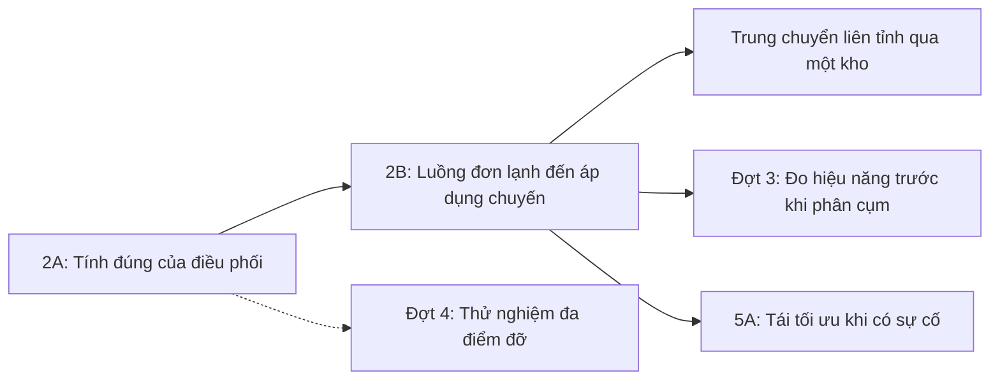

# KẾ HOẠCH TRIỂN KHAI TIẾP THEO — MẢNG ĐIỀU PHỐI & TỐI ƯU LỘ TRÌNH (NGƯỜI 1)

Ngày lập: 28/11/2026 · Đối chiếu mã nguồn nhánh `master` tại commit `ebea62f` (`feat(tms): complete optimizer dot-1, cleanup legacy tables, and sync warehouse return flow`).

> **Trạng thái tài liệu:** Đã nhận lệnh triển khai ngày 28/11/2026. Mốc khảo sát ban đầu dựa trên [KE_HOACH_TMS.md](../KE_HOACH_TMS.md), [PHAN_CONG_3_NGUOI.md](../PHAN_CONG_3_NGUOI.md), [KE_HOACH_HOAN_THANH_NGUOI_1.md](../KE_HOACH_HOAN_THANH_NGUOI_1.md) và [KE_HOACH_CAI_TIEN_OPTIMIZER_CLOUD.md](KE_HOACH_CAI_TIEN_OPTIMIZER_CLOUD.md). Các quyết định nghiệp vụ chưa xác nhận tiếp tục được theo dõi ở mục 4.

---

## Tiến độ triển khai ngày 28/11/2026

- **Đợt 2A:** Đã sửa khóa cache Hybrid và nhóm xe Cross-seed, mở danh sách xe ứng viên theo ca, ưu tiên xe cần thiết cho đơn có ít lựa chọn, bổ sung kiểm tra lịch nghỉ lái, giờ cấm và kho trong điều phối thủ công. Ca 5 xe/2 tài xế phục vụ đủ đơn lạnh và đơn khô với hai thứ tự xe. Độ rộng cửa đã được truyền trong optimizer. Việc lưu thông số độ rộng cửa ở danh mục loại xe vẫn cần quyết định OPT-N03.
- **Đợt 2B:** Có trường điều phối trên đơn, xe và tài xế, cấu hình lệch tải, màn hình quản trị giờ lái và phí đường, chi phí thành phần và giờ nghỉ trên kết quả cùng file Excel. Mặc định bảo toàn chính sách lệch tải hiện hành với mức phạt bằng 0 và giới hạn bắt buộc tắt. PostgreSQL cô lập đã chạy luồng đơn lạnh có phí đường từ chốt khung đến áp dụng và đọc lại chuyến.
- **Đợt 3:** Đã đo baseline cục bộ với dữ liệu tổng hợp gồm 50, 100, 200 và 500 đơn. Ba ca đầu phục vụ đủ, ca 500 đơn hết thời gian trong ngân sách 20 giây. [Số liệu và hash đầu vào](optimization-benchmark.md).
- **Trung chuyển:** Đã chốt xe và tài xế chặng đầu quay về TP.HCM sau bàn giao, có thể chở hàng chiều về khi thuận tuyến và giữ được lịch kế tiếp. Khi nghiệm thu cần một kho, lịch tài xế từ hai đầu và dữ liệu sang tải đại diện. Phần lập và áp dụng hai chặng đang ở trạng thái kế hoạch.

---

## 1. Hiện trạng đã hoàn thành

Toàn bộ mốc nền **OPT-01 → OPT-11** trong [KE_HOACH_HOAN_THANH_NGUOI_1.md](../KE_HOACH_HOAN_THANH_NGUOI_1.md) và **Đợt 1 tối ưu liên tỉnh/kho bãi** (`ebea62f`) đã triển khai các năng lực chính sau:

| Lớp | Năng lực đã có trong mã nguồn |
|---|---|
| **Optimizer (`optimizer/app/`)** | Kiến trúc **Hybrid-first Multi-Start** ([multi_start.py](../optimizer/app/multi_start.py)): Vét cạn cho bài siêu nhỏ, `Direct warm-start`, 5 seed `Hybrid ALNS` (10 destroy / 3 repair + SA + CP-SAT Set Partitioning), `Packing-aware ILS`, `Cross-seed CP-SAT` ([cross_seed_partitioning.py](../optimizer/app/cross_seed_partitioning.py)), và 1 lượt `OR-Tools fallback`. |
| **Xếp hàng 3D động** | Mặc định **3D nhiều tầng** (`max_tiers=3`, `lift_clearance_cm=5.0`, `owner_mode=ANY_CUSTOMER`, tải đỉnh 30% hoặc `max_top_load_g`), kiểm tra lối dỡ LIFO qua cửa sau và opt-out 2D (`demo_stacking=None`) ([stacking.py](../optimizer/app/stacking.py), [stacking_unequal.py](../optimizer/app/stacking_unequal.py), [spatial_validator.py](../optimizer/app/spatial_validator.py)). |
| **Ràng buộc Đợt 1 (liên tỉnh & thực tế)** | Kho bãi (`warehouse_location_id`, gộp thời gian cập bến, giờ mở cửa kho, tải/chiều dài tối đa, xe nâng), vùng cấm tải & giờ cấm (`LoadRestrictionZone`), tương thích hàng (nhiệt độ, HAZMAT, nhóm xung khắc, bửng nâng), chính sách nghỉ lái VN 4h/10h/48h (`DrivingRestPolicy`), phí cầu đường (`toll_matrix_vnd`), `end_depot`/`return_to_depot`, chỉ số cân bằng tải (`WeightBalanceMetrics`), đánh giá tiếp tục chuyến khi giao thất bại (`POST /evaluate-inprogress-trip` trong [inprogress_evaluator.py](../optimizer/app/inprogress_evaluator.py)). |
| **Backend (`backend/src/trips/`)** | Job nền PostgreSQL + BullMQ/Redis + Lease/Heartbeat + Recovery + Outbox + Socket.IO; lưu `OptimizationJob`, `OptimizationResult`, `LoadPlan`/`LoadPlanStep`/`LoadPlacement`; Apply/Publish có transaction & khóa; quản trị kho ([warehouses.controller.ts](../backend/src/locations/warehouses.controller.ts)) và vùng cấm tải ([zones.controller.ts](../backend/src/zones/zones.controller.ts)). |
| **Nhánh thử nghiệm riêng** | Nhánh `codex/multi-support-prototype` (chưa merge vào `master`) đã có benchmark prototype xếp **1 kiện trên 2–12 kiện đỡ** (32/32 ca tổng hợp pass, hỗ trợ lệch cao tối đa 30 mm + tấm bù). |

---

## 2. Các khoảng trống & lỗi thực tế phát hiện trong code

### 2.1. Lỗi logic/cache âm thầm cần vá sớm
1. **Thiếu thuộc tính trong cache key của Hybrid ALNS:** [solver.py](../optimizer/app/hybrid_alns/solver.py#L191-L228) (`_resource_profile`) chưa đưa `allows_hazmat`, `door_width_cm`, và `initial_weekly_driving_sec` của tài xế vào profile key (đồng thời mặc định `temperature_mode` là `"AMBIENT"` thay vì `"DRY"`). Nếu đội xe có 2 xe cùng kích thước/chi phí nhưng khác quyền HAZMAT hoặc khác độ rộng cửa, `_route_cache` có thể tái sử dụng nhầm kết quả đánh giá.
2. **Thiếu `allows_hazmat` khi gom nhóm xe thay thế trong Cross-seed CP-SAT:** [cross_seed_partitioning.py](../optimizer/app/cross_seed_partitioning.py#L179-L200) (`_build_interchangeable_vehicle_groups`) bỏ sót `allows_hazmat`, có thể gán tuyến chở hàng HAZMAT sang xe thường có cùng thông số khác.
3. **Cắt cứng danh sách xe theo số tài xế ở Backend:** [trips.service.ts](../backend/src/trips/trips.service.ts#L2189) dùng `.slice(0, freeDrivers.length)` trên `baseVehicles` trước khi gửi sang optimizer. Khi số xe rảnh > số tài xế rảnh và đội xe hỗn hợp (xe lạnh / xe HAZMAT / xe có bửng nâng đứng sau xe tải thường), backend có thể **cắt mất đúng loại xe chuyên dụng cần dùng**, gây `INFEASIBLE` oan.
4. **Lệch luật giữa Điều phối thủ công và Điều phối tự động:**
   - [trips.service.ts](../backend/src/trips/trips.service.ts#L1690-L1715) (`runOptimization` → `POST /optimize` cho 1 xe trên [DispatchPage.tsx](../frontend/src/pages/DispatchPage.tsx)) chỉ gửi `VehicleFloor` cơ bản, thiếu `temperature_mode`, `allows_hazmat`, `has_tail_lift`, `driving_rest_policy`, `end_depot`.
   - [trips.validator.ts](../backend/src/trips/trips.validator.ts) chưa kiểm tra đồng bộ các ràng buộc Đợt 1 (tương thích nhiệt độ/HAZMAT/nhóm hàng xung khắc, giới hạn kho, giờ cấm tải, chính sách nghỉ lái) khi tạo/sửa Trip thủ công.
5. **Chưa truyền `door_width_cm` từ DB:** Optimizer ([models.py](../optimizer/app/models.py#L50)) đã kiểm tra độ rộng cửa `door_width_cm`, nhưng `VehicleType` trong [schema.prisma](../backend/prisma/schema.prisma#L794-L817) và [trips.service.ts](../backend/src/trips/trips.service.ts#L2040-L2092) chưa có/chưa truyền trường này.

### 2.2. Nối chưa khép kín từ Optimizer ↔ Backend ↔ Frontend cho Đợt 1
Kiểm tra chéo 3 tầng cho thấy phần lớn tính năng Đợt 1 đã có ở DB + Optimizer + payload backend, nhưng **đứt đoạn ở tầng Settings/API quản trị và Frontend**:
- **Cân bằng trọng tâm (`weight_balance`):** Optimizer ([packing_rules.py](../optimizer/app/packing_rules.py)) đã có cả soft penalty (`weight_balance_penalty_vnd_per_percent`) lẫn hard cap (`enforce_weight_balance`, `max_lateral_imbalance_percent`, `max_longitudinal_imbalance_percent`), nhưng [settings.types.ts](../backend/src/settings/settings.types.ts) và [trips.service.ts](../backend/src/trips/trips.service.ts#L2205-L2226) chưa truyền các tham số này — hiện ở production mới chỉ tính để hiển thị trên visualizer chứ chưa tối ưu/chặn theo cấu hình.
- **Thiếu REST CRUD & UI quản trị cho `WorkPolicy` và `TollCorridor`:** Backend chỉ đọc `prisma.workPolicy.findMany` / `prisma.tollCorridor.findMany` trong [trips.service.ts](../backend/src/trips/trips.service.ts#L1837-L1850), chưa có controller/service CRUD và chưa có màn hình cấu hình (khác với `Warehouses` và `LoadRestrictionZones` đã có đầy đủ).
- **Thiếu UI nhập liệu đầu vào:** Chưa có form nhập trên [EditVehicleModal.tsx](../frontend/src/components/EditVehicleModal.tsx), [EditDriverModal.tsx](../frontend/src/components/EditDriverModal.tsx) và [OrdersPage.tsx](../frontend/src/pages/OrdersPage.tsx) cho: `temperatureMode`, `hasTailLift`, `tollFactor`, `returnToDepot`, `endDepotLocationId`, `homeLocationId`, `homeProvinceCode`, `strictHomeLocation`, `requiredTemperature`, `cargoGroup`, `incompatibleCargoGroups`, `requiresLiftEquipment`.
- **Thiếu UI hiển thị đầu ra tối ưu:** [AutomaticDispatchPage.tsx](../frontend/src/pages/AutomaticDispatchPage.tsx) và [BenchmarkCostComparisonCard.tsx](../frontend/src/components/BenchmarkCostComparisonCard.tsx) chưa hiển thị `rest_breaks` (mốc nghỉ bắt buộc trên timeline), `province_hops`, `toll_cost_vnd`, `overnight_allowance_vnd`, `weight_balance_penalty_vnd`, `end_location`.

### 2.3. Năng lực tối ưu & kiểm chứng còn thiếu cho giai đoạn tiếp theo
- **Kiểm chứng baseline `optimizer` (`pytest` ngày 28/11/2026):** Chạy toàn bộ suite đạt **432 passed / 1 failed** (290.38s); ca duy nhất lỗi là [test_spatial_cache_and_concurrent_ils.py](../optimizer/tests/test_spatial_cache_and_concurrent_ils.py#L113-L138) (`test_multi_start_runs_concurrent_ils_on_headroom_dataset`, chạy sát biên `search_time_seconds=8` với `ProcessPoolExecutor`), và đạt **1 passed** (16.94s) khi chạy độc lập → có dấu hiệu nhạy với thời gian chạy. Cần đo lặp và tách kiểm thử quyết định kích hoạt ILS khỏi phép đo thời gian thực để xác định nguyên nhân.
- **Độ ổn định & quy mô lớn (150–500 đơn):** Theo [KE_HOACH_CAI_TIEN_OPTIMIZER_CLOUD.md](KE_HOACH_CAI_TIEN_OPTIMIZER_CLOUD.md), kết quả chạy theo deadline trên dữ liệu lớn (Nha Trang 100 đơn, Đà Nẵng 150 đơn) vẫn còn dao động giữa các lần chạy và pha cải thiện tuyến có lúc vượt ngân sách ~15–67 ms; bài toán >= 200–500 đơn chưa có cơ chế phân cụm/batching địa lý chính thức và [optimization-benchmark.md](optimization-benchmark.md) cần được đo lại theo kiến trúc Hybrid-first mới.
- **Xếp chồng 3D đa điểm đỡ (`Multi-Support`):** Hiện `master` bắt buộc kiện tầng trên nằm trọn trong **đúng 1 kiện đỡ** (`support_item_id`), gây bỏ lỡ nghiệm hợp lệ khi 1 kiện rộng có thể đặt lên 2–4 kiện cùng độ cao (đã chứng minh trên nhánh `codex/multi-support-prototype`).
- **Tái tối ưu động & Khóa một phần kế hoạch (P4 trong [KE_HOACH_TMS.md](../KE_HOACH_TMS.md)):** Chưa hỗ trợ `locked_routes` / `locked_stops` / `locked_orders` để tối ưu lại khi có đơn phát sinh, xe hỏng hoặc đơn bị tách từ `/evaluate-inprogress-trip` mà không làm xáo trộn chuyến đang chạy.
- **Vận tải đa ngày liên tục, Backhaul & Trung chuyển (P4):** Chưa có mô hình chuyến liên ngày có điểm nghỉ thực tế qua đêm ngoài cơ chế tách slot `xe::day:k`, chưa tự động đề xuất ghép chiều về (backhaul), đổi tài xế theo đoạn (`DriverAssignment.startStopId/endStopId`), hay chia chặng qua kho trung chuyển (`HUB`/`TRANSIT`).
- **Kiểm chứng PostgreSQL thật:** [KE_HOACH_HOAN_THANH_NGUOI_1.md](../KE_HOACH_HOAN_THANH_NGUOI_1.md#L278) ghi rõ `npm run test:postgres` chưa được chạy trên database thật để xác nhận trực tiếp concurrency/advisory lock/atomic rollback.

---

## 3. Lộ trình triển khai đề xuất (theo thứ tự ưu tiên)

### Đợt 2A — Vá lỗi âm thầm, Đồng bộ Thủ công–Tự động & Kiểm chứng PostgreSQL (Ưu tiên #1)
**Mục tiêu:** Loại bỏ các bug có thể tạo nghiệm sai hoặc `INFEASIBLE` oan, làm ổn định test suite, thống nhất 1 nguồn quy tắc giữa điều phối thủ công và tự động.

- [ ] **Vá cache/profile optimizer:** Bổ sung `allows_hazmat`, `door_width_cm`, `initial_weekly_driving_sec` vào `_resource_profile` ([solver.py](../optimizer/app/hybrid_alns/solver.py)) và `allows_hazmat` vào `_build_interchangeable_vehicle_groups` ([cross_seed_partitioning.py](../optimizer/app/cross_seed_partitioning.py)); chuẩn hóa default `temperature_mode` về `"DRY"`.
- [ ] **Chọn xe theo nhu cầu hàng và tài xế theo ca.** Xét toàn bộ xe rảnh, tìm tập xe phù hợp và ghép với tài xế đủ điều kiện trước khi đưa vào nhánh yêu cầu mỗi xe ứng viên có một tài xế ([solver.py](../optimizer/app/hybrid_alns/solver.py#L78)). Kiểm thử 5 xe, 2 tài xế, xe lạnh đứng cuối: phục vụ đơn lạnh, dùng tối đa 2 tài xế và đạt cùng tiêu chí khi đảo thứ tự xe.
- [ ] **Đồng bộ luồng Điều phối thủ công:**
  - Nâng cấp `runOptimization` (`POST /trips/optimize`) và [TripsValidator](../backend/src/trips/trips.validator.ts) / `create` / `updatePlan` kiểm tra cùng tập hard constraints như luồng tự động (tương thích nhiệt độ/HAZMAT/nhóm hàng xung khắc, giới hạn trọng tải/chiều dài/xe nâng của kho, giờ cấm tải, `driving_rest_policy`).
  - Nếu bổ sung độ rộng cửa, truyền giá trị xuyên suốt từ `VehicleType` qua snapshot, adapter và [mô hình xe Hybrid](../optimizer/app/hybrid_alns/models.py) đến evaluator/cache. Kiểm thử kiện lọt lòng thùng nhưng quá rộng so với cửa ở mọi hướng xếp cho phép.
- [ ] **Khắc phục test flaky concurrent ILS:** Điều chỉnh cơ chế kiểm tra kích hoạt concurrent ILS trong [test_spatial_cache_and_concurrent_ils.py](../optimizer/tests/test_spatial_cache_and_concurrent_ils.py) (không hạ assertion, làm rõ headroom tránh race điều kiện biên 8s dưới tải CPU).
- [ ] **Kiểm chứng PostgreSQL thật:** Dựng DB test dùng một lần (`TEST_DATABASE_URL`) và chạy `npm run test:postgres` để xác nhận khóa đồng thời, lease worker, stale proposal và atomic rollback.

**Tiêu chí nghiệm thu:** Có regression test cho từng bug (xe HAZMAT không bị gom nhầm cache/group; đội xe 5 xe/2 tài xế không bị cắt mất xe lạnh; điều phối thủ công chặn hàng xung khắc/sai nhiệt độ/cấm tải giống tự động); `pytest`, backend unit + `test:postgres` đều đạt.

---

### Đợt 2B — Khép kín End-to-End cho tính năng Đợt 1 (Settings, API CRUD & UI)
**Mục tiêu:** Biến toàn bộ năng lực Đợt 1 (liên tỉnh, hàng đặc thù, cân bằng tải, cầu đường, giờ nghỉ) thành tính năng dùng được thật trên giao diện thay vì chỉ nằm ở tầng optimizer/DB.

**Ưu tiên trong đợt:** Hoàn thiện trước luồng nhập đơn lạnh → chọn đúng xe → xem kết quả → áp dụng và tải lại. Xếp lịch các màn hình quản trị đầy đủ, cấu hình nâng cao và Excel theo nhu cầu điều phối sau khi luồng này đạt nghiệm thu.

- [ ] **Cân bằng trọng tâm (`weight_balance`) end-to-end:** Thêm cấu hình `enforceWeightBalance`, `weightBalancePenaltyVndPerPercent`, `maxLateralImbalancePercent`, `maxLongitudinalImbalancePercent` vào `SystemSetting` (migration mới), [settings.service.ts](../backend/src/settings/settings.service.ts), payload ở [trips.service.ts](../backend/src/trips/trips.service.ts), và [SettingsGroupsForm.tsx](../frontend/src/components/settings/SettingsGroupsForm.tsx).
- [ ] **API CRUD + UI quản trị `WorkPolicy` và `TollCorridor`:** Tạo module/controller có phân quyền + validation cho chính sách giờ lái/nghỉ/lưu trú và bảng phí cầu đường liên tỉnh, tích hợp vào trang Cài đặt ([SettingsPage.tsx](../frontend/src/pages/SettingsPage.tsx)).
- [ ] **UI nhập liệu đầu vào:** Cập nhật [OrdersPage.tsx](../frontend/src/pages/OrdersPage.tsx) (nhiệt độ, HAZMAT, nhóm hàng, xung khắc, cần bửng nâng), [EditVehicleModal.tsx](../frontend/src/components/EditVehicleModal.tsx) (`returnToDepot`, `endDepotLocationId`, hiển thị năng lực nhiệt độ/HAZMAT/bửng nâng/`tollFactor`), [EditDriverModal.tsx](../frontend/src/components/EditDriverModal.tsx) (`homeLocationId`, `homeProvinceCode`, `strictHomeLocation`).
- [ ] **UI hiển thị kết quả tối ưu liên tỉnh:** Cập nhật [AutomaticDispatchPage.tsx](../frontend/src/pages/AutomaticDispatchPage.tsx), [BenchmarkCostComparisonCard.tsx](../frontend/src/components/BenchmarkCostComparisonCard.tsx) và Excel export để hiện rõ: mốc nghỉ bắt buộc (`rest_breaks`), chuỗi tỉnh đi qua (`province_hops`), điểm kết thúc (`end_location`), phí cầu đường (`toll_cost_vnd`), phụ cấp qua đêm (`overnight_allowance_vnd`), và điểm phạt lệch tải (`weight_balance_penalty_vnd`).

**Tiêu chí nghiệm thu:** Chạy được luồng E2E từ tạo cấu hình/đơn liên tỉnh có hàng lạnh & phí cầu đường → chạy tối ưu → xem đúng chi phí thành phần, mốc nghỉ, tỉnh đi qua → áp dụng & reload vẫn giữ nguyên dữ liệu.

---

### Trung chuyển liên tỉnh qua kho dọc tuyến (thuộc P4, đề xuất ưu tiên sau luồng 2B)

**Tình huống vận hành.** TP.HCM có nhiều đơn đi Hà Nội và ít tài xế đủ ca cho cả hành trình. Một xe tại TP.HCM có thể gom các đơn tương thích, đưa tới kho dọc tuyến, ví dụ Đà Nẵng. Sau khi kho nhận đủ kiện, xe và tài xế rảnh tại kho tiếp tục chở đi Hà Nội. Đà Nẵng chỉ là địa điểm minh họa. Nếu TP.HCM thiếu cả tài xế cho chặng đầu, phương án này vẫn thiếu nguồn lực.

**Ràng buộc dữ liệu khi triển khai.** DB hiện giới hạn mỗi kiện có một phân bổ đang hoạt động. Duyệt phương án trung chuyển cần giữ lịch hai chặng và lưu mối nối giữa chúng. Tại thời điểm bàn giao, đóng phân bổ của chặng đầu và mở phân bổ chặng sau trong cùng giao dịch. Giữ liên kết tới đơn gốc và dấu vết kho nhận kiện để xử lý an toàn khi người dùng gửi lại xác nhận.

- [ ] **Chọn phương án cho cả nhóm đơn.** So sánh giao thẳng với các kho có thể tiếp nhận trên hành lang. Kiểm tra xe, tài xế, ca lái và lịch đã giữ tại từng điểm theo thời gian dự kiến. Xét sức chứa xe, xếp dỡ 3D, điều kiện bảo quản, giờ kho, thiết bị và thời gian sang tải. Tính cả thời gian xe đầu có thể nhận việc tiếp theo theo chính sách điểm cuối. Trong các phương án khả thi, ưu tiên số đơn giao đúng cam kết rồi so tổng chi phí hai chặng, gồm vòng đường, chờ, sang tải và phí đường.
- [ ] **Quay về TP.HCM và xét ghép hàng chiều về.** Sau khi bàn giao tại kho, xe và tài xế chặng đầu quay về TP.HCM. Lấy chuyến về rỗng làm mốc để so quãng đường, thời gian và chi phí tăng thêm khi ghép hàng. Chỉ đề xuất đơn chiều về có tuyến thuận đường, tương thích xe, còn đủ tải và thời gian lái, giao đúng cam kết và về kịp lịch kế tiếp. Điều phối viên xác nhận trước khi nhận hàng chiều về. Nếu thiếu đơn phù hợp, tính phương án quay về rỗng. Cả hai phương án đều phải tính giờ nghỉ và thời điểm xe, tài xế thực sự sẵn sàng tại TP.HCM.
- [ ] **Liên kết hai chuyến với đơn gốc.** Mỗi chặng có xe, tài xế, lịch và kế hoạch xếp riêng. Theo dõi cùng mã đơn và mã kiện từ lúc nhận tại TP.HCM, nhập kho trung chuyển, xuất cho xe kế tiếp đến khi giao Hà Nội. Với đơn nhiều kiện, kiểm đủ bộ theo quy tắc toàn bộ-hoặc-không. Chỉ ghi nhận giao khách tại điểm cuối.
- [ ] **Bàn giao và xử lý trễ.** Điều phối viên thấy hai chặng, thời gian nối chuyến, nguồn lực và lý do chọn kho. Khi duyệt, kiểm lại và giữ nguồn lực cả hai chặng cùng lúc. Kho xác nhận nhận kiện, tài xế chặng sau xác nhận nhận hàng trước khi xuất phát. Nếu chặng đầu trễ hoặc xe sau bận, giữ lịch sử chặng đã chạy, báo các đơn bị ảnh hưởng và đề xuất lại chặng còn lại để điều phối duyệt.

**Nghiệm thu đề xuất**

| Ca vận hành | Kết quả cần kiểm tra |
|---|---|
| Nhiều đơn, TP.HCM đủ người đến kho nhưng thiếu ca chạy thẳng, kho có xe và tài xế phù hợp | Lập được hai chuyến nối tiếp, giao đúng hạn. Mỗi kiện truy được trên cả hai chặng, mỗi đơn chỉ ghi giao khách một lần. |
| Kho gần nhất dư xe nhưng thiếu tài xế đúng ca hoặc thiếu điều kiện nhận hàng lạnh | Loại kho đó. Chọn kho khả thi khác, giao thẳng nếu khả thi, hoặc nêu lý do đơn chưa được xếp. |
| Chạy thẳng phục vụ được cùng số đơn đúng hạn và có tổng chi phí thấp hơn | Chọn chạy thẳng. |
| Xe chặng đầu quay về TP.HCM, có một đơn chiều về thuận tuyến và một đơn buộc đi vòng làm trễ ca tiếp theo | Chỉ đề xuất đơn thuận tuyến. Nếu đơn này rút khỏi kế hoạch, tính lại giờ về và chi phí quay về rỗng. |
| Xe chặng đầu đến trễ, thiếu kiện bàn giao hoặc xe sau vừa được điều cho chuyến khác | Chặn xuất khi bàn giao chưa đủ, tránh giữ trùng xe/tài xế, hiển thị trạng thái thực sau khi tải lại. |

**Thứ tự triển khai thử trên tuyến TP.HCM → Hà Nội**

Đã thêm màn hình cấu hình tiếp nhận tại kho lưu chuyển, gồm giờ nhận theo giờ địa phương, thời gian sang tải và phí mỗi lượt. Cấu hình tiếp nhận tách khỏi luồng lưu kho hàng chờ giao lại. Có thể nhập dữ liệu của kho thí điểm sau khi áp dụng migration `20261128120000_transfer_receiving_profile`.

1. **Chốt dữ liệu cho một kho thí điểm.** Điều phối cung cấp giờ nhận hàng, thời gian và phí sang tải, lịch xe và tài xế của hai đầu. Chốt số km và số phút được phép tăng so với chuyến về rỗng để định nghĩa “thuận đường”. Khi thiếu các ngưỡng này, vẫn tính lượt về rỗng và để điều phối xét hàng chiều về thủ công.
2. **Chạy so sánh trước khi giữ lịch.** Với cùng một nhóm đơn, hiển thị số đơn đúng hẹn, tổng chi phí và giờ xe đầu về lại TP.HCM cho phương án chạy thẳng và phương án qua kho. Tính thử cả khi đơn chiều về bị rút để thấy phương án nào phụ thuộc vào nguồn hàng này.
3. **Duyệt và giữ lịch.** Kiểm tra quyền điều phối liên chi nhánh, giữ lịch hai chặng và khoảng thời gian quay về trong cùng giao dịch. Kiểm thử hai người cùng duyệt phương án dùng chung một tài xế. Chỉ một phương án được giữ lịch và phương án bị từ chối phải giải phóng toàn bộ lượt giữ của nó.
4. **Bàn giao và chạy thử trọn vòng.** Dùng một đơn nhiều kiện để kiểm tra kho nhận thiếu, nhận đủ, gửi lại xác nhận và xe sau đến trễ. Đối soát lịch xe về TP.HCM, lịch sử từng kiện và một lần giao khách ở Hà Nội trước khi mở rộng sang kho thứ hai.

**Việc đo hiệu năng có thể chạy song song.** Chạy lặp lại bộ 50/100/200/500 đơn trên cùng đầu vào và ngân sách 20 giây. Ghi thời gian từng pha, tỷ lệ phục vụ và số lần trả được phương án khả thi trước hạn. Dùng kết quả ca 500 đơn để chọn pha cần tối ưu trước khi quyết định chia cụm địa lý.

### Đợt 3 — Ổn định chất lượng Solver & Mở rộng quy mô (150–500 đơn)
**Mục tiêu:** Giảm dao động kết quả trên dữ liệu lớn, đảm bảo tuân thủ chặt ngân sách thời gian và nâng ngưỡng phục vụ cho batch lớn.

- [ ] **Hoàn tất chuỗi thực nghiệm đối chứng cloud:** Thực hiện đủ các bước 1–5 trong [KE_HOACH_CAI_TIEN_OPTIMIZER_CLOUD.md](KE_HOACH_CAI_TIEN_OPTIMIZER_CLOUD.md) (đo cặp Nha Trang 100 đơn / Đà Nẵng 150 đơn + 1 snapshot độc lập khác ngày), chốt cấu hình toán tử & kiểm soát trần thời gian pha post-audit/polishing.
- [ ] **Quyết định phân cụm sau benchmark.** Chốt quy mô batch vận hành, thời gian chờ và tỷ lệ phục vụ mục tiêu. Nếu baseline hụt mục tiêu, thử phân cụm theo hành lang, khung giờ và tương thích hàng/xe, rồi đo lại trên cùng payload.
- [ ] **Cập nhật bộ Benchmark chuẩn:** Đo lại [optimization-benchmark.md](optimization-benchmark.md) trên bộ 50 / 100 / 200 / 500 đơn ở chế độ 3D mặc định với đầy đủ chỉ số (thời gian, tỷ lệ phục vụ, số xe, số tuyến, km, chi phí, `selection_score_vnd`, vi phạm = 0).

**Tiêu chí nghiệm thu:** Báo cáo benchmark tái hiện được có hash payload & cấu hình máy; không giảm tỷ lệ phục vụ đầy đủ; giữ nguyên 100% kiểm định 3D và T21–T27.

---

### Đợt 4 — Tích hợp 3D Stacking Đa điểm đỡ (`Multi-Support`) lên `master`
**Điều kiện tích hợp:** Giữ ở nhánh thử nghiệm cho đến khi dữ liệu kiện đại diện cho thấy tăng tỷ lệ phục vụ hoặc giảm số xe trong ngân sách thời gian đã chốt. 32 ca tổng hợp là bộ kiểm thử hồi quy cho prototype.

- [ ] **Engine & SpatialValidator:** Tích hợp kiểm tra tiếp xúc đa điểm đỡ, độ lệch cao cho phép (theo ngưỡng đã chốt, ví dụ <= 30 mm kèm tấm bù chịu lực nếu bật), phân bổ cận tải bảo thủ, và **kiểm tra đường xếp/dỡ 3D theo cao độ** (lọc vật cản theo chiều cao khi tịnh tiến + kiểm tra thể tích quét thẳng đứng khi nâng/hạ).
- [ ] **Tìm bố trí sàn tự động + Giới hạn ngân sách:** Kết hợp multi-support vào bộ tìm kiếm sàn tự động của [stacking_unequal.py](../optimizer/app/stacking_unequal.py) có kiểm soát `max_nodes` / `deadline` để không làm chậm ALNS.
- [ ] **Contract, Database & Visualizer:**
  - Mở rộng `PlacedItem` hỗ trợ `support_item_ids: List[str]` (giữ tương thích ngược `support_item_id`) và metadata tấm bù nếu dùng.
  - Migration bổ sung cho `LoadPlacement` và cập nhật validator ở [optimizer-contract.ts](../backend/src/trips/optimizer-contract.ts), [demo-stacking.ts](../backend/src/trips/demo-stacking.ts).
  - Cập nhật [Cargo3DVisualizer.tsx](../frontend/src/components/Cargo3DVisualizer.tsx) và [FloorPackingVisualizer.tsx](../frontend/src/components/FloorPackingVisualizer.tsx) hiển thị đúng nhiều kiện đỡ và đường nâng/hạ 3D.

**Tiêu chí nghiệm thu:** Đạt toàn bộ 32 ca multi-support + không hồi quy bộ test 3D cũ + T21–T27 (khi opt-out 2D); lưu/reload `LoadPlan` và hiển thị 3D khớp 100%.

---

### Đợt 5 — Tái tối ưu động & Vận tải nâng cao (P4 trong `KE_HOACH_TMS.md`)
Chia làm 2 gói độc lập để dễ chốt phạm vi:

- **Gói 5A — Partial Re-optimization (Khóa một phần kế hoạch & Xử lý sự cố động):**
  - Mở rộng contract nhận `locked_routes`, `locked_stops`, `locked_orders` và trạng thái hàng đã lên xe (kế thừa từ [inprogress_evaluator.py](../optimizer/app/inprogress_evaluator.py)).
  - Khi có đơn mới gấp, đơn bị tách từ chuyến gặp sự cố, xe hỏng hoặc hủy đơn sau pickup: tối ưu lại **chỉ phần chưa thực hiện/chưa khóa**, sinh phiên bản `Trip Plan` mới (`version + 1`) mà không phá chuỗi bàn giao/lịch sử.
  - Bổ sung UI chọn khóa xe/tuyến/đơn trên bàn điều phối và nút "Tối ưu lại phần còn lại".
- **Gói 5B — Các mở rộng vận tải sau kịch bản trung chuyển một kho (chỉ làm các mục được duyệt):**
  - Chuyến đa ngày liên tục vượt qua 00:00 với điểm nghỉ qua đêm gắn thực tế trên timeline (không buộc tách thành 2 Trip riêng).
  - Đề xuất ghép đơn chiều về (**Backhaul**) theo tuyến rỗng sau điểm giao cuối khi `return_to_depot=false` hoặc khác chi nhánh.
  - Đổi tài xế trên cùng xe giữa chặng hoặc nối nhiều kho trong một hành trình nếu phát sinh nhu cầu.

---

## 4. Phân loại Đã chốt / Đề xuất / Cần chốt

| Trạng thái | Nội dung |
|---|---|
| **Đã chốt** | Stack cố định (Mapbox + Python/FastAPI/OR-Tools + NestJS/PostgreSQL/Redis + React/AntD); xếp chồng 3D mặc định (`max_tiers=3`, `lift_clearance_cm=5.0`, `ANY_CUSTOMER`, 30%/`max_top_load_g`) & opt-out 2D (`T21–T27`); khách không chọn hạn giao cứng (tính theo `orderedAt` + `deliveryGraceDays`); chia đơn nhiều kiện toàn bộ-hoặc-không; dispatcher duyệt trước khi publish. |
| **Đã xác nhận nhu cầu** | Điều phối liên tỉnh có phương án đổi xe tại kho dọc đường khi nơi xuất phát thiếu nguồn lực. Sau bàn giao, xe và tài xế chặng đầu quay về TP.HCM, có thể ghép hàng chiều về khi thuận tuyến. |
| **Đề xuất** | 2A → luồng E2E trọng tâm của 2B → trung chuyển qua một kho. Đo baseline song song. Ưu tiên trung chuyển trước phân cụm, tích hợp Multi-Support và mở rộng backhaul. |
| **Cần chốt (OPT-N01)** | Chọn tuyến, kho và bộ đơn đại diện để nghiệm thu trung chuyển. Xác định lịch xe/tài xế, thời gian và phí sang tải, cùng giới hạn km hoặc phút đi thêm chấp nhận được cho đơn chiều về. |
| **Cần chốt (OPT-N02)** | **Chính sách cân bằng trọng tâm (`weight_balance`):** Mặc định ở production chỉ tính cảnh báo/soft penalty (mức VND/% bao nhiêu?) hay cho phép bật hard cap (`enforce_weight_balance`, ngưỡng lệch ngang/dọc %)? |
| **Cần chốt (OPT-N03)** | **Độ rộng cửa (`door_width_cm`):** Có thêm cột `doorWidthCm` vào bảng `vehicle_types` (migration mới) không, hay giữ giả định cửa sau rộng bằng lòng thùng? |
| **Cần chốt (OPT-N04)** | **Phạm vi Multi-Support 3D (Đợt 4):** Có chốt dung sai lệch chiều cao tối đa `30 mm` + tấm bù chịu lực như nhánh `codex/multi-support-prototype` không, và áp dụng cho tầng 2 hay cả tầng 3? |
| **Cần chốt (OPT-N05)** | Phạm vi thử nghiệm đề xuất là một kho trung chuyển cho mỗi hành trình. Chốt thứ tự các mở rộng gồm nhiều kho, tái tối ưu động, backhaul và đổi tài xế giữa chặng theo nhu cầu vận hành. |
